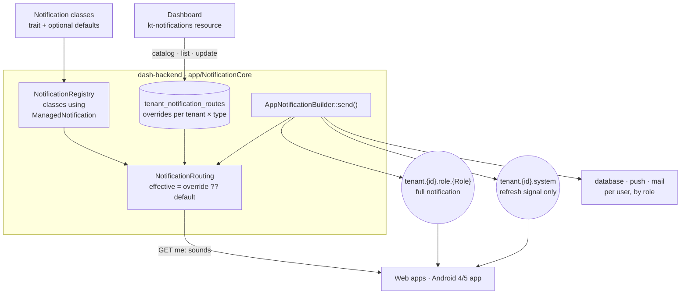

# Notification routing (NotificationCore)

Every notification that opts in can be managed per tenant from **Configuración → Notificaciones del
sistema**: whether it is sent, **which roles receive it on each channel**, and how it sounds on staff
devices.

A notification is manageable **only if its own class says so**, with the `ManagedNotification` trait. A class
without the trait does not appear on the dashboard and keeps its historic delivery.

| Channel | What it is |
|---|---|
| Tiempo real (socket) | Live delivery to open apps and tablets: toasts, sounds, spoken announcements |
| Centro de notificaciones (database) | Stored per user, shown in the notification panel with read state |
| Push móvil (FCM) | Firebase push to the mobile apps |
| Correo (mail) | Email |

## Concepts

- **Managed notification** — a class using `ManagedNotification`, declaring a stable key (`tab.confirmed`,
  `product.export.completed`…), a group, the channels its sending code uses, default roles per channel,
  and optionally a sound type. All of these are optional defaults.
- **Role-addressed vs personal** — role-addressed types go to roles of the tenant; the tenant picks, per
  channel, which roles. Personal types go to one specific user (whoever started an export, the recipient
  of a message); the tenant can only switch them on or off.
- **Mandatory** — types the system needs to work (import/export progress, the export download link)
  cannot be switched off.
- **Defaults and overrides** — a tenant's settings are stored as overrides only. Anything not customised
  follows the notification's default, so a default changed in code reaches every tenant that has not
  changed that setting. Every setting can be restored to its default.

## The order flow

| Type | Raised when | Sound | Default realtime roles |
|---|---|---|---|
| `tab.created` | a new order arrives, not yet confirmed | high beep (`soft`) | front of house |
| `tab.confirmed` | an order is confirmed — Uber orders arrive pre-accepted, so their creation counts here | alarm | everyone, including Kitchen |
| `tab.in_preparation`, `tab.prepared`, `tab.delivered`, `tab.closed` | the order changes status | low beep | front of house |
| `tab.cancelled` | the order is cancelled | low beep | everyone, including Kitchen |
| `tab.updated` | an order is edited without changing status | — | everyone |

Front of house = TenancyAdmin, Tenant, User, Staff. Email defaults to the store admins.

The food court (`mall` group) rings the alarm too:

| Type | Raised when | Sound |
|---|---|---|
| `mall.order_created` | a food-court order reaches this store | alarm |
| `mall.order_updated` | a food-court order is changed | alarm |
| `mall.assistance` | a food-court customer calls for assistance | alarm |

| Sound type | Tunable parameters |
|---|---|
| `soft` (high beep) | frequency 1500–5000 Hz, duration 200–1500 ms, volume |
| `alarm` | duration, high/low frequency, beep length, gaps, volume |
| `beep` (low) | frequency 200–1500 Hz, duration 50–600 ms, volume |

## Architecture



### Declaring a notification

The class is the only place a notification is declared:

```php
class TabPreparedNotification extends AppNotificationBase
{
    use ManagedNotification;

    public static function notificationRouting(): array
    {
        return KitchnTabsNotifications::text('tab_prepared') + [
            'key' => KitchnTabsNotifications::TAB_PREPARED,
            'group' => 'orders',
            'order' => 40,
            'channels' => ['socket', 'database'],
            'defaultRoles' => [
                'socket' => KitchnTabsNotifications::FRONT_OF_HOUSE,
                'database' => KitchnTabsNotifications::FRONT_OF_HOUSE,
            ],
            'soundType' => NotificationSoundTypes::BEEP,
        ];
    }
}
```

- The trait alone is enough: the notification then appears under "Otras", with the channels its `config()`
  turns on and every assignable role.
- Whatever `notificationRouting()` declares is a default; what a tenant sets on the dashboard overrides it.
- The core finds these classes in the domain's `app/Notifications` and core's
  `app/AppNotifications/Notifications`. A new class appears on the next request; it needs no migration,
  permission or frontend change.
- A second class that is really the same notification declares `sameAs`, and shares its row.
- A domain only declares what is not per-notification: the roles a tenant can assign and the dashboard
  groups (KitchnTabs: `app/Notifications/KitchnTabsNotifications.php`).

See the `dashadmin-notifications` skill for every option, recipes and traps.

**Not manageable, by design:** customer-facing and public broadcasts, device commands and print messages,
test messages, and generic carriers such as `TenantChannelMessageNotification`. Low stock, manual upsert and
the POS sync notifications do not opt in today.

### Delivery

For every `AppNotificationBuilder::send()` of a routed type:

1. **Disabled** — nothing is delivered (unless the type is mandatory).
2. **Database, push, email** — every user of the tenant is a candidate; each receives only the channels
   the sending code requested that one of their roles is routed to.
3. **Realtime**, with `NOTIFICATIONS_ROLE_CHANNELS=true` — the notification is broadcast on
   `tenant.{id}.role.{Role}` for each role routed to realtime (copies share a `delivery_id`), and
   `tenant.{id}.system` receives a **refresh signal**: the type, the record and the transition, with
   `sync: true` and none of the content (no message, speech, order details or sound flags). Boards and
   lists refresh from it; toasts, sounds, speech and the notification panel react only to the full
   notification.
   With the flag off, realtime keeps going to every device on `tenant.{id}.system`.
4. **Sound** — clients ask `GET api/tenant/notification-routes/me` for the sound of each type for the
   signed-in user, and play it when the notification arrives (see [Sounds](#sounds)).

The role channel is authorised for members of the tenant holding that exact role.

### Sounds

Every notification sound, the alarm included, is set here and nowhere else (since 2026-11-03).

How a client picks the sound of an incoming notification (`kt-notifications`
`notificationSounds.ts` / `CustomNotificationsProcessing.tsx`, Android 4/5 `SpeechNotifier.eventKey()`):

1. **The key.** `AppNotificationBuilder::send()` stamps every managed notification with
   `data.notification_key` — on the full notification and on the refresh signal. The client uses it first.
   Then `data.event`, then a `tab.status` change (`tab.{new}`), for messages from older senders.
2. **The sound.** The key is looked up in the caller's `GET …/notification-routes/me` answer. A key that is
   absent or `null` there is silent for this user.
3. **Fallback** — only when the backend has no notifications dashboard (VaneXa, older deployments), or
   a message carries no event at all: the deprecated tenant alarm (below) for confirmed orders, food-court
   assistance and anything flagged `alarm`.

> **Why the key comes first.** The food-court flows set `data.event` to their own names
> (`mall_order_created`, `mall_order_updated`) that are not dashboard keys. Looked up by `event`, they
> matched no sound, so food-court orders were silent wherever the dashboard was active.

**The tenant "Alarm Settings" are deprecated.** `settings.alarm_settings` (the old *Alarm Settings*
tab of the store form) was a single alarm for confirmed orders and every food-court alert. Now:

- Migration `2026_11_03_000600_move_alarm_settings_to_notification_routes` (domain) copied each tenant's
  values into the sound of `tab.confirmed`, `mall.order_created`, `mall.order_updated` and
  `mall.assistance`, wherever that sound had not been set on the dashboard. Re-running never overwrites a
  tuned sound.
- `tab.confirmed` no longer reads the setting (it used to, as its starting sound).
- The *Alarm Settings* tab is commented out in both store forms (`kt-ecommerce` `tenant_tenant.tsx`,
  kitchntabs-web `tenancy_tenant.tsx`); the `TenantAlarmSettings` component is kept.
- The setting itself is kept (hidden, marked deprecated in `Tenant::getDomainSettingFormats()`) as the
  fallback above.
- The store's *Tests* tab audio test plays the tenant's `tab.confirmed` alarm from its routes.

### Rollout

`NOTIFICATIONS_ROLE_CHANNELS` is off by default. Turn it on once every client that shows or plays
notifications listens on role channels:

| Client | Status |
|---|---|
| Web apps (kitchntabs-app/web/system) | Done. On Electron, spoken announcements are triggered here too |
| Android 4/5 kitchen app | Done, in new builds. Older builds keep refreshing but stop sounding |
| Desktop service (`dash-python-service`) | Nothing to do. It prints from device commands and `type: print` messages, which stay where they are, and does not speak |
| Terminals on the old `kitchntabs-python-service` build | Would stop announcing orders: that build spoke from the tenant channel |

The variable also has to reach production through the deploy's environment allow-list.

Shipping the defaults changes who receives email and push: the legacy targets (`kitchen`, `admin`,
`tenant_user`…) never matched a real role, and delivery relied on
`NOTIFICATIONS_DISABLE_TENANT_ROLE_CHECKING`, which sent to the whole tenant. Routed types now go to the
roles they were meant for.

### API

| Route | Who | Purpose |
|---|---|---|
| `GET api/tenant/notification-routes` | Tenant, TenancyAdmin | the dashboard list (overrides + defaults) |
| `PUT api/tenant/notification-routes/{id}` | Tenant, TenancyAdmin | set or clear (`null`) enabled, roles, sound |
| `GET api/tenant/notification-routes/catalog` | Tenant, TenancyAdmin | groups, roles, channels, sound types |
| `GET api/tenant/notification-routes/me` | every tenant role | the caller's sound per type |
