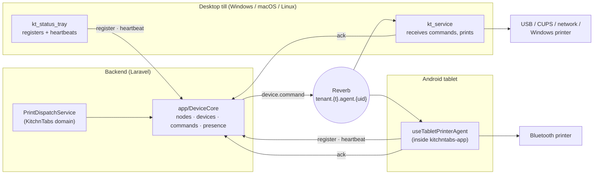
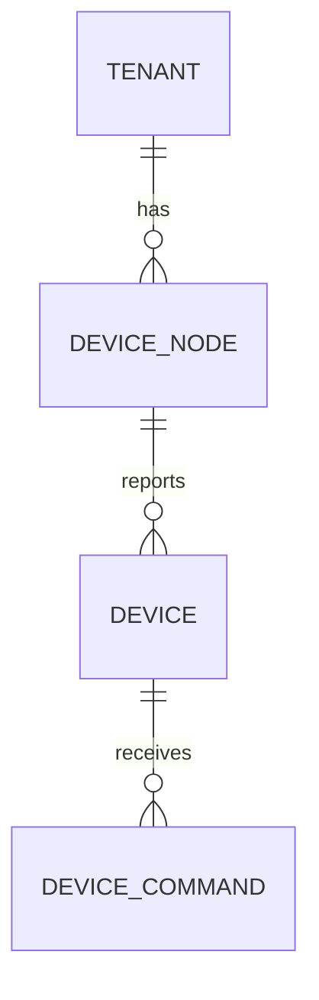
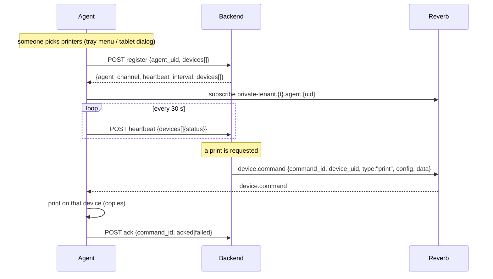
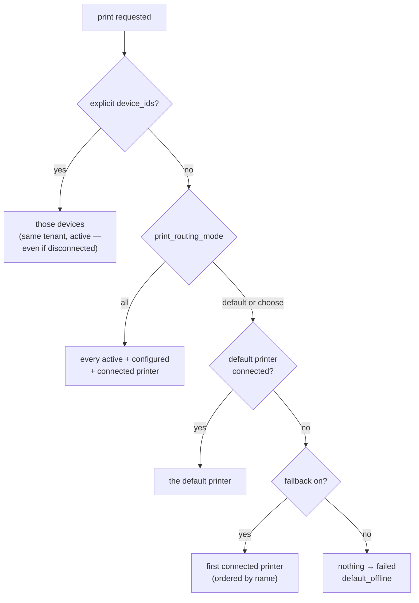
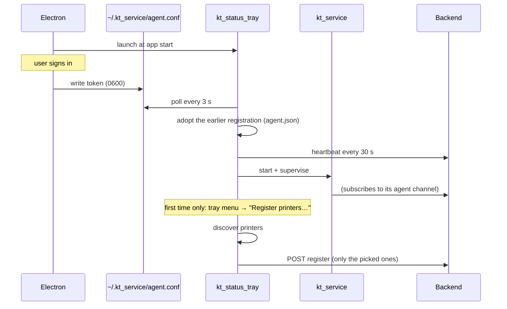
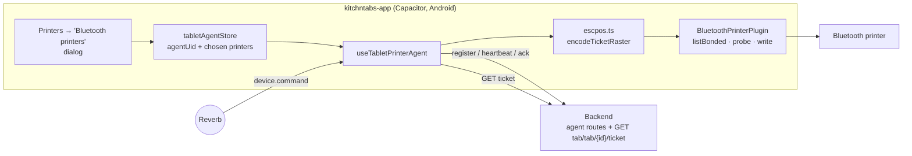

# Device Management — Printers

> **What this is:** the technical reference for how KitchnTabs finds, registers, monitors and prints
> to receipt printers, in every setup where they can be attached: a desktop till (Electron + the
> Python tray on Windows, macOS or Linux), a headless Linux box or Raspberry Pi, and an Android
> tablet with a Bluetooth printer.
>
> **Status (2026-11-03):** desktop/USB/CUPS/network/Windows printing is in production use; the
> Android tablet Bluetooth agent is built and verified on one device but not yet committed;
> Bluetooth printers on a macOS or Windows desktop are not supported yet (§8.6).
>
> **Related:** [SYSTEM-DEVICES-FEATUE.md](./SYSTEM-DEVICES-FEATUE.md) (the design and its history) ·
> [KT-TRAY-FEATURE.md](./KT-TRAY-FEATURE.md) (the desktop tray) ·
> [SERVICE-ACCOUNTS-API-KEYS.md](./SERVICE-ACCOUNTS-API-KEYS.md) (headless credentials)

---

## Contents

1. [The model in one page](#1-the-model-in-one-page)
2. [Where the code lives](#2-where-the-code-lives)
3. [Data: nodes, devices, commands](#3-data-nodes-devices-commands)
4. [Settings: per printer and per tenant](#4-settings-per-printer-and-per-tenant)
5. [The agent protocol](#5-the-agent-protocol)
6. [What makes something print](#6-what-makes-something-print)
7. [Which printer gets the ticket](#7-which-printer-gets-the-ticket)
8. [Scenarios](#8-scenarios)
9. [The Devices screen and who can do what](#9-the-devices-screen-and-who-can-do-what)
10. [Troubleshooting](#10-troubleshooting)
11. [Known gaps](#11-known-gaps)

---

## 1. The model in one page

The backend never talks to a printer. It talks to **agents** — programs running on the machine a
printer is plugged into or paired with — and each agent drives its own printers.



Five ideas carry the whole system:

| Idea | Meaning |
|---|---|
| **Node** | One agent installation: a till, a Pi, a tablet. Identified by a stable `agent_uid`. |
| **Device** | One printer a node reported. Belongs to exactly one node. |
| **Command** | One print job aimed at one device, sent only on that node's private channel, recorded in `device_commands`. |
| **Presence** | A node is online while it keeps heartbeating (every 30 s; considered gone after 90 s). |
| **Registration is deliberate** | A printer is registered because someone picked it (tray menu or tablet dialog), never because it was plugged in. |

---

## 2. Where the code lives

| Layer | Path | What it owns |
|---|---|---|
| Core | `dash-backend/app/DeviceCore/` | Models, agent endpoints, `DeviceRegistrar`, `DeviceTargetResolver`, `BroadcastDeviceCommandDispatcher`, `RedisDevicePresenceStore`, `LegacyPrintPolicy`, reaper, `config/device_core.php` |
| Core routes | `dash-backend/routes/device.php` | `device/agent/*`, `device/device/*`, `device/node/*` (name prefix `api.device.`) |
| Core channels | `dash-backend/routes/channels.php` | `tenant.{tenantId}.agent.{agentUid}` |
| Domain | `kitchntabs-backend-domain/app/Devices/PrinterDeviceType.php` | What a printer is: drivers, required connection keys, config schema |
| Domain | `.../app/Services/Devices/PrintDispatchService.php` | "Print this tab": routing settings, payload, legacy broadcast |
| Domain | `.../app/Services/Devices/TicketRenderer.php`, `.../app/Services/Tabs/SaleNoteData.php` | Text ticket for agents that cannot render a PDF (the tablet) |
| Domain | `.../config/printing_tenant_settings.php` | The tenant's **Printing** settings tab |
| Domain | `.../app/Services/Tabs/TabsNotificationService.php` (`dispatchAutoPrint`) | Automatic print on order status |
| Domain | `.../app/Http/Controllers/API/Tabs/TabController.php` (`printSaleNote`, `ticket`, `download`) | Manual print, ticket JSON, sale-note PDF |
| Desktop agent | `dash-python-service/src/kt_status_tray.py`, `pinoywok/device_agent.py`, `pinoywok/device_picker.py` | Identity, discovery, registration, heartbeat, tray UI |
| Desktop agent | `dash-python-service/src/kt_service.py`, `pinoywok/printer.py`, `pinoywok/thermal_printer.py` | Command handling, PDF download, rasterising, drivers |
| Electron | `kitchntabs-frontend/apps/kitchntabs-app/electron/main/index.ts` | Launches the tray; hands it the signed-in user's token |
| Frontend | `kitchntabs-frontend/packages/kt-devices/` | Devices screens (Printers, Kiosks), status chips, row actions, printer picker |
| Tablet agent | `kitchntabs-frontend/packages/kt-devices/src/bluetooth/` | Agent hook, picker dialog, ESC/POS raster encoder, local state |
| Tablet native | `kitchntabs-frontend/android/app/src/main/java/com/kitchntabs/app/BluetoothPrinterPlugin.java` | List paired devices, probe, write bytes over Bluetooth |

---

## 3. Data: nodes, devices, commands



### `device_nodes`
One row per agent installation. `agent_uid` is unique per tenant and is the only identity anchor.
`name` is the admin's label ("Caja 1") and is never overwritten by the agent. `is_headless` is true
when the node registered with a ServiceAccount key — such a node is expected to stay online, while an
app-backed node legitimately goes offline when staff close the app.

How each agent derives its `agent_uid`:

| Agent | `agent_uid` | Stored in |
|---|---|---|
| Desktop tray | `<hostname>-<MAC as 12 hex>`, computed once | `~/.kt_service/agent.json` |
| Android tablet | `tablet-<random uuid>-kitchntabs-app`, generated once | localStorage key `kt-tablet-printer-agent`, written through to Capacitor Preferences |

Both are cached rather than recomputed: a new uid on every start would create a new, empty node each
time.

### `devices`
| Field group | Written by | Fields |
|---|---|---|
| **Reported** | the agent, on every register | `driver`, `device_uid`, `connection`, `capabilities`, `manufacturer`, `model`, `reported_status`, `last_error`, `last_seen_at` |
| **Admin** | the Devices screen | `name`, `config`, `active`, `is_configured`, `is_default` |

The rule `DeviceRegistrar` never breaks: **an announce only writes reported fields.** A till reboot
cannot undo an admin's configuration.

On first registration a printer is created **active, configured and with the default config**, and it
becomes the tenant's **default printer if it is the first printer of that tenant**. It is usable at
once — no second "save it in the admin" step.

A printer that a node stops reporting is marked `disconnected`, **never deleted**, so it keeps its
config and default flag while unplugged. A printer that was unregistered (soft-deleted) and is
registered again comes back as a fresh row: old name and config are not restored, its command history is
kept.

### What the status chip means

A device shows **Connected** only when both are true:

1. its node is online (Redis key `device_core:node:{id}` alive — TTL 90 s, renewed by each heartbeat);
2. the agent's last report for that printer was `connected`. Both agents measure it: the desktop agent
   probes each printer's driver (§8.1), the tablet asks the printer over Bluetooth (§8.3).

Otherwise it shows the reported status (`disconnected` / `error`, with `last_error` in a tooltip), or
`disconnected` if the node itself is gone. `ReapStaleDeviceNodesCommand` runs every minute, flips
expired nodes and broadcasts `device.status` on `tenant.{t}.system`, so open Devices lists refresh
without a reload.

### `device_commands`
The audit trail that answers "did the ticket ever get sent?". Each row: `type` (`print`), `payload`,
`status`, `reason`, `error`, `issued_by_user_id`, `sent_at`, `acked_at`. Kept 30 days
(`DEVICE_COMMAND_RETENTION_DAYS`).

| Status | Meaning |
|---|---|
| `queued` | row created, not yet broadcast |
| `sent` | broadcast on the node's channel — **not** proof anything printed |
| `acked` | the agent says it printed (every copy) |
| `failed` | the agent reported a failure, or there was nothing to send to (`reason`, below) |

| `reason` on a failed row | Meaning |
|---|---|
| `no_target` | routing found no usable, connected printer; staff get a `device.command.failed` alert |
| `default_offline` | routing mode `default` with fallback off, and the default printer is not connected |
| `legacy_only` | no device target, but the legacy broadcast went out (§8.5); no alert |
| `orphan_device` | the device has no node |

A command stuck at `sent` means the agent never answered: it was offline, asleep, or it does not own
that device.

---

## 4. Settings: per printer and per tenant

### Per printer (`devices.config`, edited in the Devices screen)
Defined by `PrinterDeviceType::configSchema()`.

| Key | Values | Default | Read by |
|---|---|---|---|
| `copies` | 1–5 | 1 | desktop agent, tablet agent. There is no tenant-wide copies setting |
| `cut` | bool | true | tablet agent; desktop agent for USB, device-file and network printers |
| `paper_width_mm` | 58 \| 80 | 58 | both agents (32 / 48 columns, 384 / 576 px) |
| `encoding` | string | `cp437` | (text mode only; unused — both agents print images) |
| `ticket_variant` | `full` \| `kitchen` (no prices) | `full` | both agents |

The backend sends the device's config inside every command, so an agent always prints with the
latest admin settings without re-registering.

### Per tenant (Tenant settings → **Printing** tab)
Defined in `kitchntabs-backend-domain/config/printing_tenant_settings.php`.

| Setting | Values | Default | Effect |
|---|---|---|---|
| `print_routing_mode` | `default` \| `all` \| `choose` | `default` | which printers a ticket goes to (§7) |
| `print_fallback_enabled` | bool | true | if the default printer is offline, use the next connected one |
| `auto_print_statuses` | any of `CREATED`, `CONFIRMED`, `IN_PREPARATION`, `PREPARED` | `['CONFIRMED']` | order statuses that print automatically |
| `legacy_print_broadcast` | bool | true | also send the old tenant-wide print message (§8.5) |

The settings form schema is cached by the frontend for 5 minutes (`SystemRequestsCache`), so a new
field can take that long to appear.

---

## 5. The agent protocol

All agents speak the same HTTP + websocket protocol, authenticated with a bearer token. **The tenant is
always taken from the token's user, never from the request body.**

| Route (`/api/device/agent/...`) | Body | Answer |
|---|---|---|
| `POST register` | `agent_uid`, host info, `devices[]` (the **complete** set this node offers) | `node_id`, `tenant_id`, `agent_channel`, `heartbeat_interval`, `devices[]`, print policy |
| `POST heartbeat` | `agent_uid`, `devices[]{device_uid, status, last_error}` | 200; **404 if the node is unknown** (agent must register again) |
| `POST ack` | `command_id`, `status` (`acked`/`failed`), `error` | 200; 404 for a command of another tenant |
| `GET status?agent_uid=` | — | what the backend has for this node, with no side effects |
| `POST unregister` | `agent_uid`, `device_uid` | soft-deletes one device of this node; TenancyAdmin/Tenant only |



**A register replaces the node's device list.** Devices missing from it become `disconnected`. An agent
must therefore always send everything it offers, not just what changed.

**The per-agent channel.** Any user of the tenant may subscribe to `tenant.{t}.agent.{uid}`, but only
once that node exists — the channel stops terminals from printing each other's tickets; it is not a
secrecy boundary inside a tenant.

**The command message** (inside the notification's `data`):

```json
{
  "command_id": "uuid",
  "device_id": "uuid",
  "device_uid": "bt:AA:BB:CC:DD:EE:FF",
  "type": "print",
  "config": { "copies": 1, "cut": true, "paper_width_mm": 58, "ticket_variant": "full" },
  "data": { "tab_id": 123, "file_path": "...", "tenant_id": "...", "reason": "manual", "ticket_variant": "full" }
}
```

A test print carries `"data": {"test": true}` instead of a tab.

Agent rules, followed by both agents:
- A command for a `device_uid` the agent does not own is **ignored and not acked** (acking would claim a
  print that never happened).
- `acked` only when **every** copy printed.
- Long work (download, rasterise, write) runs off the websocket loop so Reverb pings keep being answered.

**Commands are not queued.** Broadcasts go through Horizon to Reverb and are delivered only to agents
connected at that moment. An agent that is offline misses the command, which stays `sent` — nothing
retries it. Horizon must be running, or nothing is broadcast at all.

---

## 6. What makes something print

| Trigger | Entry point | Targets |
|---|---|---|
| **Automatic**, order reaches a status in `auto_print_statuses` | `TabsNotificationService::dispatchAutoPrint()` → `PrintDispatchService::printTab($tab, null, "auto:{status}")` | routing policy (§7); `choose` acts as `default` |
| **Manual**, Print button on a tab | `GET /api/tab/tab/{id}/print` → `TabController::printSaleNote()` | routing policy, or explicit `device_ids[]` if sent |
| **Test**, Test button on a printer row | `POST /api/device/device/{id}/test` → `DeviceController::test()` | that one printer, skipping routing |
| **Tray test print** (desktop only) | tray menu → `ThermalPrinter` directly | that printer, with no backend involved |

The automatic and manual paths make sure the sale-note PDF exists first (generating it when missing). A
print failure never rolls back the order: `printTab()` swallows its own errors and logs them.

The manual endpoint answers with the commands it created (`id`, `device_id`, `status`, `reason`), and
its message says whether any printer was reached ("Comanda enviada a impresión" vs "No hay impresoras
disponibles para esta comanda").

The Test endpoint answers `delivered: true` when the command reached Reverb. Whether paper came out is
only known when the agent acks.

---

## 7. Which printer gets the ticket

`DeviceTargetResolver::resolve()` (core) with the tenant's settings:



- Candidates are printers of the tenant that are **active and configured**.
- An explicit target is used even when disconnected: the operator named it, and printing somewhere else
  silently would be worse than a failed command they can see.
- `all` prints once per connected printer, each with its own `ticket_variant` — a kitchen printer set to
  `kitchen` and a counter printer set to `full` both get the same order.
- With fallback off, the ticket prints on the default printer or not at all. That is deliberate: a
  kitchen ticket appearing at the counter is a real failure.
- One default per tenant and type. **Set default** moves the flag and broadcasts so every open list
  updates.

---

## 8. Scenarios

### 8.1 Desktop till — Electron app with the Python tray (Windows, macOS, Linux)

The standard till. The Electron `kitchntabs-app` bundles the Python services and launches
`kt_status_tray`, which owns printers on that machine and supervises `kt_service`.



**Discovery** (`ThermalPrinter.discover()`), one source at a time, each failure isolated:

| Source | Platforms | Driver | `device_uid` | Connection |
|---|---|---|---|---|
| USB devices with printer class 7 (pyusb) | all | `escpos_usb` | `usb:vid:pid:serial` | `vendor_id`, `product_id` |
| CUPS queues (`lpstat -p`) | macOS, Linux | `cups` | `cups:<queue>` | `queue` |
| Windows printers (`win32print.EnumPrinters`) | Windows | `win32` | `win32:<name>` | `printer_name` |
| `/dev/usb/lp*` and `/dev/rfcomm*` | Linux | `device_file` | `devfile:<path>` | `device_path` |

The serial is appended to the USB uid when the printer has one, so two identical printers on one till
stay two devices. The same printer can appear twice (raw USB and a CUPS queue); duplicates are dropped
by `device_uid`, keeping the first source. The agent can also print to a `network` printer (`host`,
`port`, raw port 9100 by default), but the tray has no discovery source for it yet.

**Registration** is manual from the tray menu ("Register printers…"), one printer at a time, and only
the picked printer is announced. The tray can also **Unregister** a printer (needs a TenancyAdmin or
Tenant sign-in; a Staff sign-in gets a clear 403 message). At start the tray does not discover: it
reloads the earlier registration from `~/.kt_service/agent.json` and resumes heartbeating, so a restart
does not drop known printers. If the backend answers a heartbeat with 404 (node deleted, database
reset), the agent registers again.

**Status.** Before each register and heartbeat the agent probes every registered printer
(`ThermalPrinter.probe()`) and reports what it measures:

| Driver | `connected` when | otherwise |
|---|---|---|
| `escpos_usb` | the USB vendor/product is present | `disconnected` |
| `cups` | `lpstat -p <queue>` knows the queue and it is not disabled | `disconnected` (no queue) / `error` (disabled) |
| `win32` | Windows does not report it offline or in error | `disconnected` (offline) / `error` (paper, jam, door…) |
| `device_file` | the path exists and is writable | `disconnected` / `error` (permission) |
| `network` | the TCP port accepts a connection within 2 s | `disconnected` |

Only status changes are logged. Other device types on the node (card terminals) keep reporting
`connected`.

**Credential.** Electron writes the signed-in user's token to `~/.kt_service/agent.conf`; signing out
clears it, which stops the service. The tray can also sign in on its own (email/password or a pasted
ServiceAccount token). Precedence: `argv` → `KT_AGENT_TOKEN` → `agent.conf` → interactive sign-in.
Details in [KT-TRAY-FEATURE.md §4–5](./KT-TRAY-FEATURE.md).

**Printing a tab** (`kt_service.handle_device_command` → `print_order_on_device`):

1. Look up the device locally by `device_uid`; ignore the command if it is not ours.
2. Get what to print, with the same token:
   - printer set to `ticket_variant: kitchen`: the text ticket without prices
     (`GET /api/tab/tab/{id}/ticket?width=…&variant=kitchen`), drawn in a monospace system font
     (Menlo, Consolas or DejaVu Sans Mono) at the printer's width (`pinoywok/ticket_image.py`). If it
     cannot be fetched, the agent falls back to the PDF: a priced ticket in the kitchen beats none;
   - otherwise the sale-note PDF (`GET /api/tab/tab/{id}/download`, permission `downloadSaleNote`),
     rasterised.
3. Send it through **that printer's own driver** (CUPS queue, Windows printer by name, USB ids, device
   file, network port), scaled to its paper width, with or without the cut; repeat for `copies` (max 5).
4. Ack `acked`, or `failed` with the reason.

A test command prints the device test page (`print_test_page_on_device`) on that device's own
connection.

**Duplicate protection.** `kt_service` still listens on `tenant.{t}.system` for the legacy print
message, but ignores it as soon as it has registered devices, so a till never prints the same order twice
during the migration.

### 8.2 Headless Linux box or Raspberry Pi

Same Python agent, no person signing in.

1. In the admin, create a ServiceAccount key for the tenant (see
   [SERVICE-ACCOUNTS-API-KEYS.md](./SERVICE-ACCOUNTS-API-KEYS.md)).
2. Give it a role that has **both** the agent routes and `api.tab.tab.downloadSaleNote`. The seeded
   `TenantServiceAccount` role has both (the download since migration `2026_11_03_000400`).
3. Start the tray or service with that key (sign-in dialog, `KT_AGENT_TOKEN`, or `argv`).

The node is marked `is_headless`; it is expected to stay online.

> A key that can register but cannot download the PDF registers, heartbeats and receives its commands —
> and prints nothing. The agent logs the 403 on the download; check both permissions.

**Bluetooth printers on Linux:** bind the paired printer to a serial device first
(`rfcomm bind /dev/rfcomm0 <MAC>`); it is then discovered as `device_file` `/dev/rfcomm0`.

Raspberry Pi builds and installs are covered by the `kitchntabs-app-staging-raspberry` skill — never
build or `pip install` on the Pi itself.

### 8.3 Android tablet with a Bluetooth printer

The tablet runs the Capacitor build of `kitchntabs-app`. A printer paired in Android's Bluetooth
settings is registered and printed to **by the tablet itself**, through an agent that runs inside the
app.



**Choosing printers.** Devices → Printers shows a **Bluetooth printers** button (Android app only, also
on the empty list). It lists the paired devices, printers first; ticking some and pressing Save stores
the choice and the agent registers exactly that set. Unticking every printer asks for confirmation,
then announces an empty set, so the tablet's printers go `disconnected`. Pairing itself happens in
Android settings; the app never scans.

**The agent** (`useTabletPrinterAgent`, mounted from the app's `DASHWSMessagesManager`):

| When | What it does |
|---|---|
| App start, selection change | probe each chosen printer, then `register` with its real status |
| Every `heartbeat_interval` (30 s) and when the app returns to the foreground | probe again, then heartbeat; retries a failed register while it has no channel |
| `device.command` for one of its printers | queue it (one job at a time, each `command_id` once), print, ack |
| Legacy `print` on `tenant.{t}.system` | ignored |

It runs only in the Android app with the native plugin present, and needs a signed-in user (it falls
back to the stored user when the auth context is not ready yet on a cold start).

**Status is measured, not assumed.** `probe` opens (or reuses) the Bluetooth link and sends `DLE EOT 1`;
the printer is reported `connected` only if that works, otherwise `disconnected` with the error. A
print result also updates it. The same probe re-opens the link after an app restart, so the printer
reconnects with no user action.

**Printing a tab:**

1. `GET /api/tab/tab/{id}/ticket?width=58|80&variant=full|kitchen` → `TicketRenderer` returns lines
   already laid out to 32 / 48 columns (`text`, `align`, `bold`, `double`); `kitchen` leaves prices
   out. Built from `SaleNoteData::fromTab()`, the same data as the PDF.
2. `encodeTicketRaster` draws the lines on a 384 px (58 mm) or 576 px (80 mm) canvas in monospace,
   thresholds to 1-bit and emits `GS v 0` in 24-row bands, then feed and `GS V 1` (cut, if `cut`).
3. `BluetoothPrinterPlugin.write` sends it over RFCOMM/SPP (secure socket, then insecure fallback, one
   retry), 128 bytes every 30 ms. A 58 mm ticket takes about 6 s.
4. Repeat for `copies`, then ack.

A test command prints a built-in test ticket (name, date, accented characters).

**Why images and not text:** the PT-210 printed every ASCII character as a black box in text mode, and
no initialisation command fixed it. Printing an image avoids the printer's font entirely. The text
encoder (`encodeTicket`) is kept but unused.

**Android permissions:** `BLUETOOTH_CONNECT` (runtime prompt on Android 12+);
`BLUETOOTH`/`BLUETOOTH_ADMIN` up to API 30. No scan permission.

**Verified:** Lenovo TB-X6C6L (Android 11) + PT-210 58 mm: registration, test print, tab reprint, and
selection + connection after a cold restart.

### 8.4 Web browser (no agent)

A browser can **ask** for prints but cannot **host** a printer. Pressing Print on a tab, or Test on a
printer row, sends a command to whichever till or tablet owns the target printer. Staff working on a
laptop browser can therefore print to the kitchen till. The sale-note PDF can still be downloaded and
printed by hand.

### 8.5 Old till builds (before the device system)

Builds in venues that predate this system print on **any** message whose type contains `print` on
`tenant.{t}.system`, using the single printer in their `config.yaml`. They never register, so the
backend cannot see them.

`PrintDispatchService` therefore also sends that legacy message on every print while the tenant setting
`legacy_print_broadcast` is on (default), and sends it **before** checking for device targets — a
tenant with no registered printers must keep printing. Updated agents ignore the legacy message once
they have registered printers.

Turn it off only when someone has checked that every till in the venue is updated.
`LegacyPrintPolicy::isFullyUpgraded()` ("every node we know runs agent ≥ 2.0.0") is a hint for that
person, never the decision: old tills are exactly the ones that cannot be counted.
`DEVICE_LEGACY_PRINT_BROADCAST=false` is the global kill switch.

### 8.6 Bluetooth printer on a macOS or Windows desktop — not supported yet

Pairing a Bluetooth printer with a Mac or Windows PC creates a serial port (`/dev/cu.<name>` on macOS,
a "Standard Serial over Bluetooth link" `COMx` on Windows). The desktop agent does not discover serial
ports on those systems today, so such a printer cannot be registered. Linux works through
`rfcomm bind` (§8.2).

The planned route is the Python tray, not the tablet code: add serial-port discovery as
`driver: bluetooth` with the port name, paced writes like the tablet's, a real status check, and let the
`bluetooth` driver accept a port instead of a MAC address. A Bluetooth printer accepts one connection at
a time, so a printer cannot be shared live between a tablet and a desktop.

### 8.7 Several tills and printers in one venue

- Each till or tablet is its own node; its printers are its own devices.
- A ticket goes only to the node that owns the target printer, on that node's channel. Two tills no
  longer print the same order twice.
- Typical kitchen + counter setup: set the kitchen printer's `ticket_variant` to `kitchen`, the counter
  printer's to `full`, and the tenant's `print_routing_mode` to `all`.
- One default per tenant. With `default` mode and fallback on, a ticket moves to the next connected
  printer when the default is down.

### 8.8 Tenancy admins with several restaurants

`DeviceController` lists with `visibleThroughTenant()`: a TenancyAdmin without a tenant selected sees
the printers of every restaurant in the tenancy (with a Restaurant column); after choosing a restaurant
in the tenant switcher (`X-Tenant-Id`), only that one's. The same screens serve kitchntabs-web
(tenancy-wide) and kitchntabs-app (one restaurant).

---

## 9. The Devices screen and who can do what

`kt-devices` → **Printers** list: Name · Status · Flags (Configured / Active / ★ Default) · Terminal ·
Restaurant. There is no Create: a printer exists because an agent reported it. Row actions:
**Test**, **Set default**, edit (label, config, flags). Lists are never cached (`disableCache()`), and
`device.status` / `device.command.failed` events refresh them live.

| Action | TenancyAdmin / Tenant | Staff | Kitchen, Waiter, Cashier | TenantServiceAccount |
|---|---|---|---|---|
| See the Printers list | ✅ | ✅ | — | — |
| Test print, Set default | ✅ | ✅ | — | — |
| Edit name / config / flags | ✅ | ❌ (Save answers 403) | — | — |
| Delete, trash | ✅ | ❌ | — | — |
| Run an agent (register, heartbeat, ack, status) | ✅ | ✅ | ✅ | ✅ |
| Unregister from the tray | ✅ | ❌ | ❌ | ❌ |
| Print a tab (`printSaleNote`) | ✅ | ✅ | ✅ | ❌ |
| Fetch the ticket or PDF (`ticket`, `downloadSaleNote`) | ✅ | ✅ | ✅ | ✅ |

Every grant lives in a `PermissionMigration` **and** the matching `database/data/rolePermissions/*.json`
file; a grant in only one of them is removed by the next `db:sync_roles` (this happened to all agent
routes before 2026-11-03). Frontend menus are gated by the `roles` array of each resource
(`'Staff'` is in the Printers and Kiosks resources). See the `dashadmin-permissions` skill.

---

## 10. Troubleshooting

Start from the command row: `device_commands` for the tab or test, ordered by `created_at`.

| Symptom | Likely cause | Check / fix |
|---|---|---|
| Nothing printed, no command row | no Horizon, or the print never reached `PrintDispatchService` | Horizon running; `laravel.log` for `PrintDispatchService::printTab failed` |
| Row `failed`, `no_target` | no active, configured, connected printer | Devices list: is any printer Connected and Active? |
| Row `failed`, `default_offline` | default printer down and fallback off | bring it back, pick another default, or enable fallback |
| Row `failed`, `legacy_only` | tenant has no registered printers; only old tills printed | register printers, or ignore if the venue still runs old builds |
| Row stuck at `sent` | the owning agent was offline or asleep (no queue) | is the node online? Tablet: app open and in front? Print again |
| Row `failed` with an error | the agent tried and failed | desktop: `kt_service` log; tablet: `window.__ktTabletAgent.lastError` |
| Desktop prints nothing, log shows 403 on `/download` | token or ServiceAccount lacks the download permission | grant `api.tab.tab.downloadSaleNote` (§8.2) |
| Every ticket printed twice | an old till plus an updated one both acting, or `all` mode with two printers | `legacy_print_broadcast`, routing mode |
| Printer shows Connected but is off (desktop) | an agent build older than 2026-11-03 reports every printer `connected` | update the app; the status then follows the printer within one heartbeat |
| Ticket printed on the wrong printer of a till (desktop) | an agent build older than 2026-11-03 picks the print method by platform, not by the printer's driver | update the app |
| Tablet printer `disconnected` | Bluetooth off, printer off, or the printer is connected to another device | turn it on; it reconnects within one heartbeat |
| Tablet garbled ticket | text mode on a printer with a broken font | the agent prints images by default; check it is a current build |
| Bluetooth printers button missing | not the Android app, or an APK built before the plugin | install a current build |
| Tablet forgets its printers after a restart | a raw localStorage key not written through to Preferences | `tabletAgentStore.write()` must set both ([SYSTEM-DEVICES-FEATUE.md §15](./SYSTEM-DEVICES-FEATUE.md#15-tablet-bluetooth-printers-capacitor--android-agent)) |
| Registered printer missing after DB reset | the agent's local cache disagrees with the backend | tray: "Register printers…" again (it checks `GET status`); tablet: Save the selection again |
| 403 on Test / Set default | role lacks `api.device.device.test` / `setDefault`, or a role sync removed it | compare the role JSON with `role_has_permissions` |

**Debugging the tablet agent** over USB/Wi-Fi ADB: attach Chrome DevTools to the WebView and read
`window.__ktTabletAgent` (`enabled`, `channel`, `printers[]` with status, `lastError`). Restart the app
with force-stop + launch rather than reloading the page at a deep route, which hangs on the spinner.

---

## 11. Known gaps

| Gap | Effect | Where to fix |
|---|---|---|
| Desktop probes are verified on macOS only | Windows status flags and Linux paths are covered by code review, not a real till | test on a Windows and a Linux till |
| A CUPS queue whose USB printer is unplugged can stay "idle" | macOS/Linux may still show such a printer connected | also check the queue's device URI |
| `choose` routing mode has no dialog | `PrinterPickerDialog` and `useTabPrintFlow` exist in `kt-devices` but no Print button uses them, so `choose` behaves like `default` | wire `useTabPrintFlow` into `kt-tabs` Print buttons |
| No command queue | a command sent while the agent is offline is lost and stays `sent` | pending-commands endpoint, or (tablet) FCM wake-up / foreground service |
| Tablet agent only runs while the app is open | a sleeping tablet misses tickets | same as above |
| Bluetooth on macOS / Windows desktops | cannot register such printers | §8.6 |
| Tablet Bluetooth work is uncommitted | — | commit across backend domain, frontend and docs |
