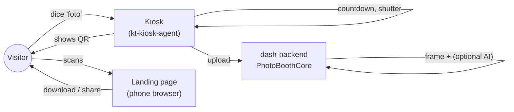
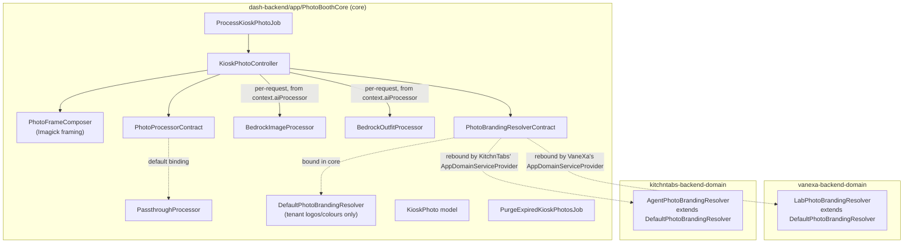
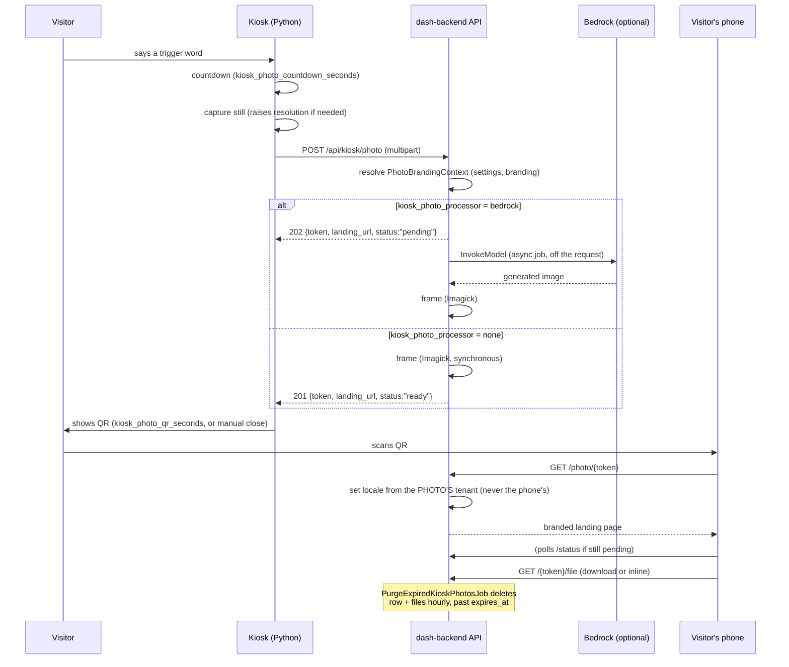
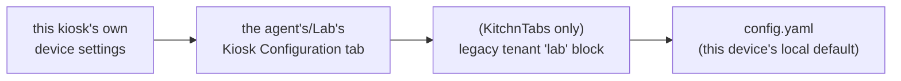
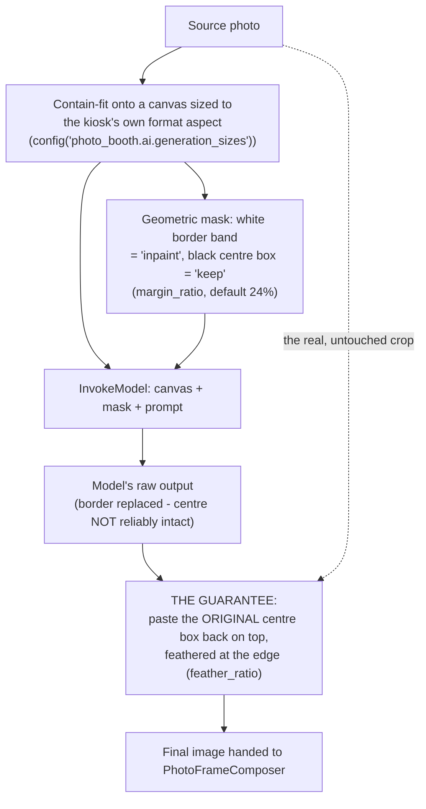
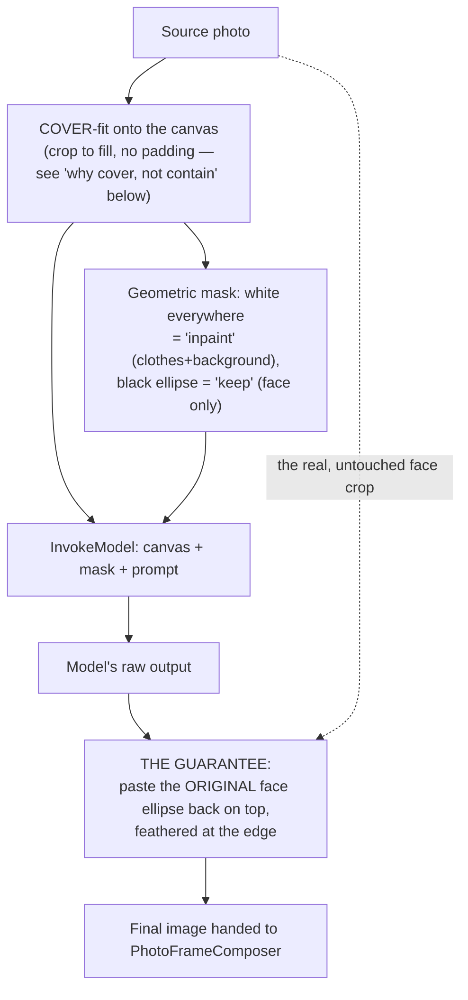

# Kiosk Photo Booth — Full Technical documentation

**Status as of 2026-08-27: implemented and live-verified**, including the AI
background transform (§7) and its outfit variant (§7.6, opt-in, separately
live-verified — not yet through the real HTTP controller, and currently
DISABLED pending that verification and real face detection — see §7.6's own
status line). This document describes what actually exists in the codebase
today, not the original design — see `KIOSK-PHOTO-BOOTH-PLAN.md` for the
pre-implementation proposal this evolved from, where this document
disagrees with it.

## 1. What it does

A visitor at a kiosk (VaneXa or KitchnTabs — one shared implementation) says
a trigger word ("foto"). The kiosk counts down, takes a picture, frames it in
the tenant's branding, optionally replaces the background with an
AI-generated technological scene, and shows a QR code. Scanning it opens a
branded landing page on the visitor's phone where they can download or share
the photo. The photo and its file are deleted automatically a fixed number
of hours later — there is no gallery and no way to keep one past that.

It is **not an AI feature** in the conversational sense: it never opens a
Lab/agent session, never calls a chat model, and works whether or not the
kiosk is even logged in to an AI-capable tenant. The one place AI enters is
optional and per-tenant: the background transform described in §7.

## 2. Architecture — core/domain split

Follows this codebase's standing rule: **domain-agnostic mechanism → core;
product-shaped surface → domain**. Almost everything here is mechanism, so
nearly all of it lives in one core module.

The **only** product-shaped decision anywhere in this feature is "whose
character sprite goes in the corner, and where do the AI/sharing settings
come from" — everything else (upload, storage, framing, the landing page,
purge) is identical for both products and lives once, in core.

## 3. End-to-end flow

## 4. Kiosk-side components (`kt-kiosk-agent`)

Shared verbatim by `vanexa.py` and `kitchntabs.py` — `TenantAssistant`
(KitchnTabs) subclasses `VanexaAssistant`, so one edit to the shared
`pw/vanexa/assistant.py` serves both.

| File | Role |
|---|---|
| `pw/photo_booth.py` | Orchestration: `PhotoBooth.fire()` — countdown → capture → shutter → upload → hand the URL to the overlay. Runs on its own daemon thread; never blocks the assistant thread or the render loop. |
| `pw/photo_client.py` | `PhotoBoothClient` — HTTP client for `store()`/`strings()`/status polling. Sends `Accept-Language` derived from the tenant's `primary_language_code`, which `SetLocaleFromHeader` reads for the kiosk's own on-screen copy. |
| `pw/ui/photo_overlay.py` | `PhotoOverlay` — the on-screen states: countdown → flash → processing → QR (or failed). `show/clear/visible/update/draw` — the same shape `pw/vanexa/rich_view.py` uses. The QR state has a tap-to-close badge, top-right of the card (added 2026-08-27; see §9). |
| `pw/ui/qr_render.py` | `render_qr_surface()` — promoted out of `pw/ui/selfservice_qr.py` so the photo overlay doesn't have to import KitchnTabs-only self-service code into `vanexa.py`'s import graph. |
| `pw/camera.py` | `LatestFrame` — a locked, cross-thread holder for the most recent clean camera frame, read by the photo-booth thread instead of touching the shared `cv2.VideoCapture` directly. `capture_lock` (added 2026-08-27) — see §9; guards every native call into that same `VideoCapture` object, from either thread. |
| `pw/wake_word.py` | `contains_wake_word()` — reused as-is for trigger matching; no new matching code. `kiosk_photo_triggers` is comma-separated, exactly like `WAKE_WORD`/`CHARACTER_NAME`, capped at 3 words per entry (`MAX_NAME_WORDS`). |
| `pw/vanexa/assistant.py` | The trigger check in `assistant_thread()`'s main loop, checked **before** the wake-word check and **not gated on `ai_conversation_status`** — a photo works whether or not a conversation is open, by design. Never opens a session, never calls a model. |
| `vanexa.py` / `kitchntabs.py` | `_refresh_photo_booth()` (rebuilds `PhotoBooth`/`PhotoBoothClient` on login/account-switch), `_on_photo_trigger()` (the `ON_PHOTO` callback — checks `kiosk_photo_enabled` and logs *which* settings tier decided if it's off), `_kiosk_photo_format()` (screen shape → vertical/horizontal/square), event-loop wiring for `photo_overlay.handle_event()`, and `photo_overlay.update()`/`.draw(screen)` in the render loop. |

### Settings resolution (kiosk side)

`_kiosk_setting(key)` — most-specific source first. VaneXa has 3 tiers,
KitchnTabs 4 (it also has the legacy tenant-settings `lab` block VaneXa never
had):

`_kiosk_setting_source(key)` (added 2026-08-27) walks the same chain to name
*which* tier answered, for diagnostics — see §9.

## 5. Backend components (`dash-backend/app/PhotoBoothCore`)

| File | Role |
|---|---|
| `Http/Controllers/KioskPhotoController.php` | The whole HTTP surface: `store()`, `finish()`, `show()` (landing page), `status()`, `file()`, `strings()`. `processorFor($context)` (added 2026-08-27) picks `PassthroughProcessor` or `BedrockImageProcessor` **per request**, from `$context->aiProcessor` — not a fixed DI binding, so one Lab/agent can turn the AI transform on while another stays free. |
| `Models/KioskPhoto.php` | The row. UUID PK, `token` is the route key and the only capability (no signed URLs — see §8 for why). `isExpired()`/`isDownloadable()` gate every read. |
| `Services/PhotoFrameComposer.php` | Imagick framing: gradient background, coloured border, horizontal logo top-centre, cover CONTAIN-fit (never stretched, capped upscale), squared logo bottom-left, character bottom-right. Untouched by the AI work — it frames whatever `process()` handed it, AI-transformed or not, identically. |
| `Processors/PassthroughProcessor.php` | `name() = 'none'`, `isAsync() = false`. Returns the source path unchanged. |
| `Processors/BedrockImageProcessor.php` | `name() = 'bedrock'`, `isAsync() = true`. The AI background transform — see §7. |
| `Processors/BedrockOutfitProcessor.php` | `name() = 'bedrock_outfit'`, `isAsync() = true`. Clothing + background transform — see §7.6. Separate opt-in, not a replacement. |
| `Contracts/PhotoProcessorContract.php` | `process(sourcePath, context, format): string`, `isAsync(): bool`, `name(): string`. `$format` was added 2026-08-27 so a processor can generate at the kiosk's own aspect ratio. |
| `Contracts/PhotoBrandingResolverContract.php` + `ValueObjects/PhotoBrandingContext.php` | The core/domain seam (§2). `aiProcessor`/`aiPrompt` fields added 2026-08-27. |
| `Services/DefaultPhotoBrandingResolver.php` | Tenant logos/colours only — the base both domain resolvers extend, and the working default for a domain that binds nothing of its own. |
| `Jobs/ProcessKioskPhotoJob.php` | Runs `KioskPhotoController::finish()` off the request cycle, on the `agent` queue, for an async processor. Skips a photo that expired while queued. |
| `Jobs/PurgeExpiredKioskPhotosJob.php` | Deletes rows and both files (source + framed) where `expires_at < now()`. Scheduled hourly by `PhotoBoothCoreServiceProvider`. |
| `config/photo_booth.php` | Retention, disk, frame templates/layout, sharing, purge schedule, and the `ai` block (§7). |
| `database/migrations/2026_08_27_000100_create_kiosk_photos_table.php` | The `kiosk_photos` table. |
| `resources/views/landing.blade.php`, `expired.blade.php` | The two pages a scanned QR can show. Self-contained (no build step, no CDN) — opened on a stranger's phone, possibly on venue wifi. |
| `routes/photo_booth.php` (in `dash-backend/routes/`, loaded by the module's own provider) | See §6. |

### Domain resolvers

| Repo | Class | Reads |
|---|---|---|
| `vanexa-backend-domain` | `Domain\App\Services\Lab\LabPhotoBrandingResolver` | The session's `LabProject` — character sprite, and (as of 2026-08-27) `settings.kiosk_photo_processor` / `kiosk_photo_ai_prompt` / `kiosk_photo_sharing`, resolved **regardless of whether the project has a character sprite** (fixed 2026-08-27 — these three used to be silently skipped for a Lab with no uploaded character). |
| `kitchntabs-backend-domain` | `Domain\App\Services\AI\AgentPhotoBrandingResolver` | The tenant's one active `AgentConfiguration`, same fields, same fix. |

## 6. Routes

| Method | Path | Middleware | Purpose |
|---|---|---|---|
| POST | `/api/kiosk/photo` | `api`, `auth:sanctum` | Upload + compose. Returns `{token, landing_url, status}`, `201` (sync) or `202` (async). |
| GET | `/api/kiosk/photo/strings` | `api`, `auth:sanctum` | The kiosk's own on-screen copy, translated via `SetLocaleFromHeader` reading the kiosk's `Accept-Language`. |
| GET | `/photo/{token}` | `web` | The branded landing page. **No auth** — the token is the capability. |
| GET | `/api/kiosk/photo/{token}/file` | `api` | Streams the framed JPEG. The only reader of the photo disk; the only place expiry is enforced. |
| GET | `/api/kiosk/photo/{token}/status` | `api` | Poll target for the landing page while an async processor runs. |

`auth:sanctum` **without** `AccessMiddleware`'s `access` check, deliberately,
on the kiosk-facing routes — a kiosk device account missing a seeded
permission grant would otherwise fail in a venue with nothing on screen to
explain it. Same reasoning already recorded on
`lab/project/{id}/character-manifest`.

## 7. The AI transform ("digital twin") — `BedrockImageProcessor`

### 7.1 Off by default, per-tenant opt-in

`kiosk_photo_processor` (`none` | `bedrock`, **default `none`**) — declared
identically in `vanexa-backend-domain/config/lab_project_settings.php` and
`kitchntabs-backend-domain/config/kt_agent_kiosk_settings.php`, editable on
the Kiosk Configuration → Photo Booth tab. This calls a paid image model on
every photo and adds 10-30 seconds, so a Lab/agent opts in deliberately
rather than the whole platform inheriting it. Resolved **per request**
(`PhotoBrandingContext::$aiProcessor`, read by
`KioskPhotoController::processorFor()`) — not a single app-wide DI binding —
so different Labs/agents on the same deployment can genuinely disagree.

`kiosk_photo_ai_prompt` — free text, English (the underlying model is
English-prompt-tuned regardless of the tenant's own language), describing
the desired background. Empty = the built-in default
(`config('photo_booth.ai.default_prompt')`).

### 7.2 Model

**`us.stability.stable-image-inpaint-v1:0`** (Stability AI's Stable Image
Inpaint, via a Bedrock cross-region inference profile), region `us-east-1`.

Why not the more obvious choices, in the order they were actually tried
(2026-08-27, live against the real AWS account):

| Candidate | Result |
|---|---|
| **Amazon Nova Canvas** (`amazon.nova-canvas-v1:0`) | The natural first choice — a Nova-family model that can output images. **`LEGACY`, access denied** on this account ("not actively used in the last 30 days ... upgrade to an active model"). Re-requesting access is a manual step in the Bedrock console (Model access), not guaranteed to be granted. |
| Nova Pro / Nova Lite / Claude Sonnet (any "multimodal" reasoning model) | Can accept an image as **input** and reason about it, but has **no image output capability at all** — text/JSON only. Not a config issue; a hard capability boundary. Ruled out on that basis alone, not tried. |
| `stability.stable-image-search-replace-v1:0` (`search_prompt` targeting "the background"/"the person") | **Rejected, live test failed**: replaced the entire subject with a generated figure, not just the background. Fails the whole point of a "digital twin" — the visitor must stay recognisable. |
| `stability.stable-image-remove-background-v1:0` (real segmentation) + composite onto a separately generated plate | Segmentation was excellent on a clean synthetic test image, but **did not fire at all** on a real, imperfectly-lit webcam photo (backlit, close crop) — too unreliable to build identity-preservation on top of for arbitrary real venue photos. |
| `stability.stable-image-inpaint-v1:0` **with a geometric (not AI-derived) mask** | **Shipped.** See 7.3. |

All Stability models on this account require a `us.`-prefixed **inference
profile** id, not the bare model id — Bedrock rejects on-demand invocation
outright otherwise (`ValidationException: ... isn't supported. Retry your
request with the ID or ARN of an inference profile`).

### 7.3 The identity guarantee

**This is the part that matters most and must not be simplified away.**

Confirmed live, against this exact model: a mask region explicitly marked
"keep" is **not reliably left alone**. One real test masked a visitor's
torso as protected and got back a torso partially redrawn as robot armour —
the model still regenerated content it was told to preserve. A souvenir
photo cannot ship on the basis of "the model probably respects its own
mask" — a visitor must always get back a photo of *themselves*, never a
reinterpretation.

So the mask is used only to tell the model **where to spend its effort**
(composition), never trusted for identity:

The feather (`config('photo_booth.ai.feather_ratio')`, default 2% of the
shorter canvas side) softens the seam between the restored centre and the
generated border — a hard rectangular paste was visibly obvious in testing
before this was added.

**If a future model or task type ever replaces this one, keep the final
re-composite step regardless of how good that model's own mask fidelity
claims to be.** This is documented identically in the class's own docblock.

### 7.4 Size — "fit the kiosk"

This model returns output at **exactly the resolution it was sent** —
confirmed live; there is no separate output-size request parameter. So
sizing happens on the way *in*:
`config('photo_booth.ai.generation_sizes')` maps each kiosk format to a
fixed width/height matching that format's exact aspect ratio (not
`photo_booth.formats`' own numbers — those are the FRAMED canvas size,
larger than what was validated against this model):

| Format | Generation size | Aspect |
|---|---|---|
| `vertical` | 864 × 1536 | 9:16 (exact) |
| `horizontal` | 1536 × 864 | 16:9 (exact) |
| `square` | 1152 × 1152 | 1:1 |

The source photo is CONTAIN-fit onto that canvas first (same discipline
`PhotoFrameComposer::drawPhoto()` already applies — never stretch, capped
upscale via the same `photo_booth.max_upscale`), so the model sees the real
photo, not a blank page — the generated border is conditioned on its actual
lighting and perspective, which is what makes it look intentional rather
than pasted from nowhere.

### 7.5 Verified live, end-to-end

Run directly through the real `KioskPhotoController::finish()` (not a
standalone script), against the real dev backend, a real uploaded kiosk
photo, and a real `InvokeModel` call: ~20 seconds, `status = ready`, no
error. Face, headphones, and torso in the output were pixel-identical to the
original; the generated border showed a coherent technological scene. The
Lab's settings were reverted to their prior state immediately afterward —
this was a temporary live test, not a persisted configuration change.

**Not yet done:** no automated test coverage for this class specifically
(the whole `PhotoBoothCore` module has none yet — a pre-existing gap, not
introduced here); the KitchnTabs code path (`AgentPhotoBrandingResolver`) is
a structural mirror of the tested VaneXa one but was not separately
live-run; the async queue dispatch path (`ProcessKioskPhotoJob`) itself
wasn't separately exercised (`finish()`, the method it calls, was — this is
a reasonable but not identical stand-in).

## 7.6 Outfit variant — `bedrock_outfit` (`BedrockOutfitProcessor`)

**Status as of 2026-08-27: implemented, live-verified against the real
`process()` method (VaneXa path) via `tinker` against a running dev
container — not yet exercised through the real HTTP controller/queue path
the way §7.5 was. Currently DISABLED — `bedrock_outfit` was deliberately
removed from `kiosk_photo_processor`'s `rules`/`options` in both
`lab_project_settings.php` and `kt_agent_kiosk_settings.php`, so no Lab/agent
can select it right now. Not a rollback: `BedrockOutfitProcessor` itself,
`KioskPhotoController::processorFor()`'s routing to it, and its
`config('photo_booth.ai.outfit')` block are all untouched — re-enabling is
adding `bedrock_outfit` back to those two settings files' `rules`/`options`,
not rebuilding anything. Off until the open items below (real face
detection, HTTP/queue-path verification) are closed.**

A separate opt-in from `bedrock` (`kiosk_photo_processor = bedrock_outfit`),
not a replacement — existing tenants on `bedrock` keep today's
background-only transform unchanged. Promoted from a standalone POC
(`KITCHNTABS/digital-twin-pocs/poc-002`, `poc-004`) run against the real AWS
account before this class existed; that folder still holds the raw
experiments and dead ends (Titan Image Generator, Nova Canvas — both
confirmed unusable on this account, see that folder's own README).

**What's different from `BedrockImageProcessor`:** clothing AND background
are both handed to the model; only the visitor's face is protected. Same
model (`stability.stable-image-inpaint-v1:0`), same identity-guarantee
discipline (§7.3's rule applies unchanged — the mask is never trusted for
identity, only composition; the real face pixels are always pasted back
after generation, feathered, regardless of how good the model's own output
looks).

**Why COVER-fit (crop), not CONTAIN-fit (pad) like `BedrockImageProcessor`:**
confirmed live — a padded/letterboxed canvas (gray bars where the photo
doesn't fill the target aspect ratio) makes the model render disconnected
body parts (floating hair, a floating jacket collar) into the padding,
since nothing tells it that space isn't part of the same continuous
photograph. `BedrockImageProcessor` can use CONTAIN+pad safely because its
"keep" region is nearly the whole photo — this processor's is only the
face, so a modest edge crop is low-risk here in a way it wouldn't be there.

**Always square, regardless of the kiosk's own screen format** — unlike
`BedrockImageProcessor`, which generates at the kiosk's exact aspect ratio
(vertical/horizontal/square) so its added border lines up with the final
frame. `targetSize()` ignores `$format` entirely and always requests
`photo_booth.ai.generation_sizes.square`. Deliberate, not an oversight: this
processor regenerates almost the whole canvas anyway, so there's nothing
gained by matching kiosk aspect ratio at generation time, and fixing it to
one shape means `face_region` (Known limitation 1, below) only ever needs
tuning against one aspect ratio instead of three. Safe downstream because
`PhotoFrameComposer::drawPhoto()` CONTAIN-fits whatever aspect ratio it's
handed into the kiosk's own frame template regardless — verified live,
requesting `format: 'vertical'` still produced a `1152x1152` output.

**Known limitations** (both documented in the class's own docblock, read
that before changing the relevant code):

1. **No real face detection.** The "keep" ellipse
   (`config('photo_booth.ai.outfit.face_region')`) is a fixed geometric
   region — fractions of the photo's own placed box, not the canvas —
   sized against one real test photo (a centred, chest-up selfie). Not yet
   validated against this platform's actual kiosk camera framing, which may
   crop differently. Retune before this reaches a real venue.
2. **Visible seam when the prompt's lighting departs far from the source
   photo's.** A prompt requesting a dramatically different mood (e.g. dark
   sci-fi) than the source photo's actual lighting (e.g. bright indoor
   flash) produces a visible circular seam — confirmed live, and confirmed
   to originate in the model's own border generation, not the re-composite
   step. `config('photo_booth.ai.outfit.default_prompt')` is deliberately
   kept close to a bright, frontal, evenly-lit scene for this reason.

**A third bug, found and fixed during this implementation — see §9.5.**

## 7.7 Format choice and unbranded mode

**Status as of 2026-08-27: implemented, live-verified** (`composeUnbranded()`
run against a real photo through `tinker`, produced a correct 1080×1080
JPEG — no border, logo, or character).

Two independent settings, both default to today's original behaviour
(square, framed):

- **`kiosk_photo_format`** (`square` default \| `kiosk`) — kiosk-side only,
  `_kiosk_photo_format()`. `square` always sends `format=square`; `kiosk`
  restores the pre-existing vertical/horizontal/square-from-window-shape
  logic. The backend has no opinion on this at all — it accepts whatever
  `format` the upload carries, exactly as before.
- **`kiosk_photo_branding`** (`true` default \| `false`) — backend-side,
  `PhotoBrandingContext::$brandingEnabled`, resolved by both domain
  resolvers the same way `kiosk_photo_sharing` already is. `false` routes
  `KioskPhotoController::finish()` to `PhotoFrameComposer::composeUnbranded()`
  instead of `compose()` — the photo COVER-fit-cropped (same discipline
  `BedrockOutfitProcessor::coverFit()` uses — see §7.6) to
  `kiosk_photo_format`'s exact aspect ratio, nothing else drawn. Independent
  of `kiosk_photo_processor`: any processor's output can be branded or not.

**Live fix made alongside this**: the `LabPhotoBrandingResolver`/
`AgentPhotoBrandingResolver` `aiProcessor()` allowlist already correctly
coerced any non-`'bedrock'` value to `'none'` — confirmed live against the
`Cumbre Inacap` Lab (`369caa2c-9b18-4626-aeed-64b77991a7ee`), which had
`kiosk_photo_processor` persisted as `'bedrock'` from earlier live testing
in this document's own history. Reset to `'none'` directly via `tinker`
against the dev database this Lab actually runs against (confirmed reached
via a local `cloudflared` tunnel, not a genuinely separate remote
environment) — see §10 for where that setting lives.

## 8. Storage & security

**The critical fact that shaped this design**: `App\Http\Controllers\API\
FileController` serves `/api/storage/{path}` with `->where('path', '.*')`
and **no authentication at all**, reading `config('filesystems.default')`.
Both that and `config('filesystems.media_private_disk')` default to
`local` — the *same* disk. So putting these photos on the so-called
"private" disk would still serve them by path like a public asset.

Three layers, all load-bearing:

1. **A dedicated disk** (`kiosk_photos`, `config/filesystems.php`), rooted
   at `storage_path('kiosk-photos')` — **outside** `storage_path('app')`,
   the local disk's own root. `/api/storage/{path}` genuinely cannot reach
   it; this is real isolation, not a naming convention.
2. **The token is the filename** (`{token}.jpg` / `{token}-framed.jpg` /
   `{token}-ai.jpg`), under the standard `dashPath()` tenant-scoped layout.
   Even if the disks were ever reconfigured back together, the path is as
   unguessable as the download URL itself.
3. **`KioskPhotoController::file()` is the only reader**, and the only place
   `expires_at` is enforced.

A **random 32-char token** (`KioskPhoto::newToken()`, checked for collision)
is used instead of a Laravel signed URL: a signed URL's `?expires=…&signature=`
query string makes a much denser, harder-to-scan QR code at the actual
physical distance a kiosk QR is read from, rotating `APP_KEY` would
invalidate every outstanding photo link, and a token column can be revoked
by nulling it where a signature cannot.

## 9. Bugs found and fixed during implementation (2026-08-27)

These were real, live-reproduced defects, not hypothetical hardening —
listed here because the *symptoms* are worth recognising if they recur.

### 9.1 Camera thread-safety segfault

**Symptom**: `zsh: segmentation fault` while taking a photo, no Python
traceback (a native crash bypasses Python's exception handling).

**Cause**: `cv2.VideoCapture` is not thread-safe. The render loop calls
`cap.read()` every frame on the main thread; `PhotoBooth._capture_raised()`
— used whenever the live feed is below the photo floor (true on essentially
every kiosk, since the live feed typically runs at a much lower resolution
for face/motion detection) — called `cap.set()`/`cap.read()` on that exact
same object from its own daemon thread, with zero synchronisation.

**Fix**: `pw/camera.py` gained `capture_lock` (a `threading.Lock`,
process-wide, next to the existing `latest_frame`). Both the render loop's
read and every native call in `_capture()`/`_capture_raised()` (including
the `.get()` resolution probe, not just `.set()`) now run inside
`with camera_mod.capture_lock:` — the whole raise → settle-read → restore →
drain sequence as **one** acquisition, not released between calls. Verified
via `testing/test_photo_camera_lock.py` (a fake `cap` records whether the
lock was held at each native call).

### 9.2 Landing page rendered in the visitor's language, not the tenant's

**Symptom**: an English-language phone opened the landing page in English,
even for a Spanish-speaking tenant.

**Cause**: `SetLocaleFromHeader` runs on the `web` middleware group too (not
just `api`), and sets the app locale from **whoever's browser is making the
request** — for this route, the scanning visitor's phone, which has nothing
to do with the tenant. `KioskPhotoController::show()` never overrode it.

**Fix**: `applyPhotoLocale()` resolves the photo's own tenant
(`Tenant::getPrimaryLanguageCode()`) and calls `App::setLocale()` in the
controller, which runs after — and correctly overrides — the middleware.
Clamped to `en`/`es` (the two locales `photo_booth.php` actually ships),
defaulting to `es`. Verified live: the same request with
`Accept-Language: en-US` now renders `¡Aquí está tu foto!`, not `Here is
your photo!`.

### 9.3 `kiosk_photo_enabled` off, with no clue why

**Symptom**: `[photo] trigger heard` logged, then nothing — no error, no
countdown.

**Cause**: the trigger-word check and the enabled check are independent.
`kiosk_photo_triggers` has a real fallback (so a trigger word always exists
even before the feature is turned on), so saying "foto" always matches and
logs — even when `kiosk_photo_enabled` is off. The disabled branch in
`_on_photo_trigger()` returned silently.

**Fix**: `_kiosk_setting_source(key)` (mirrors `_kiosk_setting()`'s own
precedence — see §4) added to both `vanexa.py` and `kitchntabs.py`; the
disabled-feature log line now names which tier decided
(`"...set by the Lab project's Kiosk Configuration tab"` vs
`"...this kiosk's own device settings"` vs `"...config.yaml"`).

### 9.4 QR had no manual dismiss

Added a tap-to-close badge, top-right of the QR card, in
`pw/ui/photo_overlay.py` — same vector-drawn-icon convention as the expand
badges on `RichView`/`DocumentsView`. `PhotoOverlay.handle_event()` is new;
every other state (countdown/flash/processing/failed) still has nothing to
press and auto-dismisses on its own timer, by design. Wired into both
kiosks' event loops with the same "owns input while it covers the screen"
priority the real modals (login/settings dialogs) already have.

### 9.5 A freshly-drawn Imagick mask silently fails under `COMPOSITE_COPYOPACITY`

Found building `BedrockOutfitProcessor` (§7.6), 2026-08-27.

**Symptom**: `restoreFace()`'s re-composite appeared to do nothing — the
final image was pixel-identical to the ORIGINAL photo, as if the model call
had never run, even though the raw model output (inspected separately) was
a correct, fully-transformed result. No exception, no warning, no visible
error anywhere.

**Cause**: the re-composite technique (§7.3's guarantee, reused here with
an ellipse instead of a rectangle) builds a black/white alpha mask in
memory — `newImage()`, draw a white shape, `blurImage()` — then uses it as
`COMPOSITE_COPYOPACITY`'s source, expecting the grayscale VALUE to become
the destination's opacity. Confirmed live, pixel-by-pixel: a **freshly
built** Imagick object behaves differently here than the exact same visual
content **re-decoded from real PNG bytes** — the fresh in-memory object
appears to already carry its own active (fully opaque) alpha channel from
`newImage()`/`blurImage()`, and `COMPOSITE_COPYOPACITY` uses that existing
alpha channel as-is instead of deriving one from the drawn grayscale,
silently leaving the "subject" fully opaque everywhere — so the ENTIRE
original photo got composited back over the model's output, not just the
small protected ellipse.

This one is dangerous specifically because it fails silent and looks
correct at a glance for a design where "keep" already covers nearly the
whole photo (`BedrockImageProcessor`'s rectangle) — a global "stays fully
opaque" bug is nearly invisible when the intended result is *also* "stays
mostly opaque". It only became obvious here because `BedrockOutfitProcessor`'s
ellipse is small, so "the whole photo came back unchanged" was unmistakable
against a raw model output that should have looked completely different.
**`BedrockImageProcessor`'s own re-composite was not separately re-audited
for this — it has shipped and been live-verified (§7.5) on real output, so
if it were affected the same way, that verification would already have
caught it, but this is worth remembering if that class is ever touched.**

**Fix**: force a real decode by round-tripping the alpha mask through an
in-memory PNG blob (no disk I/O) immediately before compositing —
`(new Imagick())->readImageBlob($alpha->getImageBlob())`. Verified live,
pixel-by-pixel, both with and without this line, on the identical mask and
identical model output. The fix and its rationale are recorded directly in
`BedrockOutfitProcessor::restoreFace()`'s own comment — do not remove that
line on the assumption it's a no-op.

### 9.6 The QR (and its own auto-hide timer) could appear before the photo was ready

Found live-testing an async processor (`bedrock`) end-to-end, 2026-08-27.

**Symptom**: for an async processor, `PhotoBooth._run()` called
`overlay.show_qr()` immediately after `upload()` returned its `202`
(`status: "pending"`) — there was no kiosk-side polling at all, only the
phone's own landing page polled `/status`. So the QR appeared, and its
`kiosk_photo_qr_seconds` countdown started, while the AI transform was
still generating — a visitor could scan a code for a photo that didn't
exist yet, or watch the code disappear mid-generation.

**Fix**: `PhotoBooth._await_ready()` (new) polls `/status` every
`STATUS_POLL_INTERVAL` (2s), up to `STATUS_POLL_TIMEOUT` (90s), keeping the
`PROCESSING` overlay up the whole time; `_run()` only reaches `show_qr()`
once status is genuinely `"ready"` (or fails closed into `FAILED` on an
explicit failure or timeout). `PhotoOverlay`'s `PROCESSING` state also
gained an actual rotating spinner (ported from `pw/ui/splash.py`'s
technique) since it can now sit on screen for up to 90s, not just the
second or two the upload itself takes — a message that never moves reads as
"the kiosk froze" well before that. Covered by
`testing/test_photo_await_ready.py` (5 scenarios: first-try ready,
multi-poll pending→ready, explicit failure, a flaky status check that
recovers, and a full timeout).

### 9.7 Show the photo itself alongside the QR, not just the code

Added 2026-08-27. `PhotoBoothClient.file(token)` fetches the final image
(same `/api/kiosk/photo/{token}/file` endpoint the landing page uses) once
status is ready; `PhotoOverlay.show_qr()` decodes it and `_draw_qr()` draws
it as a rounded-corner thumbnail directly above the QR card, CONTAIN-fit
into whatever headroom is actually free on THAT screen (clamped, not
assumed — a short/portrait display never has the thumbnail run off the top).
Purely additive: the QR card's own position is unchanged, and a fetch/decode
failure degrades to no thumbnail rather than failing the photo — a visitor
still gets a working QR either way.

## 10. Settings reference

Declared identically in `vanexa-backend-domain/config/lab_project_settings.php`
and `kitchntabs-backend-domain/config/kt_agent_kiosk_settings.php`, tab
"Photo Booth":

| Setting | Type | Default | Notes |
|---|---|---|---|
| `kiosk_photo_enabled` | boolean | `false` | The feature switch. |
| `kiosk_photo_triggers` | string (comma-separated) | `foto, photo, fotografia, una foto` | Words/short phrases, ≤3 words each (`wake_word.MAX_NAME_WORDS`). |
| `kiosk_photo_countdown_seconds` | integer | `5` | 2–15. |
| `kiosk_photo_qr_seconds` | integer | `45` | 10–300. Ignored if closed manually (§9.4). |
| `kiosk_photo_min_capture_width` / `_height` | integer | `800` / `600` | The floor the camera briefly raises to for the shot. |
| `kiosk_photo_sharing` | boolean | `true` | Veto only — `config('photo_booth.sharing.enabled')` is the deployment ceiling; this can turn sharing off, never on where the deployment forbids it. |
| `kiosk_photo_processor` | select: `none` \| `bedrock` (`bedrock_outfit` currently disabled, not selectable — §7.6) | `none` | The AI transform switch — §7.1, §7.6. |
| `kiosk_photo_ai_prompt` | textarea | *(empty → built-in default)* | English. Used by whichever of `bedrock`/`bedrock_outfit` is selected — each has its own built-in default (`photo_booth.ai.default_prompt` / `photo_booth.ai.outfit.default_prompt`) when empty. |
| `kiosk_photo_format` | select: `square` \| `kiosk` | `square` | Read **kiosk-side only** (`_kiosk_photo_format()` in `vanexa.py`/`kitchntabs.py`), not by the backend at all. `square` always sends `format=square` regardless of the kiosk's own screen; `kiosk` restores the original vertical/horizontal/square-from-window-shape behaviour. |
| `kiosk_photo_branding` | boolean | `true` | `PhotoBrandingContext::$brandingEnabled`. `true`: `PhotoFrameComposer::compose()` draws the full branded frame. `false`: `composeUnbranded()` instead — the photo cropped to `kiosk_photo_format`'s exact aspect ratio, nothing else drawn (no border, logo, or character). Independent of `kiosk_photo_processor` — either processor can pair with either branding choice. |

Deployment-wide config (`dash-backend/app/PhotoBoothCore/config/photo_booth.php`,
env-overridable): retention (`ttl_hours`, default 24h), disk, frame
templates/layout fractions, `max_upscale`, JPEG quality, sharing channels,
purge schedule, and the `ai` block (region, model id, `margin_ratio`,
`feather_ratio`, `default_prompt`, `generation_sizes` — all §7; plus the
`ai.outfit` sub-block — `face_region`, `default_prompt` — §7.6).

**`bedrock_outfit` re-enabling, corrected**: earlier revisions of this doc
said re-enabling was just adding `bedrock_outfit` back to the two settings
files' `rules`/`options`. That was incomplete — `LabPhotoBrandingResolver::
aiProcessor()` and `AgentPhotoBrandingResolver::aiProcessor()` each have
their own independent allowlist (`$value === 'bedrock' ? 'bedrock' :
'none'`) that also does not accept `'bedrock_outfit'` and would silently
coerce it back to `'none'` even if the settings dropdown offered it. Both
need updating together.

## 11. Open items / not yet built

From the original plan, still outstanding:

- **Privacy notice copy review** — the strings exist and are wired
  (`lang/{en,es}/photo_booth.php`, kept in sync with `resources/lang/`
  per `F19-Internationalization_BACKEND_TRANSLATIONS.md`), but the exact
  wording hasn't had a product/legal pass.
- **Frame template visual design** — the three orientations render and
  compose correctly (verified live, §7.5) but haven't had a design pass
  independent of the AI work.
- **A real TC191W/Pi hardware test** of the camera re-negotiation path —
  verified logically and thread-safety-fixed (§9.1), but not run on the
  actual weak hardware this floor/restore logic is written for.
- **Automated test coverage for `PhotoBoothCore`** generally — the module
  has none; every backend verification to date has been live/manual
  (tinker, curl, a real `InvokeModel` call).
- **`bedrock_outfit`'s face region needs real face detection, or at least
  retuning** — §7.6's fixed geometric ellipse was sized against one test
  photo, not this platform's actual kiosk camera framing.
- **`bedrock_outfit` has not been exercised through the real HTTP
  controller or `ProcessKioskPhotoJob`** — only `process()` directly via
  `tinker`, and only the VaneXa path. Same category of gap §7.5 already
  records for `bedrock`'s KitchnTabs path and async dispatch.
