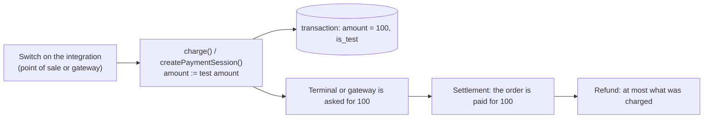

# Payment test mode

> **Status:** built and tested; unmerged on the `feat/pos-terminals` line of work.
> **Audience:** engineers and venue or account administrators.
> **Related:** [PHYSICAL-POS-INTEGRATIONS.md](./PHYSICAL-POS-INTEGRATIONS.md) · [SERVICE-FEES.md](./SERVICE-FEES.md)

## 1. What it is for

Rehearsing a payment on a machine whose terminal or gateway credentials are **real ones** moves real
money. Payment test mode makes an integration charge **one small fixed amount** (default **100 CLP**)
instead of the order's value.

The rule that keeps it simple:

> **The amount is replaced at the source, and nothing else is special.**
> The transaction, the payment, the terminal or gateway call, the settlement and any refund all see
> the same 100. The system books what was charged, exactly as it would for any other payment.

There is one marker: `is_test` on the transaction, plus a `[PRUEBA]` label on the terminal order and a
**Test** chip in the payments list. It exists so screens and filters can tell a test from a real
payment. It changes no behaviour.

It works for every product that charges through the core: KitchnTabs (counter, self-service,
VaneXa kiosk) and MBTickets (box office, kiosk), on card terminals and on online gateways.

## 2. Where the switch lives, and who manages it

The switch belongs to the **integration that moves the money**, and is managed by whoever manages that
integration. It is a manual toggle with no expiry.

| Integration | Where | Who can switch it |
|---|---|---|
| **Card terminal** (a point of sale's integration) | `point_of_sales.payment_settings.test_mode`, optional `test_amount` | Anyone who can configure that point of sale: its venue's tenant admin, the account's TenancyAdmin, a SystemAdmin (`PosPaymentAccess::canConfigure`). |
| **Online gateway** (Transbank, Mercado Pago checkout, the demo gateway) | `checkout_gateways.test_mode`, optional `test_amount` | `CheckoutGatewayPolicy::manage`: the owning TenancyAdmin, a tenant admin the gateway is assigned to, a SystemAdmin. |

A checkout gateway belongs to the **TenancyAccount** and is shared with its stores, so its switch is at
the account level. A point of sale belongs to a venue, so its switch is at the venue level.

Switching it only changes what the owner's **own** acquirer account is charged, so the platform loses
nothing. Each change is logged (who, which integration, on or off). The forms show a warning while it
is on. It is **not** in the VaneXa integration form: the charge is made in the core.

## 3. What happens

| | In test mode |
|---|---|
| **Terminal** | `PosPaymentService::charge()` swaps the amount before the transaction is created. The Mercado Pago connector needs no special case. |
| **Online gateway** | `withTestAmount()` runs first in each provider's `createPaymentSession()` (Transbank, Mercado Pago, the demo gateway). The transaction, the provider call and the provider's own confirmation (Transbank checks the confirmed amount against ours) agree. |
| **KitchnTabs order** | Its total becomes the amount charged: the terminal settlement and the QR completion both set it. |
| **MBTickets booking** | Keeps its price; the payment is the 100. Tickets are issued as in any sale. |
| **Tip (service fee)** | Forced to **0**. The charged amount replaces total plus tip, so there is no tip to add, and no tip figure is recorded on the payment. |
| **Refunds** | A domain asking back the order's price (a cancellation) gets **at most what was charged**: the request is capped to the refundable amount, so a 15.000 cancellation of a 100 charge refunds 100. |
| **Cash counts and reports** | Nothing special. A test sale is a sale of the amount that moved. Reports can filter on `is_test`. |

## 4. API

| | |
|---|---|
| `PUT pos-payments/point-of-sales/{id}/payment` | `settings.test_mode` (boolean) and `settings.test_amount` (number ≥ 1), with the rest of the integration. |
| `GET pos-payments/point-of-sales/{id}/payment` | `settings.test_mode`, `settings.test_amount` (the effective one). |
| `PUT/POST checkout/checkout_gateway` | `test_mode` and `test_amount`, validated in `CheckoutGatewayRequest`. Returned by `CheckoutGatewayResource`. |
| Payments list | `is_test` on every transaction. |

Configuration: `config/payment_test_mode.php`, `amount` from `PAYMENT_TEST_AMOUNT` (default `100`),
used when an integration has no `test_amount` of its own.

## 5. Code map

`dash-backend/`:

| File | Role |
|---|---|
| `config/payment_test_mode.php`, `app/Support/PaymentTestMode.php` | Default amount, validation, the log line. |
| `app/PosPaymentCore/Models/PointOfSale.php` | `inTestMode()`, `testAmount()`. |
| `app/PosPaymentCore/Services/PosPaymentService.php` | Swaps the amount in `charge()`, caps the refund, flags the transaction. |
| `app/PosPaymentCore/Http/Controllers/PosPaymentController.php` | The setting, and the log when it changes. |
| `app/CheckoutCore/Models/CheckoutGateway.php` | `inTestMode()`, `testAmount()`. |
| `app/CheckoutCore/Gateways/AbstractCheckoutGatewayProvider.php` | `withTestAmount()`, the `is_test` marker, the refund cap. |
| `app/CheckoutCore/Http/Controllers/CheckoutGatewayController.php` | The log when it changes. |
| Migrations `2026_10_24_000010_…` (PosPaymentCore and CheckoutCore) | `pos_payment_transactions.is_test`; `checkout_gateways.test_mode`, `test_amount`; `checkout_gateway_transactions.is_test`. |

`kitchntabs-backend-domain/`: `TabPosPaymentService` (no tip in test mode), `CompleteSelfServiceCheckoutSale`
(the order is paid for the amount charged).

Frontends: `dash-pos-payments` (`PosPaymentSettings` switch, `PosPaymentsList` Test chip) and
`kt-ecommerce` (`checkoutGateway` schema fields).

## 6. Tests

- Core: a test-mode point of sale charges and books the test amount (default, its own, and a retry is the
  same payment); without the switch the real amount; a cancellation asking more than was charged is capped;
  a venue admin switches it with the rest of the integration; a gateway in test mode charges and books the
  test amount, and its refund is capped.
- KitchnTabs: a test charge is booked for the amount charged with no tip; a real charge keeps its tip and
  is not flagged; a test sale is counted as charged in the cash count; refunding a test charge returns what
  was charged; a QR payment on a gateway in test mode books the test amount with no tip.
- MBTickets: a window in test mode sells for the test amount, issues the tickets, and a cancellation
  refunds what was charged.

## 7. Known limits

- **Test data is in the books.** There is no automatic exclusion from cash counts and reports; a test sale
  counts as a sale of the amount that moved. The `is_test` marker lets a report filter be added.
- **A KitchnTabs order's total shows the test amount** after it is paid, even though its items add up to
  more.
- **Partial refunds** of a test charge cannot exceed what was charged.
- The test amount is in the payment's currency: 100 means 100 CLP for a CLP payment.

## 8. Switching it on and off

- **A card terminal:** the point of sale's payment integration form, *Modo de prueba*.
- **An online gateway:** the checkout gateway's edit form, *Modo de prueba*.
