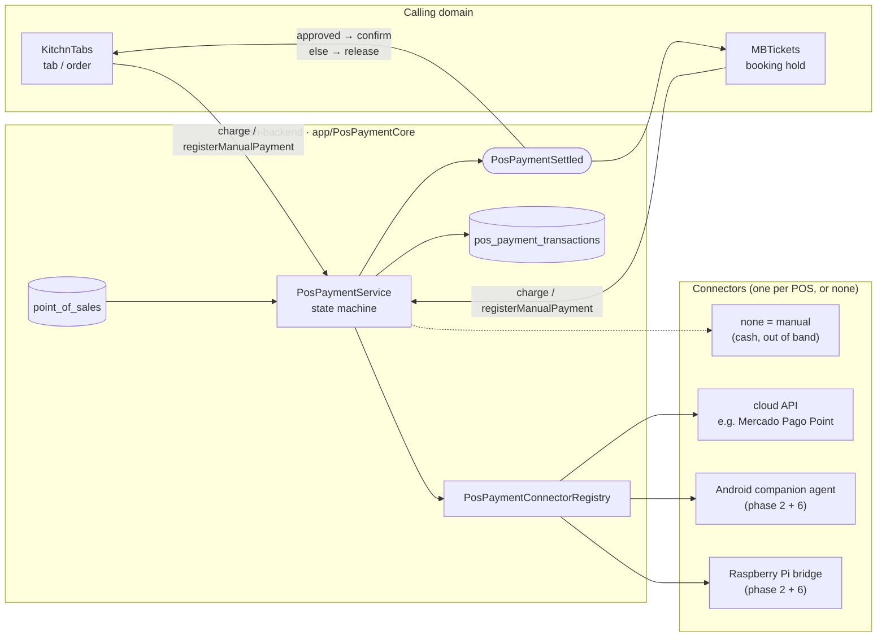
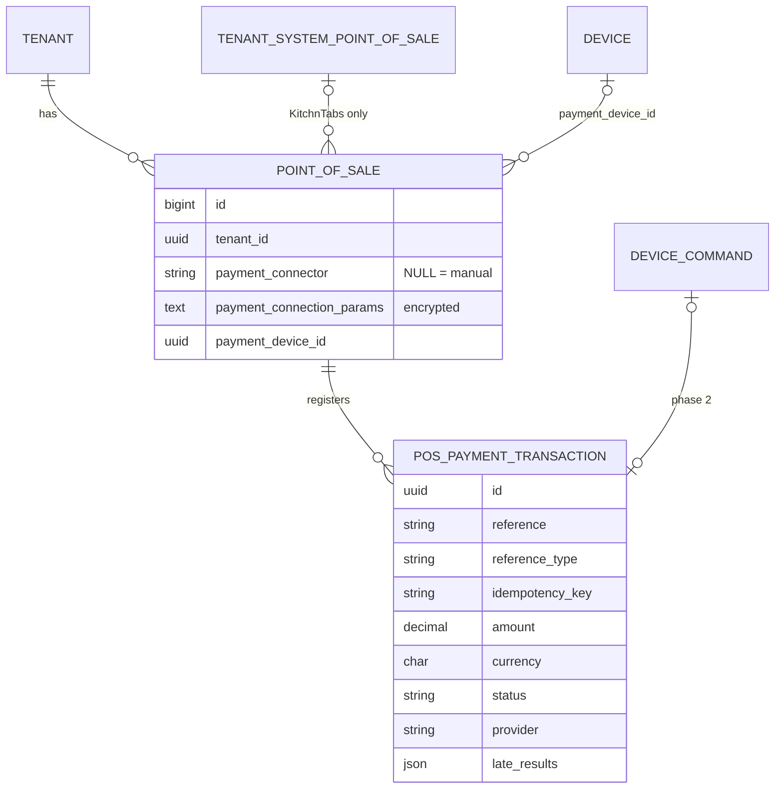
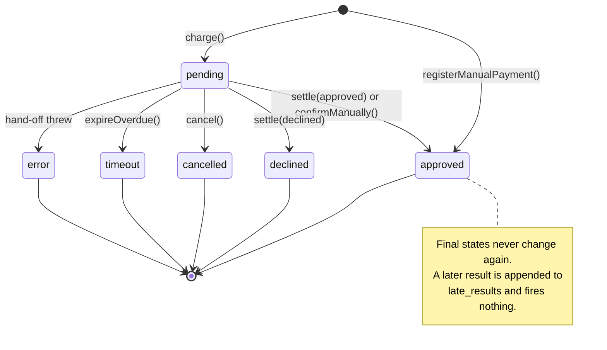
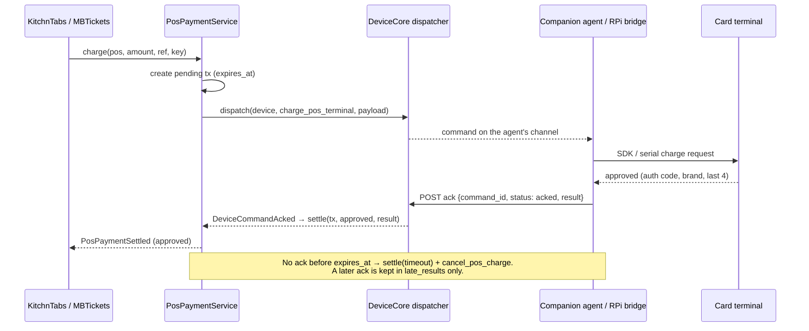
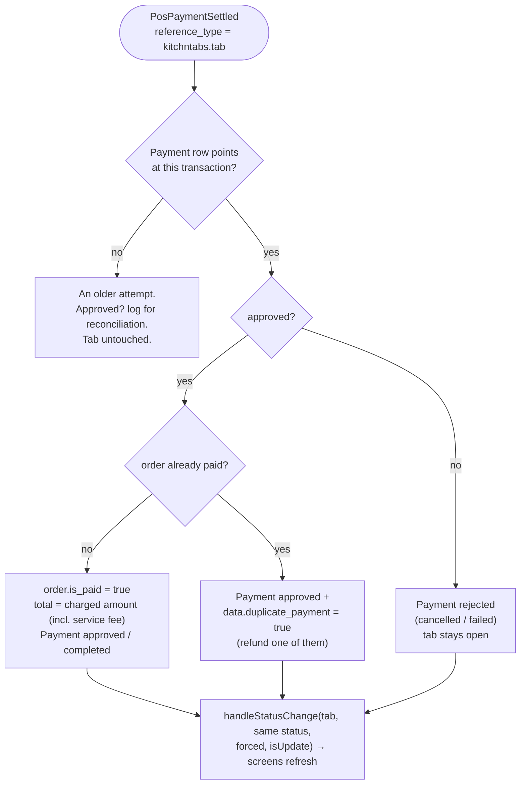
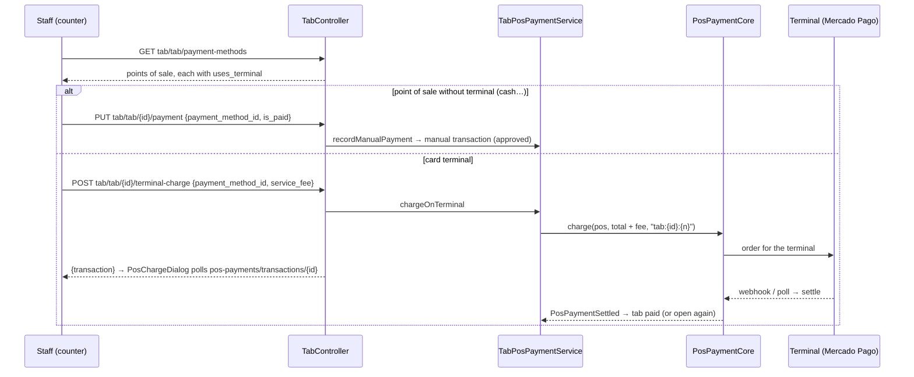
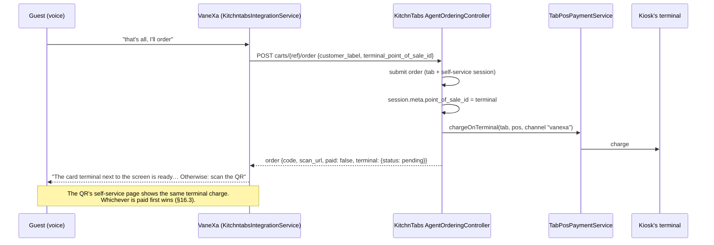

# Physical POS Integrations — card-present payments at a point of sale (`PosPaymentCore`)

> **Status:** 🟡 **Phases 1, 3 and 5 built; phase 4 partly built.**
> - Phase 1: the core foundation.
> - Phase 3: the Mercado Pago Point connector, with its webhook and operator commands.
> - Phase 4, partly: the staff API, the shared settings and charge UI, and partial refunds.
> - Phase 5: KitchnTabs counter, self-service and VaneXa kiosk payments.
>
> Phases 2 and 6, and the rest of phase 4 (the payments list), are designed here but not built.
> Every terminal path is tested against a faked Mercado Pago only. The first terminal test is the
> runbook in §14.4. It is pending because no terminal is available yet.
>
> | Repo | Branch | Commits | State |
> |---|---|---|---|
> | `dash-backend` | `development` | `99b3671` merges phases 1 and 3 (`feat/pos-payment-core`) | merged locally, **not pushed** |
> | `dash-backend` | `feat/pos-terminals` | `b4f8b2d` opt-in, `a72da11` staff API, `8815019` partial refunds | committed, **not pushed, not merged** |
> | `dash-frontend-core` | `feat/pos-payments` | `12369c6`, `11e8482` (package `dash-pos-payments`) | committed, **not published to npm** |
> | `kitchntabs-backend-domain` | `feat/pos-terminals` | `c4c109f`, `ccff8ab`, `8deb8b1`, `afd2893`, `231d59b` | committed, **not pushed, not merged** |
> | `kitchntabs-frontend` | `feat/pos-terminals` | `9ab27c8`, `560baef`, `e7d0ccd`, `e5cd88e`, `cad8b72` | committed, **not pushed, not merged** |
> | `vanexa-backend-domain` | `feat/pos-terminals` | `5ade22d` (kiosk terminal), `d0d41a8` (seeder fix, §21.13) | committed, **not pushed, not merged** |
>
> **Layer:** `dash-backend` **core** (`app/PosPaymentCore`). Two domains use it:
> `kitchntabs-backend-domain` (§16) and `mbtickets-backend-domain` (box office, documented in
> MBTickets' own docs). Each domain turns it on (§12). Domains that do not get no POS tables.
> **Related:** [SYSTEM-DEVICES-FEATUE.md](./SYSTEM-DEVICES-FEATUE.md) (DeviceCore, which phase 2
> dispatches through) · [VX-INTEGRATIONS.md](./VX-INTEGRATIONS.md) (the integration-catalog
> pattern this mirrors) · [CASHCOUNTS.md](./CASHCOUNTS.md) (cash counts already break down by
> point of sale) · [SERVICE-ACCOUNTS-API-KEYS.md](./SERVICE-ACCOUNTS-API-KEYS.md) (how device
> agents authenticate).
> **Specification:** MBTickets requirements series, document 09 *"Point-of-Sale Payment Terminal
> Integration (Core Capability)"*, its companion 08 *"Vanexa AI Kiosk Integration"*, and the
> acquirer pre-study in document 03 *"Requerimientos Técnicos"* §7 (Transbank and Mercado Pago
> hardware and APIs, October 2026). None are stored in this workspace. §4 below lists where the
> implementation deliberately departs from spec 09; §2.1 summarises what the pre-study says the
> hardware allows.
> **Last updated:** 2026-10-20. Changes in this update:
> - The module is now opt-in per domain (§12).
> - Staff API and shared UI (§15).
> - Partial refunds and a refund mode per point of sale (§15.3).
> - KitchnTabs wiring: counter, self-service and the VaneXa kiosk (§16).
> - Design of the Mercado Pago account options: a pasted token or platform OAuth (§14.6).
> - Design of the shared Python device service (§17.5).

---

## Table of contents

1. [The problem](#1-the-problem)
2. [What this feature builds](#2-what-this-feature-builds)
3. [Design decisions](#3-design-decisions)
4. [Where the implementation departs from spec 09](#4-where-the-implementation-departs-from-spec-09)
5. [Data model](#5-data-model)
6. [The transaction state machine](#6-the-transaction-state-machine)
7. [Code map](#7-code-map)
8. [`PosPaymentService` API](#8-pospaymentservice-api)
9. [Connectors: contract, capabilities, registry](#9-connectors-contract-capabilities-registry)
10. [Events: how a domain consumes a payment](#10-events-how-a-domain-consumes-a-payment)
11. [Card data hygiene](#11-card-data-hygiene)
12. [Configuration and scheduling](#12-configuration-and-scheduling)
13. [Phase 2 — device dispatch through DeviceCore (designed)](#13-phase-2--device-dispatch-through-devicecore-designed)
14. [Phase 3 — Mercado Pago Point connector (built, not yet run on a terminal)](#14-phase-3--mercado-pago-point-connector-built-not-yet-run-on-a-terminal)
15. [Phase 4 — staff API, shared UI and refunds (partly built)](#15-phase-4--staff-api-shared-ui-and-refunds-partly-built)
16. [Phase 5 — KitchnTabs wiring (built)](#16-phase-5--kitchntabs-wiring-built)
17. [Phase 6 — companion agent, Raspberry bridge, Transbank (designed)](#17-phase-6--companion-agent-raspberry-bridge-transbank-designed)
18. [Verification](#18-verification)
19. [Operations notes](#19-operations-notes)
20. [Open questions](#20-open-questions)
21. [Implementation notes](#21-implementation-notes)

---

## 1. The problem

No system on this stack has ever charged a card that is physically present.

| What exists | Why it is not this |
|---|---|
| KitchnTabs checkout gateways (`AbstractCheckoutGatewayProvider`, Transbank Webpay Plus, Mercado Pago) in `kitchntabs-backend-domain/app/Services/ECommerce/Checkout/` | **Card-not-present.** The customer's browser is redirected to a hosted payment page and back. No serial, USB, Bluetooth or local-network code exists anywhere. |
| KitchnTabs `PointOfSale` (`kitchntabs-backend-domain/app/Models/ECommerce/PointOfSale.php`) with `PointOfSaleConnectionClient` (`.../Services/ECommerce/Contracts/`) | The right **concept** (a checkout station of a tenant), wired to the wrong **concern**: its only connector (`ManualOAuthClient`) and its contract (OAuth URL, token refresh, `publishSettings`) serve retail stock and pricelist sync with an external POS *system*, not payment capture. |
| `payments.source_id` on KitchnTabs orders | Records *which* point of sale a payment belongs to (`Payment::pointOfSale()`), but the payment itself is typed in by staff. |

Both KitchnTabs (paying a tab at the counter or kiosk) and the upcoming MBTickets (box office,
self-service kiosk, the Vanexa conversational kiosk) need to:

1. tell a physical card terminal to charge an amount,
2. learn whether it was approved, exactly once,
3. never charge twice, and never confirm a sale whose charge already timed out,
4. keep cash and out-of-band payments as a first-class option, not a degraded fallback.

## 2. What this feature builds

A core module, **`PosPaymentCore`**, beside `DeviceCore`, `IntegrationCore` and `ReportCore`.
Every point of sale registers the payments made against it; a **connector** only decides whether
that happens automatically (a card terminal) or manually (staff confirm cash).



### Phases

| # | Phase | Needs hardware | Status |
|---|---|---|---|
| 1 | **Core foundation:** module, adopted `point_of_sales`, payment columns, `pos_payment_transactions`, contract, registry, service (manual, charge, settle once, cancel, timeout), event, tests; KitchnTabs model extends core | no | ✅ built, 15 tests |
| 2 | **Device dispatch:** DeviceCore ack carries a result and fires an event; `pos_terminal_agent` / `pos_bridge` device kinds; `charge_pos_terminal` / `cancel_pos_charge` as DeviceCommands; fake device for tests | no | designed (§13) |
| 3 | **Mercado Pago Point connector** (Orders API, no device on our side): charge, webhook, polling backstop, cancel, refund, operator commands | a Point Smart 2 for the last step; the rest runs on the virtual terminal | ✅ built, 18 tests; terminal test pending (§14.4) |
| 4 | **Staff API, shared UI and refunds** (FR-23): endpoints, permissions, `dash-pos-payments` package (settings + charge dialog), partial refunds, refund mode | no | 🟡 API, UI and refunds built; the payments list is pending (§15) |
| 5 | **KitchnTabs wiring:** every counter, self-service and VaneXa payment is a `PosPaymentTransaction`; a tab is paid when the event says approved | no | ✅ built, 6 tests (§16) |
| 6 | **Transbank through a Raspberry Pi bridge**; shared Python device service; Mercado Pago Android companion only if a venue needs a paired reader | yes | designed (§17) |

Phase 2 and the rest of phase 4 can still be built and tested before any terminal arrives.

### 2.1 What the hardware allows (acquirer pre-study)

> For Mercado Pago, §14.1 supersedes this section. It is verified against Mercado Pago's current
> documentation, and the API the pre-study describes is the older one.

Summary of document 03 §7, which read Transbank's and Mercado Pago's public developer
documentation in October 2026. These are the pre-study's findings, **not re-verified here**;
confirm against the vendors' current documentation and a sandbox or test terminal before
building each connector.

| Acquirer · product | How a charge reaches the terminal | `transport` | Needs one of our devices | Plan |
|---|---|---|---|---|
| Mercado Pago · Point Smart (1, 2), Point Plus, Point Air | Our backend creates a *payment intent* for a specific terminal through Mercado Pago's cloud API; the terminal has its own internet | `cloud_api` | **no** | **Phase 3, first connector** (§14) |
| Mercado Pago · a Bluetooth reader paired to the kiosk tablet (Point Mini or similar) | App-to-app: our companion app opens the official *Mercado Pago Point* app with an Intent; that app talks to the reader | `android_agent` | yes, `pos_terminal_agent` | Phase 6, only if a venue needs it (§17) |
| Mercado Pago · *Smart Apps* on a Point Smart | Our own Android app runs on the terminal itself | — | — | Future, out of v1 (§17) |
| Transbank · POS Integrado (Verifone VX520/VX520C, Ingenico Desk 3500) | The cash register sends the amount over **serial (RS-232) or USB**; no network or Bluetooth integration, **no Android SDK** | `raspberry_bridge` | yes, `pos_bridge` | Phase 6, priority 2 (§17) |

What this changes in the design:

1. The simplest real connector in the whole catalog needs no device at all, so phase 3 can ship
   before phase 6 and before any companion app exists.
2. Transbank's "Android-paired" path from spec 09 does not exist in practice. Driving its serial
   protocol over USB-OTG from an Android app is possible but needs the same physical cabling as a
   Raspberry Pi, so the bridge is the v1 path.
3. A Mercado Pago companion app would be an **invoker** of the official Mercado Pago Point app,
   not a Bluetooth client, and that official app must be installed and current on every kiosk
   that uses it.
4. Mercado Pago's "check it on the terminal" result needs handling the state machine did not
   have. In the Orders API this is `action_required`. It was solved without a new status (§14.2).

## 3. Design decisions

Each decision below was either made in spec 09's review or taken while building phase 1, and has
a reason that should survive the next person who wants to undo it.

| # | Decision | Why |
|---|---|---|
| D1 | **The core adopts `point_of_sales` in place; it does not move it.** | On KitchnTabs the table has existed since 2023, uses a `bigint` key, and about 15 retail-sync tables point at it (§21.1). Moving it would mean re-keying production data. The core already adopts `system_point_of_sales` / `tenant_system_point_of_sales` the same way. *(Chosen by the product owner, 2026-10-17.)* |
| D2 | **Terminal commands travel as DeviceCore `DeviceCommand`s, not through the Vanexa Lab actions contract.** | The Lab actions contract (`config/lab_actions.php`) lives in `vanexa-backend-domain` and is scoped to Lab sessions; core cannot depend on a domain. DeviceCore already has commands, a dispatcher contract, an ack endpoint and a device-type registry (§13). *(Chosen by the product owner, 2026-10-17.)* |
| D3 | **No connector means manual.** `payment_connector IS NULL` is a supported configuration. | Many box-office windows will never need more than cash. Spec 09 §2. |
| D4 | **Separate `payment_*` columns** instead of reusing `connection_params`. | On KitchnTabs `connection_params` already holds the retail-sync connector's settings, and one point of sale can need both a retail sync and a card terminal. |
| D5 | **The database stores a connector key, never a class name.** | Only classes registered in `PosPaymentConnectorRegistry` can ever be instantiated; a row cannot point at an arbitrary class, and renaming a class does not corrupt data. Never rename a shipped key. |
| D6 | **Connectors are transport only; `PosPaymentService` owns every status change.** | Idempotency and settle-once live in one place instead of being re-implemented per acquirer. Spec 09 had `charge(array): Transaction`; here `charge(Transaction): void` (§4). |
| D7 | **Settle once, under a row lock; late results never change the status.** | A device ack can arrive after the timeout released the seat; a webhook can arrive after staff confirmed by hand. The first final status wins and later ones go to `late_results` for reconciliation (§6). |
| D8 | **Connector credentials are encrypted at rest** (`encrypted:array`). | Same rule as `IntegrationCore` (`app/IntegrationCore/Models/Integration.php`): a Mercado Pago access token is a secret. |
| D9 | **Card data never reaches the database.** Only auth code, brand and last four digits. | §11. |
| D10 | **One connector per point of sale in v1.** | Spec 09 FR-20.5. Fallback chains are out of scope. |
| D11 | **Acquirer order: Mercado Pago first, Transbank second.** Concretely: Mercado Pago **Point Smart over the cloud API** (no device on our side) is the first connector; Transbank goes through a **Raspberry Pi bridge**, because it has no Android SDK. | Spec 09 §1.1, sharpened by the pre-study (§2.1). One acquirer may still need several connectors (one per terminal product line and transport). |
| D12 | **`refund()` is optional on the contract.** | The refund *feature* (authorization, audit, trigger) lives in the payments admin (phase 4); a connector that cannot refund answers "not implemented" and the UI says so plainly. Spec 09 §11. |
| D13 | **Both a local relay and a direct backend socket must be supported for device-routed connectors**, per connector instance. | Spec 09 §5.1. A relay helps when *our* backend is briefly unreachable; it cannot make a card charge work without the terminal's own path to the acquirer. |

## 4. Where the implementation departs from spec 09

| Spec 09 says | Implemented / designed as | Reason |
|---|---|---|
| Promote the `PointOfSale` model to core with a UUID key, "stripped of anything KitchnTabs-specific" | Core **adopts** the table (created only where absent), keeps the `bigint` key, KitchnTabs' model **extends** the core one | D1, §21.1 |
| `connection_client` (class name) + `connection_params` on `PointOfSale` | `payment_connector` (registry key) + `payment_connection_params` (encrypted) + `payment_device_id` | D4, D5, D8 |
| `device_id` column | `payment_device_id` | Leaves room for other device links on a point of sale later. |
| Dispatch through the Kiosk Actions Contract (`config/lab_actions.php` or its core-promoted equivalent) | DeviceCore `DeviceCommand` types `charge_pos_terminal` / `cancel_pos_charge` | D2 |
| `charge(array $chargeData): PosPaymentTransaction` on the connector | Service creates the pending transaction, then calls `charge(PosPaymentTransaction): void` | D6 |
| `settle()` and `cancel(string $transactionId)` on the connector | `settle()` lives on `PosPaymentService` only; the connector has `cancel(PosPaymentTransaction): bool` (best effort) | D6, D7 |
| Mirror `completeTransaction()`'s idempotency | Stricter: `completeTransaction()` skips side effects on a replay but **still overwrites the status**; `settle()` never changes a final status | §21.4 |

## 5. Data model

### 5.1 `point_of_sales` — adopted, plus payment columns

Two migrations (`app/PosPaymentCore/database/migrations/`):

- `2026_10_17_000010_adopt_point_of_sales_table` creates the table **only if it does not exist**.
  On KitchnTabs it does nothing (the domain's own migrations are dated 2023 and run first). On a
  domain without POS tables (MBTickets, VaneXa, INAMAP) it creates the same shape KitchnTabs has.
  `down()` is intentionally empty: on KitchnTabs it created nothing, and dropping the table would
  destroy a domain-owned table.
- `2026_10_17_000020_add_payment_columns_to_point_of_sales` adds the payment columns everywhere,
  each guarded by `hasColumn`.

| Column | Type | Core shape | KitchnTabs | Notes |
|---|---|---|---|---|
| `id` | bigint | ✓ | ✓ | Deliberately not UUID (D1). |
| `tenancy_id`, `tenant_id` | uuid, nullable | ✓ | ✓ | |
| `tenant_system_point_of_sale_id` | bigint | **nullable** | **NOT NULL** | KitchnTabs' retail-sync catalog entry; a box office or kiosk needs none (§21.2). |
| `name`, `active`, `notified`, `is_default` | — | ✓ | ✓ | KitchnTabs keeps "one default per tenant" in its own `saving` hook. |
| `connection_params` | json | ✓ | ✓ | **Retail-sync** settings. Not used by payments (D4). |
| `deleted_at`, timestamps | — | ✓ | ✓ | |
| **`payment_connector`** | varchar(100), nullable | added | added | Registry key. `NULL` = manual. |
| **`payment_connection_params`** | text, nullable | added | added | `encrypted:array`; text because ciphertext is not valid JSON. Hidden from `toArray()`. |
| **`payment_device_id`** | uuid → `devices.id`, nullable, `ON DELETE SET NULL` | added | added | Only for connectors that declare `requires_device`. |
| **`payment_settings`** | json, nullable | added | added | Non-secret settings. Today only `refund_mode` (§15.3). Migration `2026_10_20_000010_add_payment_settings_to_point_of_sales`. |

### 5.2 `pos_payment_transactions` — one payment

Migration `2026_10_17_000030_create_pos_payment_transactions_table`.

| Column | Type | Notes |
|---|---|---|
| `id` | uuid | |
| `point_of_sale_id` | bigint → `point_of_sales.id` | |
| `tenancy_id`, `tenant_id` | uuid | Copied from the point of sale (standing convention). |
| `reference` | varchar | The caller's own id (a tab, a booking hold). The core never interprets it. |
| `reference_type` | varchar(100), nullable | Namespaces `reference` so a listener only reacts to its own payments, e.g. `kitchntabs.tab`, `mbtickets.booking`. |
| `idempotency_key` | varchar | **Unique per point of sale.** |
| `amount` | decimal(15,2) | Zero is allowed (a free ticket registered manually). |
| `currency` | char(3) | ISO 4217, upper-cased by the service. |
| `status` | varchar(20) | §6. |
| `provider` | varchar(100) | Connector key, or `manual`. |
| `auth_code`, `card_brand`, `acquirer_transaction_id` | varchar, nullable | Filled on settlement. |
| `masked_pan` | varchar(32), nullable | Always `•••• 1234` (§11). |
| `raw_response` | json, nullable | The transport's settlement payload, card data stripped. |
| `late_results` | json, nullable | Results that arrived after settlement (§6.3). |
| `device_command_id` | uuid, nullable | Phase 2: the DeviceCommand that carried the charge. |
| `expires_at` | timestamp, nullable | Deadline for a pending charge. |
| `settled_at` | timestamp, nullable | |
| `settled_by_user_id`, `created_by_user_id` | uuid, nullable | Who registered or confirmed it by hand. |

Indexes: `unique(point_of_sale_id, idempotency_key)`, `(reference_type, reference)`,
`(status, expires_at)` for the expiry sweep, `status`, `tenancy_id`, `tenant_id`.



## 6. The transaction state machine



`PosPaymentTransaction::TERMINAL_STATUSES` = `approved`, `declined`, `timeout`, `cancelled`,
`error`. `pending` is the only non-final status, and `settle()` refuses it.

### 6.1 Idempotency

`(point_of_sale_id, idempotency_key)` identifies one payment. Calling `charge()` or
`registerManualPayment()` again with the same key returns **the same transaction** and never
calls the connector again. Reusing a key for a different amount, currency or reference throws
`PosPaymentException`: that is a caller bug, not a replay.

Two concurrent requests with the same key: the insert runs inside a nested `DB::transaction()`
(a savepoint), the loser hits the unique index, catches `UniqueConstraintViolationException` and
returns the winner's row (§21.5).

### 6.2 Settle once

`settle()` (and every internal settlement) runs in a database transaction that takes
`lockForUpdate()` on the row. If the row is already final, the new result is **not applied**.
Otherwise status, receipt fields, `raw_response` and `settled_at` are written and
`PosPaymentSettled` is queued with `DB::afterCommit()`, so it fires once and only after commit.

### 6.3 Late results

A result for a final transaction is appended to `late_results`:

```json
[{"status": "approved", "result": {"auth_code": "A1B2"}, "received_at": "2026-10-17T14:02:11-03:00"}]
```

and logged at warning level. This is the spec's HU-25 case: the terminal approves after the
system already timed out and released the seat. The money is recorded for the venue's
reconciliation, and nothing is re-confirmed. Staff reconcile or refund it from the payments admin
(phase 4).

The expiry sweep settles with recording **off**: if an ack beat the sweep to the lock, a
"timeout" entry in `late_results` would only be noise.

## 7. Code map

All paths relative to `dash-backend/`.

| File | Role |
|---|---|
| `app/PosPaymentCore/PosPaymentCoreServiceProvider.php` | Merges config, binds the registry and service as singletons, registers the core connectors (Mercado Pago), loads migrations and the webhook route, registers the commands, schedules the expiry. |
| `app/Providers/AppServiceProvider.php` | Registers the provider right after `IntegrationCoreServiceProvider`, so the registry exists (empty) before `AppDomainServiceProvider::boot()` registers a domain's connectors. |
| `app/PosPaymentCore/Contracts/PosPaymentConnectionClient.php` | The connector contract (§9). |
| `app/PosPaymentCore/Support/AbstractPosPaymentConnector.php` | Base class: holds the point of sale, `params()`/`param()`, default `cancel()` (false) and `refund()` ("not implemented"). |
| `app/PosPaymentCore/Services/PosPaymentConnectorRegistry.php` | `register`, `has`, `classFor`, `all`, `catalog` (for the picker), `make(PointOfSale)`. |
| `app/PosPaymentCore/Services/PosPaymentService.php` | The state machine (§8). |
| `app/PosPaymentCore/Models/PointOfSale.php` | Core model on `point_of_sales`: fillable, casts, `paymentDevice()`, `paymentTransactions()`, `usesManualPayments()`. |
| `app/PosPaymentCore/Models/PosPaymentTransaction.php` | Statuses, `isTerminal()`, `isApproved()`, `pending()` and `overdue()` scopes. |
| `app/PosPaymentCore/Events/PosPaymentSettled.php` | Fired once per transaction (§10). |
| `app/PosPaymentCore/Exceptions/PosPaymentException.php` | Refusals a caller should show (manual POS asked to charge, unsupported currency, missing device, key reuse). |
| `app/PosPaymentCore/Console/ExpireOverduePosPayments.php` | `pos-payments:expire-overdue`. |
| `app/PosPaymentCore/Contracts/PollsForResult.php` | Optional connector contract: `poll()` returns `{final, status, result, provider_status, attention}`. |
| `app/PosPaymentCore/Connectors/MercadoPago/MercadoPagoApi.php` | Thin HTTP client: orders (create with retry on 5xx, read, cancel, refund, simulate), terminals (list, set operating mode). |
| `app/PosPaymentCore/Connectors/MercadoPago/MercadoPagoPointConnector.php` | The `mercadopago_point` connector (§14.2). Registered by the core provider. |
| `app/PosPaymentCore/Http/Controllers/MercadoPagoWebhookController.php` + `routes/pos_payments.php` | The public order webhook, loaded by the provider under `api` (`api.pos-payments.webhooks.mercadopago`). |
| `app/PosPaymentCore/Console/*` | The operator commands of §14.3; `Concerns/InspectsPosPayments.php` holds the shared lookups and output. |
| `app/PosPaymentCore/config/pos_payment_core.php` | §12. |
| `app/PosPaymentCore/database/migrations/` | §5. |
| `app/PosPaymentCore/Http/Controllers/PosPaymentController.php` | The staff API (§15.1). |
| `app/PosPaymentCore/Http/Resources/PosPaymentTransactionResource.php` | A transaction as the UI sees it, with the derived flags `final`, `approved`, `needs_attention` and `error`. |
| `app/PosPaymentCore/Support/PosPaymentAccess.php` | Row scoping for the staff API: `canSee`, `canConfigure`, `canSeeTransaction`, `tenantIdOf`. |
| `app/PosPaymentCore/database/migrations/permissions/2026_10_20_000020_add_pos_payment_permissions.php` | The `api.pos-payments.*` permissions (§15.2). |
| `database/data/rolePermissions/{tenant,tenancy}AdminPermissions.json` | The same route names, so a role sync keeps them. |
| `lang/{es,en}/pos_payments.php` | API messages. |
| `tests/Feature/PosPaymentCore/PosPaymentServiceTest.php` | 15 tests (§18). |
| `tests/Feature/PosPaymentCore/MercadoPagoPointConnectorTest.php` | 19 tests against a faked Mercado Pago (§18). |
| `tests/Feature/PosPaymentCore/PosPaymentApiTest.php` | 3 tests for the staff API (§18). |
| `tests/Feature/PosPaymentCore/Fakes/FakeCloudConnector.php`, `FakeDeviceConnector.php` | Stand-ins for a cloud terminal and a device-routed one. |

In `dash-frontend-core/packages/dash-pos-payments/` (§15.4):

| File | Role |
|---|---|
| `src/core/types.ts`, `src/core/api.ts` | Types, and `createPosPaymentsApi(http, { transactionsPath })` over `/api/pos-payments/*`. |
| `src/core/context.tsx` | `PosPaymentsProvider` (the host passes `http`, `translate`, `notify` and optionally `transactionsPath`), `usePosPayments`. |
| `src/PosPaymentSettings.tsx` | A point of sale's integration form: connector picker, the connector's fields, terminal picker, refund mode. |
| `src/PosChargeDialog.tsx` | Follows one charge until it settles: waiting, approved, declined, check the terminal; cancel and (staff only, `allowConfirm`) confirm. |
| `src/i18n/{es,en}.ts` | The package's own texts; the host's translations win when it has them. |

KitchnTabs files are listed in §16.5.

## 8. `PosPaymentService` API

Resolve it from the container (`app(PosPaymentService::class)`); it is a singleton.

```php
registerManualPayment(PointOfSale $pos, $amount, string $currency, string $reference,
    string $idempotencyKey, ?string $referenceType = null, ?string $userId = null): PosPaymentTransaction
```
Cash or any out-of-band method. Settles `approved` immediately, fires `PosPaymentSettled`. Works on
any point of sale, connector or not (a window with a terminal can still take cash).

```php
charge(PointOfSale $pos, $amount, string $currency, string $reference, string $idempotencyKey,
    ?string $referenceType = null, ?string $userId = null, ?int $timeoutSeconds = null): PosPaymentTransaction
```
Refuses a manual point of sale, a currency outside the connector's `supported_currencies`, and a
device connector with no `payment_device_id`, before anything is created. Creates the `pending`
row with `expires_at = now + timeout` (default `charge_timeout_seconds`), then calls the
connector's `charge()`. If the hand-off throws, the transaction settles `error`. Returns the
transaction; a pending one is normal, and the caller waits for the event.

```php
settle(string $transactionId, string $status, array $result = [], ?string $userId = null): PosPaymentTransaction
```
The only place a status changes. Called by a connector's webhook or poll (phase 3), by the device
ack listener (phase 2), and by the methods below. `$result` keys read: `auth_code`, `card_brand`,
`masked_pan`, `acquirer_transaction_id`; everything else is kept in `raw_response`, sanitized.

```php
confirmManually(PosPaymentTransaction $tx, string $userId, ?string $note = null): PosPaymentTransaction
```
Staff mark a pending charge as paid (the terminal printed "approved" but its ack was lost).

```php
cancel(PosPaymentTransaction $tx, ?string $userId = null): PosPaymentTransaction
```
No-op on a final transaction. Otherwise asks the connector to stop (best effort, errors logged)
and settles `cancelled`.

```php
expireOverdue(): int
```
Pending charges past `expires_at`: asks the terminal to stop, settles `timeout`, returns the count.
Run every minute by the scheduler.

```php
refund(PosPaymentTransaction $tx, ?string $userId = null, $amount = null, ?string $idempotencyKey = null): array
```
Refunds an approved charge through its connector, in full (`$amount` null) or in part. Returns
the connector's outcome `{success, error?, status?, refund_id?}`.
- It refuses a manual payment (refunded by hand), a point of sale that changed connector, and an
  amount that is zero or more than what is left of the charge.
- A successful refund is appended to `raw_response.refunds[]` with its amount, the refund id and
  the user. `raw_response.refunded` becomes true once everything has been returned.
- The status stays `approved`, because the charge itself happened.
- The connector's idempotency key defaults to `<transaction id>-refund`. A caller that refunds in
  several parts passes its own key per part, for example its refund record's id (§15.3).

```php
refresh(PosPaymentTransaction $tx): PosPaymentTransaction
```
Asks a `PollsForResult` connector for the result now and applies it. The UI's "check again"
button calls this.

## 9. Connectors: contract, capabilities, registry

### 9.1 The contract

```php
interface PosPaymentConnectionClient
{
    public static function key(): string;                    // stored in point_of_sales.payment_connector
    public static function label(): string;                  // picker label (i18n key or text)
    public static function getCapabilities(): array;         // §9.2
    public static function getConnectionParamFormats(): array; // credentials form, integration-form shape
    public function __construct(PointOfSale $pointOfSale);
    public function verifyCredentials(): bool;
    public function charge(PosPaymentTransaction $transaction): void;  // hand off; outcome via settle()
    public function cancel(PosPaymentTransaction $transaction): bool;  // best effort
    public function refund(PosPaymentTransaction $transaction, ?string $amount = null,
        ?string $idempotencyKey = null): array;                         // optional (D12); null amount = in full
}
```

Rules for a connector:

- **Never write `status`.** Hand the charge off and return. The outcome comes back through
  `PosPaymentService::settle()`, from a webhook, a poll or a device ack.
- **Throw from `charge()`** if the hand-off itself failed (credentials rejected, acquirer API down);
  the service settles `error`.
- A connector *may* call `settle()` synchronously if its acquirer answers in the same request; the
  service handles that.
- Read credentials with `$this->param('access_token')`; they are already decrypted.

### 9.2 Capabilities

| Key | Type | Meaning |
|---|---|---|
| `requires_device` | bool | Needs a DeviceCore device to run the charge. |
| `device_kind` | string\|null | `pos_terminal_agent` (Android companion) or `pos_bridge` (Raspberry Pi); `null` for cloud API. |
| `transport` | string | `cloud_api` \| `android_agent` \| `raspberry_bridge`. |
| `supported_currencies` | string[] | Empty = no restriction. |
| `region` | string | e.g. `CL`. |
| `supports_refund` | bool | Whether `refund()` is real. |

The organizer picks a **connector**, never a transport (spec 09 FR-20.2). If the connector
requires a device, the UI then asks which registered device fulfils it.

### 9.3 Registry

Starts empty. A connector shipped by core is registered in a core provider; a domain-specific one
in the domain's `AppDomainServiceProvider`:

```php
app(\App\PosPaymentCore\Services\PosPaymentConnectorRegistry::class)
    ->register(\App\PosPaymentCore\Connectors\MercadoPago\MercadoPagoPointConnector::class);
```

`register()` refuses a class that does not implement the contract and a key already taken by a
different class. `catalog()` returns key, label, capabilities and form for the connector picker.
`make($pos)` returns `null` for a manual point of sale and throws for an unknown key.

### 9.4 Writing a connector (skeleton)

```php
class ExampleCloudConnector extends AbstractPosPaymentConnector
{
    public static function key(): string { return 'example_cloud'; }
    public static function label(): string { return 'pos_payments.connectors.example_cloud'; }

    public static function getCapabilities(): array
    {
        return ['requires_device' => false, 'device_kind' => null, 'transport' => 'cloud_api',
                'supported_currencies' => ['CLP'], 'region' => 'CL', 'supports_refund' => false];
    }

    public static function getConnectionParamFormats(): array
    {
        return [['id' => 'access_token', 'type' => 'string', 'secret' => true, 'rules' => 'required|string']];
    }

    public function verifyCredentials(): bool { /* call the acquirer's "who am I" endpoint */ }

    public function charge(PosPaymentTransaction $tx): void
    {
        // Create the payment request at the acquirer, tagged with $tx->id so the webhook can find it.
        // Do NOT settle here unless the acquirer answered with a final result.
    }
}
```

The webhook or poll handler then calls `app(PosPaymentService::class)->settle($txId, 'approved',
[...])`.

## 10. Events: how a domain consumes a payment

`App\PosPaymentCore\Events\PosPaymentSettled` carries the transaction and `approved(): bool`. It is
fired **once per transaction**, after commit, never for a late result.

A domain listens and filters by `reference_type`:

```php
Event::listen(PosPaymentSettled::class, function (PosPaymentSettled $event) {
    $tx = $event->transaction;
    if ($tx->reference_type !== 'mbtickets.booking') {
        return;
    }

    $event->approved()
        ? $bookings->confirm($tx->reference)      // hold → sold, BookingConfirmed
        : $bookings->releaseHold($tx->reference); // declined, timeout, cancelled, error
});
```

The listener never needs to know which transport ran the charge (spec 09 FR-21.5). For heavy work,
dispatch a queued job from the listener rather than doing it inline.

## 11. Card data hygiene

`PosPaymentService::sanitize()` runs on every result before anything is stored:

| What | Handling |
|---|---|
| Keys `pan`, `card_number`, `cvv`/`cvc` (and `…2`), `track`, `track1`, `track2`, `track_data`, `pin`, `pin_block`, `expiry`, `exp_month`/`exp_year`/`exp_date`, `card_holder(_name)` | **Dropped**, at any depth. |
| `masked_pan` | Reduced to the last four digits: `•••• 1111`, whatever format arrives. |
| A full card number inside free text (an error message, a receipt line) | Masked the same way, but **only if it passes the Luhn check**, so long acquirer ids are not mangled (§21.6). |
| Values under id-like keys (`id`, `*_id`, `reference`, `auth_code`, `*_code`) | Left intact: reconciliation needs them. |

A test asserts that the full card number appears nowhere in the stored row.

## 12. Configuration and scheduling

### 12.1 Opt-in per domain

PosPaymentCore is **off by default**. The registry and the service are always bound, so code that
type-hints them still resolves. The rest only exists where a domain turned the module on: the
migrations (tables and permissions), the webhook and staff routes, the commands and the expiry
schedule. VaneXa and INAMAP never get `point_of_sales` or `pos_payment_transactions`. This closes
Q4.

A domain turns it on in its `AppDomainServiceProvider::register()`:

```php
\App\PosPaymentCore\PosPaymentCoreServiceProvider::enable(\Domain\App\Models\ECommerce\PointOfSale::class);
```

The argument is optional: the domain's subclass of `PointOfSale`. The staff API loads points of
sale through it, so domain accessors apply. KitchnTabs passes it because it resolves a point of
sale's tenant through its retail catalog entry, not through the `tenant_id` column. MBTickets
passes its own model as well. The env flag `POS_PAYMENT_ENABLED=true` does the same without code.

### 12.2 Keys

`app/PosPaymentCore/config/pos_payment_core.php` (merged as `pos_payment_core`):

| Key | Env | Default | Meaning |
|---|---|---|---|
| `enabled` | `POS_PAYMENT_ENABLED` | `false` | §12.1. Usually set by `enable()`. |
| `point_of_sale_model` | — | core `PointOfSale` | Set by `enable($model)`. |
| `charge_timeout_seconds` | `POS_PAYMENT_CHARGE_TIMEOUT` | `120` | Pending deadline, unless the caller passes its own. |
| `expire.enabled` | `POS_PAYMENT_EXPIRE_ENABLED` | `true` | Schedule the expiry sweep. |
| `expire.schedule` | `POS_PAYMENT_EXPIRE_CRON` | `* * * * *` | Cron of `pos-payments:expire-overdue`; runs `withoutOverlapping()->onOneServer()`, the same shape as DeviceCore's reaper. Every minute because a timed-out charge holds a seat or a table until it runs. |
| `mercadopago.base_url` | `POS_PAYMENT_MERCADOPAGO_BASE_URL` | `https://api.mercadopago.com` | Mercado Pago API host. The tests point it at a fake host. |
| `mercadopago.connect_timeout` / `timeout` | `POS_PAYMENT_MERCADOPAGO_CONNECT_TIMEOUT` / `_TIMEOUT` | `5` / `15` | Seconds per HTTP call. |
| `mercadopago.result_grace_seconds` | `POS_PAYMENT_MERCADOPAGO_GRACE` | `60` | Added to a Mercado Pago charge's deadline, so Mercado Pago's own expiry notification arrives before our sweep (§14.2). |

## 13. Phase 2 — device dispatch through DeviceCore (designed)

For the two device-routed transports: an Android companion agent next to the kiosk app, and a
Raspberry Pi bridge. Both are DeviceCore devices with their own revocable credentials (spec 09
FR-22, §7).

### 13.1 What DeviceCore has today

Read in `dash-backend/app/DeviceCore/` on 2026-10-17:

| Piece | File | Fit |
|---|---|---|
| `DeviceCommand` (uuid, `type`, `payload`, `status` queued/sent/acked/failed, `error`, `sent_at`, `acked_at`) | `Models/DeviceCommand.php` | ✓ carries a charge |
| `DeviceCommandDispatcherContract::dispatch(Device, type, payload, userId)` + `BroadcastDeviceCommandDispatcher` | `Contracts/`, `Services/` | ✓ sends it to one device |
| Device ack: `POST` with `command_id`, `status` acked/failed, `error`, scoped to the caller's tenant | `Http/Controllers/DeviceAgentController.php:445` | ✗ **no result payload, no event** |
| `DeviceTypeContract` + `DeviceTypeRegistry` | `Contracts/`, `Services/` | ✓ for the two device kinds |

### 13.2 The DeviceCore extension (backward compatible)

1. Migration: nullable `result` json on `device_commands`.
2. `ack()` accepts an optional `result` object (validated as an array, size-limited), stores it,
   and fires a new `App\DeviceCore\Events\DeviceCommandAcked($command)` after saving.
3. Print agents, which send no `result`, behave exactly as today.

### 13.3 The payment side

- Device types `pos_terminal_agent` and `pos_bridge` registered in `DeviceTypeRegistry`, with a
  config schema for pairing medium (cable/Bluetooth) and backend reachability (direct/relay, D13).
- An `AbstractDeviceRoutedConnector` whose `charge()` dispatches:

  | type | payload |
  |---|---|
  | `charge_pos_terminal` | `transaction_id`, `amount`, `currency`, `reference`, `idempotency_key` |
  | `cancel_pos_charge` | `transaction_id` |

  and stores the command id in `pos_payment_transactions.device_command_id`.
- A listener on `DeviceCommandAcked` for those two types maps the device's `result.status`
  (`approved` / `declined` / `cancelled` / `error`) to `PosPaymentService::settle()`. A `failed`
  ack with no result settles `error`. A late ack lands in `late_results` like any other (§6.3).
- If the device never acks, the existing expiry sweep settles `timeout` and dispatches
  `cancel_pos_charge`.
- Transbank's protocol has operations beyond a sale (reprint the last sale, totals, close the
  batch, §17.1). Those become further DeviceCommand types on the same bridge when phase 6 needs
  them; they do not create payment transactions.



### 13.4 Tests to write (no hardware)

A `FakeDeviceConnector` already exists. Phase 2 adds tests that dispatch, simulate the ack through
the real ack endpoint with a device token, and assert: approval settles once; a failed ack settles
`error`; an ack after timeout lands in `late_results`; a print ack without `result` is unchanged.

## 14. Phase 3 — Mercado Pago Point connector (built, not yet run on a terminal)

The first real connector: **Mercado Pago Point over Mercado Pago's cloud Orders API**
(`transport = cloud_api`, `requires_device = false`). Our backend talks HTTPS to Mercado Pago, and
the terminal picks the order up over its own internet connection. No DeviceCore, companion app or
bridge is involved. Location: `app/PosPaymentCore/Connectors/MercadoPago/` in core, so KitchnTabs
and MBTickets share it. Connector key: `mercadopago_point`. Never rename it once shipped (D5).

**Source.** Mercado Pago's Point documentation (Chile site, October 2026), saved in
[PHYSICAL-POS-INTEGRATIONS-MERCADOPAGO-DOCUMENTATION.md](./PHYSICAL-POS-INTEGRATIONS-MERCADOPAGO-DOCUMENTATION.md).
It **replaces the pre-study for Mercado Pago.** The pre-study described the older Point Integration
API (payment intents, amounts in minor units); new integrations use the Orders API, and in Chile
amounts are whole pesos.

### 14.1 Mercado Pago's model (verified against its documentation)

| Topic | What Mercado Pago does |
|---|---|
| Account setup | An application in *Your integrations* gives **test** and **production** credentials (both access tokens start with `APP_USR`). A Mercado Pago **store** holds Mercado Pago **points of sale**; each of those takes **one terminal in PDV mode**. The terminal is associated by scanning its QR with the Mercado Pago app, logged in as the receiving account. |
| PDV mode | Only a terminal in `PDV` mode receives orders. `STANDALONE` is the default and never receives them. `GET /terminals/v1/list` shows the mode; `PATCH /terminals/v1/setup` with `{"terminals":[{"id","operating_mode":"PDV"}]}` changes it, then the terminal must be **restarted**. Check it on the terminal under *More options > Settings > Pairing mode*. |
| Terminal id | `"<terminal type>__<serial>"`, for example `NEWLAND_N950__N950NCB801293324`. The serial is on the back label. |
| Charge | `POST /v1/orders` with a required `X-Idempotency-Key` header. Body: `type: point`, `external_reference` (≤64 chars, `[A-Za-z0-9_-]`, unique, no personal data), `expiration_time` (ISO 8601 duration, PT30S to PT3H, default 15 min), `transactions.payments[0].amount`, `config.point.terminal_id`, `config.point.print_on_terminal` (`seller_ticket` or `no_ticket`), and optionally `config.payment_method.default_type` and `description` (≤150). The order loads on the terminal by itself. |
| Amount | A string. For Chile it must be a **whole number with no decimals**: `"1500"` is $1.500 CLP. This answers Q8. |
| Same key twice | Returns the order that already exists. A **5xx after the order was created** is a known case, so retrying with the same key is safe. |
| Errors | `401` bad token; `403 forbidden_checking_terminal_owner` (the terminal belongs to another account); `409 idempotency_key_already_used`; `409 already_queued_order_for_terminal` (the terminal already has an order); `400` validation. |
| Order status | `created` → `at_terminal` → `processed` \| `failed` \| `canceled` \| `expired`, and later `processed` → `refunded`. `action_required` comes about 40 s after processing starts with no result. Per the docs, *"this status will not change"*: staff must check the terminal. |
| Read back | `GET /v1/orders/{id}`, for orders up to 3 months old. The payment carries `id` (`PAY…`), `status`, `status_detail`, `paid_amount`, `reference_id` and `payment_method {id: brand, type, installments}`. It has **no last four digits and no authorization code**. |
| Cancel | `POST /v1/orders/{id}/cancel`. While `created`: synchronous, `200`, order `canceled`. While `at_terminal`: only with the header `x-allow-cancelable-status: at_terminal` (Point Smart 2 on current software), answers `202` and is **not final**; the payment shows `cancellation_requested` until a webhook confirms, and a payment already in progress can still win. Without the header it answers `409 cannot_cancel_order`. On the terminal itself, the bottom-right button leaves the charge screen. |
| Refund | `POST /v1/orders/{id}/refund`. With no body it refunds in full; with `transactions:[{id, amount}]` it refunds part. Cards can be refunded for up to 90 days. |
| Webhook | Configured once per **application**: *Your integrations > Webhooks > Configure notifications*, **Production mode** tab, HTTPS URL, event **Order (Mercado Pago)**. Saving generates the signing secret. Actions: `order.processed`, `.failed`, `.canceled`, `.expired`, `.refunded`, `.action_required`. The request is `POST <url>?data.id=ORD…&type=order` and the body's `data` includes `external_reference`, `status` and the payments. Answer `200`/`201` within **22 s**; otherwise Mercado Pago retries every 15 minutes, then less often. |
| Webhook with test credentials | Log in to Mercado Pago Developers **as the test seller account**, and configure that account's webhooks in **Production mode**. |
| Signature | Header `x-signature: ts=…,v1=<hex>`. Manifest: `id:<data.id from the URL query, lowercased>;request-id:<x-request-id>;ts:<ts>;`, leaving out the id or request-id part if it is absent. Compute HMAC-SHA256 with the application's secret and compare. `ts` may be in milliseconds. |
| Testing | Use test credentials. The **virtual terminal** with serial `SBX0000001` works with any valid terminal type, for example `NEWLAND_N950__SBX0000001`. `POST /v1/orders/{id}/events` with `{status, payment_method_type, installments, payment_method_id, status_detail}` answers `204` and moves the order within about 10 s (about 40 s for `action_required`, and `refunded` goes there directly). **A physical terminal on test credentials cannot charge a real card.** Real charges need production credentials. |
| Going live | Activate production credentials; create the store and point of sale **again** with the production token; log the terminal out and **associate it again** with the real account; turn on PDV mode; configure the webhook on the production application. |

### 14.2 How the connector uses it

**Charge.** `charge()` sends `POST /v1/orders`:
- our transaction id is both `external_reference` and `X-Idempotency-Key` (a UUID fits the allowed
  characters);
- the amount comes from `amountFor()`: CLP with decimals is refused before anything is sent, and
  the transaction settles `error`;
- `expiration_time` is the charge timeout, clamped to PT30S–PT3H.

It retries **once with the same key** on a 5xx or a dropped connection. It stores the order id in
`provider_reference` and the order's progress in `provider_status` (for example `created`,
`at_terminal`, `at_terminal:cancellation_requested`, `action_required:check_on_terminal`).

**Deadline.** The connector declares the capability `result_grace_seconds`, 60 by default. The
service sets `expires_at = timeout + grace`, and Mercado Pago gets `expiration_time = timeout`.
Mercado Pago expires the order first and notifies, so its own answer settles the charge and our
sweep is only the backstop.

**Webhook** (`MercadoPagoWebhookController`, public route
`POST /api/pos-payments/webhooks/mercadopago`, throttled to 120 requests per minute):
1. It finds the transaction by `data.external_reference` (our id), or else by
   `provider_reference = data.id`. An order that is not ours gets `200` and is ignored, so Mercado
   Pago does not retry it forever.
2. If the point of sale has a `webhook_secret`, it verifies `x-signature` and answers `401` when it
   does not match.
3. It answers `200 {"note":"accepted"}` **at once** and does the rest after the response is sent
   (`app()->terminating`; php-fpm has already returned the response).
4. **It never trusts the payload.** It reads the order back with that point of sale's own token
   (`poll()`) and acts on what the API says. A forged "processed" for an order that is still at
   the terminal changes nothing (tested).
5. If the create call failed after Mercado Pago had already made the order, the transaction has no
   `provider_reference` yet. The handler then adopts the notified order id only if
   `GET /v1/orders/{id}` says that order's `external_reference` is this transaction. The charge was
   already settled `error`, so the approval lands in `late_results` for staff to reconcile or
   refund.

**Polling backstop.** The connector implements `PollsForResult`. `expireOverdue()` polls every
overdue Mercado Pago charge before timing it out:
- an approval whose webhook was lost settles `approved`;
- an order Mercado Pago expired settles `timeout`;
- `action_required` keeps the charge pending;
- if Mercado Pago cannot be reached, the charge still times out (and is cancelled, best effort).

`pos-payments:status <id> --refresh` runs the same poll by hand.

**Status mapping.**

| Mercado Pago order | Our transaction |
|---|---|
| `created`, `at_terminal` | stays `pending` (`provider_status` updated) |
| `processed` | `approved` |
| `failed` | `declined` (`raw_response.payment_status_detail` has the reason, e.g. `insufficient_amount`, `rejected_by_issuer`) |
| `canceled` | `cancelled` |
| `expired` | `timeout` |
| `refunded` | `approved`, the charge itself happened. Records `raw_response.refunded`, including a refund made outside us, e.g. from the terminal. |
| `action_required` | stays `pending` and is flagged (`attention`): the sweep never times it out |

**`action_required` uses no new status.** The pre-study design proposed a non-final
`needs_confirmation` status (Q9). The build does without one:
- the poll result carries `attention: true`;
- the sweep skips the charge and logs a warning;
- `provider_status` reads `action_required:check_on_terminal`;
- the caller's hold stays in place.

Staff check the terminal and resolve it with `pos-payments:confirm` (it was approved) or
`pos-payments:cancel` (it was not). The phase 4 admin lists pending charges by `provider_status` so
these stand out. This keeps §6 unchanged. If a product decision prefers a real status, it can be
added later without touching the connector.

**What a settled charge stores.**
- `acquirer_transaction_id`: the Mercado Pago payment id (`PAY…`).
- `card_brand`: `payment_method.id`, e.g. `visa`, `master`, `debvisa`.
- `raw_response`: `payment_type`, `installments`, `acquirer_reference_id` (the payment
  `reference_id`), `paid_amount`, the payment and order status details, and `order_id`.
- `masked_pan` and `auth_code` stay empty, because the Orders API does not return them.

**Cancel.**
- `200` or `202` counts as "asked to stop", and the service settles `cancelled` at once.
- If the terminal still completes a payment it already had in progress, the approval lands in
  `late_results`. It is never lost and never re-opens the charge.
- The cancel uses the idempotency key `<transaction id>-cancel`.

**Refund.**
- In full: `POST /v1/orders/{id}/refund` with no body.
- In part: the body names the order's payment and the amount,
  `{"transactions":[{"id":"PAY…","amount":"5000"}]}`. The amount goes through the same
  `formatAmount()` as a charge, so CLP stays a whole number.
- The idempotency key is the caller's, or `<transaction id>-refund`.
- `PosPaymentService::refund()` records the outcome (§8). The status stays `approved`.
- The `order.refunded` webhook that follows counts as a repeat, not a late result.

**Connection form** (`getConnectionParamFormats()`; the labels are i18n keys for the phase 4 form,
not translated yet):

| Field | Secret | Notes |
|---|---|---|
| `access_token` | yes | Test or production token of the account that owns the terminal. |
| `terminal_id` | | Exactly as `GET /terminals/v1/list` returns it. |
| `print_on_terminal` | | `seller_ticket` (default) or `no_ticket`. |
| `default_payment_type` | | Optional: `debit_card`, `credit_card`, `voucher_card`, `cash`, `qr`. |
| `webhook_secret` | yes | Optional, but needed for signature checks. It is per **application**, so every point of sale on one application has the same secret. |
| `description` | | Optional, shown on the order (≤150). Defaults to `Pago <reference>`. |

`verifyCredentials()` is true only when the configured terminal is listed for the token **and** is
in PDV mode.

**Capabilities:**
- `requires_device: false`, `transport: cloud_api`;
- `supported_currencies: ['CLP']` and `region: CL` (other countries' amount rules are not
  confirmed);
- `supports_refund: true`;
- `result_grace_seconds`.

### 14.3 Operator commands

There is no admin UI until phase 4, so these commands drive the first tests. They run in the app
container (`docker exec -it dash_image_app php artisan …` locally). Every command that takes a
transaction also accepts the Mercado Pago order id (`ORD…`).

**Secrets are never taken as plain options.** `pos-payments:configure` prompts for a required
secret, or reads one from an environment variable named by `--secret-env=key=ENV_VAR`.

| Command | What it does |
|---|---|
| `pos-payments:configure [--tenant=]` | Lists points of sale: id, tenant, connector, terminal. |
| `pos-payments:configure <pos> --connector=mercadopago_point --param=terminal_id=… [--param=print_on_terminal=no_ticket] [--secret-env=access_token=VAR] [--secret-env=webhook_secret=VAR] [--no-verify]` | Sets the connector and its values (merged over what is stored, validated against the form), then runs `verifyCredentials()` unless `--no-verify`. `--connector=manual` reverts to manual. |
| `pos-payments:mercadopago:terminals [<pos>] [--token-env=VAR] [--pdv=<terminal id>]` | Lists the account's terminals and their mode, and warns about any not in PDV mode. `--pdv` switches one to PDV (restart the terminal afterwards). |
| `pos-payments:charge <pos> <amount> [--currency=CLP] [--reference=] [--key=] [--timeout=] [--wait]` | Sends a charge the way a tab or a booking would (`reference_type = cli.test`). `--wait` polls every 3 s and prints each `provider_status` change until it settles. |
| `pos-payments:status [<id>] [--refresh] [--pos=] [--recent=15]` | Lists the latest payments, or shows one in full (including `raw_response` and `late_results`). `--refresh` polls Mercado Pago and applies the answer. |
| `pos-payments:cancel <id>` | Cancels a pending charge. |
| `pos-payments:confirm <id> --user=<uuid> [--note=]` | Staff confirm a pending charge as approved after checking the terminal (the `action_required` case). |
| `pos-payments:refund <id> [--force]` | Refunds an approved charge in full (asks for confirmation first). |
| `pos-payments:mercadopago:simulate <id> <processed\|failed\|canceled\|expired\|refunded\|action_required> [--payment-type=credit_card] [--brand=master] [--installments=1] [--detail=] [--wait]` | **Test credentials only.** Moves the order through Mercado Pago's simulator, so the webhook-or-poll path runs exactly as in production. |

### 14.4 Runbook: first test with the terminal

The local KitchnTabs stack serves the webhook through the tunnel at
`https://api-dev.kitchntabs.com/api/pos-payments/webhooks/mercadopago`. On 2026-10-18 this URL
answered `200` to an unknown order. The dev database has four manual points of sale, two per
sample tenant: 25 and 27 *Efectivo*, 26 and 28 *Tarjeta de crédito*. The steps below use **26**.
`pos-payments:configure` lists them.

Load secrets into the shell without leaving them in the history, and pass them to the container
by name only:

```bash
read -rs MP_TOKEN && export MP_TOKEN            # paste the access token, Enter
read -rs MP_WEBHOOK_SECRET && export MP_WEBHOOK_SECRET
alias kt='docker exec -it -e MP_TOKEN -e MP_WEBHOOK_SECRET dash_image_app php artisan'
```

**A. Sandbox, no card (can be done before the terminal arrives)**
1. In *Your integrations*, create the application (Point), and note the test access token and the
   test seller account's username and password.
2. Log in to Mercado Pago Developers **as the test seller account**. Go to the application >
   *Webhooks > Configure notifications* > **Production mode**, set the URL above, choose the event
   **Order (Mercado Pago)**, save, then reveal the secret.
3. Point the point of sale at the virtual terminal. Use `--no-verify`, because the virtual terminal
   may not be listed:
   `kt pos-payments:configure 26 --connector=mercadopago_point --param=terminal_id=NEWLAND_N950__SBX0000001 --secret-env=access_token=MP_TOKEN --secret-env=webhook_secret=MP_WEBHOOK_SECRET --no-verify`
4. `kt pos-payments:charge 26 1500`, then
   `kt pos-payments:mercadopago:simulate <id> processed --wait`. Expect `approved`, the webhook in
   `storage/logs`, and `card_brand` filled in.
5. Repeat for each scenario:
   - `failed --detail=insufficient_amount` → `declined`;
   - `canceled` → `cancelled`;
   - `expired` → `timeout`;
   - `action_required` → stays pending; then `kt pos-payments:confirm <id> --user=<uuid>`;
   - `pos-payments:cancel` while still `created` → `cancelled`;
   - simulate `refunded` on an approved charge → `raw_response.refunded`.

**B. The physical terminal on test credentials (orders reach it; it cannot charge a real card)**
1. As the test seller account, create a store and a point of sale (*Your business > Stores and
   points of sale*).
2. Turn the terminal on and choose *I am the business owner*. Scan the QR with the Mercado Pago app
   logged in as the **test seller account**. Pick the store and the point of sale, then set the
   terminal password.
3. `kt pos-payments:mercadopago:terminals --token-env=MP_TOKEN` shows the terminal (its serial
   matches the back label). If it is not `PDV`, add `--pdv=<id>`, **restart the terminal**, and
   check *More options > Settings > Pairing mode*.
4. `kt pos-payments:configure 26 --param=terminal_id=<id>`. Verification must now pass.
5. `kt pos-payments:charge 26 1500 --wait`. The order should appear on the terminal. Finish it with
   `simulate`, or press the terminal's bottom-right button to leave the charge screen, which should
   produce `order.canceled` → `cancelled`.
6. Try `kt pos-payments:cancel <id>` while the order is on the terminal screen. This exercises the
   `at_terminal` async cancel, which is Point Smart 2 only.

**C. A real charge (production credentials; real money)**
1. Activate the production credentials.
2. Create the store and point of sale again with the production token, log the terminal out,
   associate it with the **real** account, and check PDV mode.
3. Configure the webhook on the production application.
4. Use a separate point of sale (for example 28) with the production token, so test and production
   values never mix.
5. Charge a small amount and pay with a real card. Then run `kt pos-payments:refund <id>`.

**Record on the day.** These close Q14 and Q7:
- the real webhook headers: whether `ts` is in seconds or milliseconds, whether `x-request-id` is
  present, and whether our signature check passes;
- how long an order takes to reach the terminal;
- whether the virtual terminal appears in `terminals/v1/list`;
- whether `at_terminal` cancel works on this model;
- the `card_brand` values that come back;
- what the printed ticket shows;
- any minimum amount.

### 14.5 Still to confirm on a real terminal

- Whether `x-signature`'s `ts` unit matters. We do not check its age, because a replayed valid
  notification only makes us read the real order again.
- Whether a single application serves every venue (one webhook secret), or each tenant brings its
  own application. The second case means **third-party OAuth** (`/oauth/token`, a token valid for
  180 days with a refresh token), which is not built: today the access token is pasted per point of
  sale.
- Point Mini, Plus and Air: the Orders API documentation lists Point Smart 2 as the integrable
  terminal.

### 14.6 Mercado Pago accounts: a pasted token or platform OAuth (decided; OAuth not built)

Decided by the product owner (October 2026): a venue connects its Mercado Pago account **either
way**, as the KitchnTabs marketplaces already do (Uber Eats, Paris, Ripley). There, the integration
form asks whether the venue uses the platform's application or its own (`use_own_token`,
`use_custom_connection`). The platform's application goes through OAuth, with `getAuthUrl()`, the
callback at `/oauth/marketplace/callback`, and a scheduled `refreshToken()`.

| | **A. Pasted token** (built) | **B. Platform OAuth** (designed) |
|---|---|---|
| Who owns the Mercado Pago application | The venue (or whoever set its terminal up) | The platform: one KitchnTabs application and one MBTickets application |
| What the venue does | Creates an application in *Your integrations*, copies its access token into the point of sale's form | Clicks "Connect Mercado Pago", logs in to Mercado Pago and authorises the platform |
| What is stored | `payment_connection_params.access_token` (encrypted) | The same field, plus `refresh_token`, `expires_at`, `user_id` (the seller's Mercado Pago id), and `auth_mode: oauth` |
| Token lifetime | Until the venue revokes it | 180 days. A scheduled job refreshes it before then (`POST /oauth/token`, `grant_type=refresh_token`) |
| Webhook | The venue configures it in its own application, and pastes the signing secret | Configured **once** on the platform's application; one secret in the backend's env, not per point of sale |
| Who it suits | A venue with technical staff, or the first pilots | Every other venue; no developer panel for the venue |

How B fits the existing code, without touching the state machine:

1. **Connect.** A new staff endpoint `GET pos-payments/point-of-sales/{id}/oauth/url` builds
   `https://auth.mercadopago.com/authorization?client_id=…&response_type=code&platform_id=mp&state=<signed point of sale id>&redirect_uri=…`.
   The `state` is signed, so a callback can only land on the point of sale that asked.
2. **Callback.** A public route exchanges the code at `POST /oauth/token`
   (`grant_type=authorization_code`, with the platform's client id and secret from env). It stores
   the tokens in the point of sale's encrypted params and redirects back to the settings screen.
3. **Refresh.** A scheduled command refreshes every OAuth token that expires within 30 days. A
   failed refresh marks the integration as unverified, and the settings screen shows "reconnect".
4. **Connector.** `MercadoPagoPointConnector` keeps reading `access_token`. Only its webhook
   secret lookup changes: with `auth_mode: oauth` it uses the platform secret from env.
5. **Form.** `PosPaymentSettings` shows the two choices. "Use your own application" is mode A, as
   today. "Connect with Mercado Pago" is mode B, a button instead of the token field.
6. **Terminals.** The terminal picker (`GET …/terminals`) works the same in both modes, because it
   only needs a valid token.

Still open: Mercado Pago's application review for the platform applications, and whether
`platform_id` or the marketplace fee fields apply to Point orders (Q15).

## 15. Phase 4 — staff API, shared UI and refunds (partly built)

Spec 09 FR-23. Built: the staff API, the shared UI package, partial refunds and the refund mode.
Still to build: the payments list with filters, and the audit view (§15.5).

### 15.1 Staff API

Core routes in `app/PosPaymentCore/routes/pos_payments.php`, under `auth:sanctum` and `access`.
The route name is the permission, as everywhere in DASH. **Starting a charge is not here.** It
belongs to the domain flow that knows what is being paid (a tab, a booking), which calls
`PosPaymentService::charge()` with its own reference.

| Method and path (`/api/…`) | Route name | What it does |
|---|---|---|
| `GET pos-payments/connectors` | `api.pos-payments.connectors` | The registry catalog: key, label, capabilities and form of each connector. |
| `GET pos-payments/point-of-sales/{id}/payment` | `api.pos-payments.pointOfSale.payment` | The point of sale's integration. **Secrets are never returned**: the response has `secrets_set: {access_token: true}` instead. |
| `PUT pos-payments/point-of-sales/{id}/payment` | `api.pos-payments.pointOfSale.configurePayment` | Body `{connector: key\|null, params, settings: {refund_mode}, device_id, verify}`. `connector: null` means manual. **An empty secret keeps the stored one**, so the form never has to show it again. Values are validated against the connector's form. The integration is saved even when the credentials check fails, and the response says `verified: false`. |
| `GET pos-payments/point-of-sales/{id}/terminals` | `api.pos-payments.pointOfSale.terminals` | The acquirer account's terminals, so staff pick one instead of typing its id. Only for connectors that can list them (Mercado Pago). |
| `GET pos-payments/transactions/{id}` | `api.pos-payments.transaction.show` | What a waiting screen polls. |
| `POST pos-payments/transactions/{id}/refresh` | `api.pos-payments.transaction.refresh` | Asks the acquirer now instead of waiting for its webhook (`PosPaymentService::refresh()`). |
| `POST pos-payments/transactions/{id}/cancel` | `api.pos-payments.transaction.cancel` | The customer walked away. The terminal is asked to stop. |
| `POST pos-payments/transactions/{id}/confirm` | `api.pos-payments.transaction.confirm` | Body `{note}`. Staff checked the terminal or the voucher and confirm the approval (Mercado Pago's `action_required`). Refused once the charge is final. |

A transaction is returned by `PosPaymentTransactionResource`: id, point of sale, amount,
currency, status, provider status, receipt fields, timestamps, and the derived flags:

| Flag | Meaning for a screen |
|---|---|
| `final` | Stop polling. |
| `approved` | Paid. |
| `needs_attention` | Pending with `provider_status = action_required`: show "check the terminal" and, for staff, the confirm button. |
| `error` | Failed before reaching the terminal (credentials, terminal busy). |

### 15.2 Who sees what

Two layers, as everywhere in DASH:

1. **Route permission** (who reaches an endpoint). The `api.pos-payments.*` names are granted by
   the core `PermissionMigration` `2026_10_20_000020_add_pos_payment_permissions`, and are also
   listed in core's `tenantAdminPermissions.json` and `tenancyAdminPermissions.json`. Without
   the JSON entries, `db:sync_roles` would strip them. Each domain grants its own staff roles in
   its own permission migration. KitchnTabs grants show, refresh, cancel and confirm to `kitchen`
   and `staff` (§16.5).
2. **Row scope** (`PosPaymentAccess`), which decides which rows:
   - a system admin sees everything;
   - a tenancy admin sees every point of sale of its tenancy;
   - everyone else sees the points of sale of their own tenant;
   - configuring an integration (`canConfigure`) also needs an admin role (system, tenancy, or
     the venue's `Tenant` role). A cashier can follow and cancel a charge but cannot see or
     change credentials.
   - A row outside the user's scope answers `404`, never `403`, so ids cannot be probed.

Points of sale are always loaded through the domain's model
(`PosPaymentCoreServiceProvider::pointOfSaleModel()`, §12.1).

### 15.3 Refunds and the refund mode

Partial refunds are built (§8, §14.2). Who calls them is the domain's decision. MBTickets refunds
a cancelled card-terminal sale from its own refund records, one idempotency key per record.

**Refund mode** (`payment_settings.refund_mode`, decided by the product owner as a setting of the
point of sale's integration):

| Mode | What happens when a card sale is cancelled |
|---|---|
| `connector` (default) | The domain refunds it through the terminal's connector, automatically. |
| `manual` | Staff refund it by hand on the terminal or in the acquirer's panel. The domain records the refund as done by hand. |

`PointOfSale::refundMode()` answers `manual` for a manual point of sale, and for a connector that
cannot refund (`supports_refund: false`). Callers do not need to check this themselves.

### 15.4 Shared UI: `dash-pos-payments`

A package in `dash-frontend-core/packages/dash-pos-payments`, used by KitchnTabs and MBTickets.
Decided by the product owner: one shared component in each product's own admin, published to npm
like the other core packages.

It is **not published yet**. Each product's Vite config aliases it to the sibling source (the
`UNPUBLISHED_CORE_PACKAGES` list in `vite-plugins/dashCoreSrcAliases.mts`, plus `tsconfig`
paths). Before a production build, publish it and remove it from that list.

The package depends on no product. The host passes in what it already has:

```tsx
<PosPaymentsProvider
    http={() => axiosInstance}          // the host's authenticated axios
    translate={translate}                // react-admin's translate; the package's es/en texts are the fallback
    notify={(message, { type }) => …}    // the host's toasts
    transactionsPath="pos-payments/transactions"   // default; a public screen passes its own scoped route
>
    <PosPaymentSettings pointOfSaleId={id} />
    <PosChargeDialog transactionId={tx} open onSettled={…} onClose={…} allowConfirm />
</PosPaymentsProvider>
```

| Component | What it does |
|---|---|
| `PosPaymentSettings` | The integration form for one point of sale. It offers the connector picker ("no integration" means paid by hand), the connector's fields with secrets shown only as "saved, leave empty to keep", the terminal picker ("choose from the account"), and the refund mode. Saving shows whether the credentials verified. |
| `PosChargeDialog` | Follows one charge. It polls the transaction, and every fourth poll asks the acquirer directly (refresh), so a charge settles on screen even without the webhook. It shows waiting, approved, declined and "check the terminal". It has cancel, and confirm when `allowConfirm` is set (staff screens only). It calls `onSettled` once, with the final transaction. |

The translate fallback: react-admin returns the key itself (or `_`) when it has no translation.
The package asks the host without a default and falls back to its own text when the answer is
the key.

### 15.5 Still to build

- **Payments list:** the transactions of a venue, filtered by point of sale, status, date range
  and provider. Pending charges with `provider_status = action_required` should stand out. Plus
  refund from the list.
- **Audit view:** manual confirmations, cancels and refunds already store the user
  (`settled_by_user_id`, `raw_response.note` with `manual_confirmation`, `raw_response.refunds[].user_id`). The view to read them
  is still to build.
- **Device picker** for connectors that `requires_device` (phase 2).

## 16. Phase 5 — KitchnTabs wiring (built)

Every payment of a tab is now registered against a point of sale, cash included (decided by the
product owner). There are three places a tab is paid:

| Where | Who starts it | How the terminal is chosen | Channel stored |
|---|---|---|---|
| **Counter** (`kt-tabs`) | Staff | Staff pick the point of sale when charging. The "payment method" list *is* the tenant's points of sale. | `counter` |
| **Self-service** on a venue tablet | The customer | The tablet is opened with `?terminal=<point of sale id>` | `selfservice` |
| **VaneXa kiosk** (KitchnTabs on VaneXa) | The customer, by voice | Set per kiosk in its KitchnTabs integration: `terminal_point_of_sale_id` | `vanexa` |

### 16.1 The ledger: `TabPosPaymentService`

`kitchntabs-backend-domain/app/Services/Tabs/TabPosPaymentService.php` owns every link between a
tab and PosPaymentCore. `reference_type` is `kitchntabs.tab`, and `reference` is the tab id.

| Method | What it does |
|---|---|
| `pointOfSaleFor(tab, id)` | The tab tenant's **active** point of sale with that id, or a validation error. Every caller goes through it, so a request can never charge another tenant's terminal. |
| `chargeOnTerminal(tab, pos, serviceFee, user, channel)` | Charges the order total plus the service fee on the terminal, with the idempotency key `tab:<id>:<attempt>`. A charge still pending is **returned as is**, never charged twice. After a decline, each retry is a new attempt. Refuses a manual point of sale, a cancelled tab and a paid order. |
| `recordManualPayment(tab, pos, user)` | A tab paid by hand at a point of sale without terminal (cash, transfer) is also recorded as a manual transaction in that point of sale's ledger. **It never blocks the counter**: a ledger failure is logged, not thrown. |
| `settled(transaction)` | The `PosPaymentSettled` listener (§16.2). |
| `cancelPendingFor(tab)` | Paid another way while a terminal charge waits: asks the terminal to stop (§16.3). |
| `terminalForSession(session)` | The terminal a self-service session can pay on: an active, terminal-backed point of sale of the session's own tenant, or `null`. |

The tab's KitchnTabs `Payment` row tracks the terminal charge. `source_id` is the point of sale,
`status` and `broker_status` follow the charge, and `data` holds `pos_transaction_id`,
`pos_status`, `service_fee`, `channel`, and after settlement `auth_code`, `card_brand`,
`masked_pan`, `acquirer_id`, `settled_at`. An online payment keeps its own row. Cash counts keep
reading `Payment`, so they needed no change.

### 16.2 Settlement

`AppDomainServiceProvider` listens to `PosPaymentSettled` and calls `settled()`:



- The service fee is charged on the terminal but only added to the order total once approved.
- The refresh notification passes `isUpdate = true`. Without it the kitchen saw a "new order"
  toast for a tab that only changed payment.
- **A charge refused at hand-off** (bad credentials, terminal busy) settles inside `charge()`,
  before the `Payment` row points at it. `chargeOnTerminal()` therefore applies a final
  transaction itself right after linking it. Without this, the tab stayed "in process" for good.

### 16.3 First payment wins

A self-service or VaneXa order can be paid on the terminal **or** online with the QR, whichever
the customer does first:

- **Paid online first.** `SelfServiceCheckoutController` and the
  `CompleteSelfServiceCheckoutSale` listener call `cancelPendingFor()`, so the terminal stops
  waiting.
- **The terminal approves anyway** (the customer was already tapping the card). `settled()` sees
  the order already paid, records the payment with `data.duplicate_payment = true`, and logs a
  warning. Staff refund one of the two. Nothing is lost.

### 16.4 The three flows

**Counter.**



- `payment-methods` now returns `uses_terminal` per point of sale. The counter opens the charge
  dialog for those, and keeps the old "mark as paid" for the rest.
- **A terminal point of sale can never be marked paid by hand.** Both `PUT tab/tab/{id}/payment`
  and the tab update answer `422`. The guard runs before anything is changed.
- Permission `api.tab.tab.terminal-charge` goes to tenancy admin, tenant admin, `kitchen` and
  `staff`.

**Self-service on a venue tablet.**

1. The venue opens the self-service page on its tablet once with `?terminal=<point of sale id>`.
   `SelfServiceQRGenerator` keeps the id in `localStorage` (`kt-selfservice:terminal`) and sends
   it as `meta.point_of_sale_id` with every session it creates.
2. The session endpoints (`getSession`, and the auth payload's `selfservice.terminal`) return the
   terminal only if `terminalForSession()` accepts it. A tampered id simply shows no terminal
   button.
3. After the order is placed, `SelfServiceOrderActions` shows **"Pagar en el terminal"** next to
   the QR. It calls the public, session-scoped routes (throttled to 60 per minute):

   | Route (`/api/public/selfservice/{hash}/terminal/…`) | |
   |---|---|
   | `POST tabs/{id}/charge` | Charge this session's own tab on its terminal. |
   | `GET charges/{transactionId}` | What the dialog polls. |
   | `POST charges/{transactionId}/refresh` | Ask the acquirer now. |
   | `POST charges/{transactionId}/cancel` | The customer changed their mind. |

   Each call checks that the tab's order belongs to **this** session (`brokerable` is the session)
   and that the transaction is that tab's. Another session gets `404`.
4. The dialog runs with `allowConfirm={false}`: a customer can cancel, never confirm.

**VaneXa kiosk.** Decided by the product owner: *"The Vanexa Kiosk will trigger the payment on
the device if attached, and will show the regular QR to pay through the web app."*



- `terminal_point_of_sale_id` is a field of the kiosk's KitchnTabs integration in VaneXa. Empty
  means no terminal, and the kiosk behaves as before.
- **A terminal problem never fails the order.** `chargeOnKioskTerminal()` catches everything and
  logs it. The guest then pays with the QR or at the counter.
- The order state VaneXa reads (`compactOrder`) now carries `paid` and `terminal`, the status of
  the charge. While it is `pending`, the agent's next instruction starts with the terminal
  sentence, then the usual QR or code instruction.

### 16.5 KitchnTabs code map

`kitchntabs-backend-domain/`:

| File | Change |
|---|---|
| `app/Providers/AppDomainServiceProvider.php` | `PosPaymentCoreServiceProvider::enable(PointOfSale::class)`. Listener on `PosPaymentSettled`. |
| `app/Models/ECommerce/PointOfSale.php` | Extends the core model (phase 1). |
| `app/Services/Tabs/TabPosPaymentService.php` | §16.1. |
| `app/Http/Controllers/API/Tabs/TabController.php` | `terminalCharge()`. `uses_terminal` in payment methods. Guards in `payment()` and `_update()`. `handlePaymentMethodUpdate()` records manual payments. |
| `app/Http/Controllers/API/SelfService/SelfServiceTerminalController.php` | The public session-scoped charge routes. |
| `app/Http/Controllers/API/SelfService/SelfServiceSessionController.php`, `Traits/SelfServiceAuthResponseTrait.php` | Return the session's terminal. |
| `app/Http/Controllers/API/SelfService/SelfServiceCheckoutController.php`, `app/Listeners/Checkout/CompleteSelfServiceCheckoutSale.php` | `cancelPendingFor()` when paid online. |
| `app/Http/Controllers/API/AI/AgentOrdering/AgentOrderingController.php` | `terminal_point_of_sale_id` on `placeOrder`, `chargeOnKioskTerminal()`, `paid` and `terminal` in the order state. |
| `routes/api/tabs.php`, `routes/api/selfservice.php` | The new routes. **Routes are cached in the dev container**: run `php artisan route:cache` after pulling. |
| `database/migrations/permissions/2026_10_20_000100_add_tab_terminal_charge_permissions.php` + `database/data/rolePermissions/*.json` | `api.tab.tab.terminal-charge`, and the `pos-payments` transaction routes for `kitchen` and `staff`. |
| `resources/lang/{es,en}/tabs.php` | `tabs.pos.*` messages. |
| `tests/API/Tabs/TabTerminalPaymentTest.php` | 6 tests (§18). |

`kitchntabs-frontend/`:

| File | Change |
|---|---|
| `packages/kt-utils/src/components/TerminalChargeDialog/KtPosPaymentsProvider.tsx` | The `dash-pos-payments` provider wired to DashAdmin's axios, react-admin's translate and toasts. |
| `packages/kt-utils/src/components/TerminalChargeDialog/TerminalChargeDialog.tsx` | The shared charge dialog for KitchnTabs screens. |
| `packages/kt-ecommerce/src/components/PointOfSale/PointOfSalePaymentSettings.tsx` + `schemas/pointofsaleSchema.tsx` | "Cobro con tarjeta" in the point of sale's edit view (`PosPaymentSettings`). |
| `packages/kt-tabs/src/components/tab2/hooks/useTabActions.tsx` | `startTerminalCharge()` and the dialog, rendered by `TabsList` and `TabActionButtonsField`. |
| `packages/kt-selfservice/src/components/SelfServiceQRGenerator.tsx` | `?terminal=` kept in `localStorage`, sent as `meta.point_of_sale_id`. |
| `apps/kitchntabs-app/src/kt-kiosk/components/SelfServiceOrderActions.tsx` | "Pagar en el terminal" and the dialog on the public route, `allowConfirm={false}`. |
| `packages/vx-integrations/src/i18n/{es,en}.ts` | Texts for the VaneXa integration field. |
| `vite-plugins/dashCoreSrcAliases.mts` | `dash-pos-payments` in `UNPUBLISHED_CORE_PACKAGES` (§15.4). |

`vanexa-backend-domain/`: `app/Services/Lab/Integrations/KitchntabsIntegrationService.php`
(the form field, `place_order`, `compactOrder`, the terminal instruction) and
`tests/Feature/Integrations/KitchntabsIntegrationTest.php`
(`a_kiosk_with_a_card_terminal_charges_it_and_still_offers_the_qr`).

### 16.6 Setting up a venue

1. **Points of sale.** In *Puntos de Venta*, one per way of paying: for example
   "Efectivo" (no integration) and "Tarjeta (terminal)".
2. **The terminal.** Edit "Tarjeta (terminal)". Under *Cobro con tarjeta*, choose *Mercado Pago
   Point*, paste the access token, choose the terminal from the account (it must be in PDV mode,
   §14.1), and save. "Verified" means the token works and the terminal is listed in PDV mode.
3. **Counter.** Nothing more. The new point of sale appears among the payment methods.
4. **Self-service tablet.** Open the venue's self-service page on the tablet once with
   `?terminal=<point of sale id>`.
5. **VaneXa kiosk.** In VaneXa, the kiosk's KitchnTabs integration: set *Terminal de tarjeta de
   este kiosco* (the point of sale id).
6. **Webhook.** Mercado Pago must reach `https://<api host>/api/pos-payments/webhooks/mercadopago`
   (§14.4). Without it, a charge still settles while its dialog is open (the dialog polls the
   acquirer) or when the expiry sweep polls it, but other screens learn about it later.

## 17. Phase 6 — companion agent, Raspberry bridge, Transbank (designed)

Needs hardware. Spec 09 §5–§7, adjusted by the pre-study (§2.1).

### 17.1 Transbank — Raspberry Pi bridge (priority 2)

From document 03 §7.1 (confirm before building):

- **Product:** *POS Integrado*: the cash register sends the amount, the terminal runs the sale,
  prints the voucher and returns the result. Terminals: Verifone VX520/VX520C and Ingenico Desk
  3500, external devices independent of any tablet.
- **Transport:** **serial (RS-232) or USB**, port by name (`COM4`, `/dev/tty…`), 115200 baud by
  default. Ethernet only sets the terminal's IP; it is not the sale protocol. No Bluetooth.
- **SDKs:** .NET, Node.js, Java, Python, a web SDK that needs a desktop agent with a local
  WebSocket on port 8090, and documented native commands. **No Android SDK.**

Design:

- Connector `transbank_pos_integrado`: `transport = raspberry_bridge`, `requires_device = true`,
  `device_kind = pos_bridge`. Pairing medium (spec 09 axis A) is always **cable**.
- The bridge is a small Python service on a Raspberry Pi using Transbank's official Python SDK
  (or Node.js). It registers as its own DeviceCore device, receives `charge_pos_terminal`, runs the
  sale on the serial port, and acks with a `result`. The Raspberry Pi form factor is already
  operated on this stack (`kt-kiosk-agent`'s `config.raspberry.*` profiles), and the bridge may
  double as the venue's local relay (D13).
- **Result mapping** from the SDK's sale response:

  | Transbank field | Our field |
  |---|---|
  | `Response` (e.g. "Aprobado") | `status`: approved / declined |
  | `Authorization Code` | `auth_code` |
  | `Operation Number` | `acquirer_transaction_id` (the void needs it) |
  | `Card Brand` | `card_brand` |
  | `Amount` | checked against the transaction's amount |
  | SDK exception (`TransbankSaleException`) | `status: error`, with the message |

- **Ticket number:** a sale needs one, and it is printed on the voucher. The bridge derives it
  from the transaction (§20 Q10 for the allowed format).
- **Cancel:** the pre-study does not say whether a sale already sent to the terminal can be
  aborted from the cash register. `cancel_pos_charge` may have to answer "unsupported", leaving
  the operator to cancel on the terminal; the sale's own response, or the timeout, then settles it
  (§20 Q11).
- **Other protocol operations**, as further DeviceCommand types when needed: last sale (reprint),
  **anulación** (void, needs the operation number; this is `refund()` for an approved sale),
  totals and transaction detail (reconciliation, phase 4), **batch close** against the authorizer,
  key load, connection poll (maps to the bridge's health).
- **POS Multicódigo Integrado** (one terminal settling to several merchant codes): documented,
  out of scope for v1.
- **Not in public documentation:** merchant/integration certification, terminal availability and
  cost in Chile, and how long enabling POS Integrado takes per merchant (§20 Q12).

### 17.2 Mercado Pago — Android companion agent (only for a paired reader)

Only needed if a venue uses a Bluetooth reader paired to the kiosk tablet instead of an autonomous
Point Smart (which is §14 and needs no agent). From document 03 §7.2(c):

- The integration is **app-to-app**, not a Bluetooth SDK: the official **Mercado Pago Point** app
  is installed on the same tablet, our companion app starts it with an Intent
  (`com.mercadopago.PAYMENT_ACTION`, with amount, description and application credentials as
  extras) or the equivalent deep link, and that app talks to the reader through its own pairing.
- The result comes back through `onActivityResult` or the return URL's parameters
  (`result_status`, `payment_id`, error codes such as user cancellation, expired card, declined).

Design:

- Connector `mercadopago_point_android`: `transport = android_agent`, `requires_device = true`,
  `device_kind = pos_terminal_agent`. The companion app is a thin **invoker**: it receives
  `charge_pos_terminal`, starts the Mercado Pago Point app, maps the result and acks.
- It is still its own DeviceCore device with its own credential (spec 09 FR-22), and it does not
  talk to the guest-facing kiosk app.
- **Operational dependency:** the official Mercado Pago Point app must be installed and kept
  current on every tablet using this connector.
- **Kiosk mode:** the Mercado Pago app comes to the foreground during the payment, over the
  guest-facing kiosk app (e.g. the Vanexa Android kiosk). If the tablet runs in lock-task mode,
  that app must be allowlisted, and the hand-off of the screen and back needs designing (§20 Q13).
- Provisioning the application credentials the Intent needs, on each tablet (§20 Q13).

### 17.3 Mercado Pago — Smart Apps on the terminal (future)

A Point Smart is itself an Android device, and Mercado Pago lets a merchant install its own app on
it, as the terminal's main app or as a "Mini App". The terminal would then be the only device of a
simple point of sale (charge only, no conversational kiosk). If ever built, it would be a DeviceCore
device running on the terminal itself. Out of scope for v1.

### 17.4 A card charge needs the terminal online

**A card charge always needs the terminal's live path to the acquirer.** Unlike entry-scanner QR
validation, there is no offline mode for charging; a local relay only protects against *our*
backend being briefly unreachable. Venue-facing documentation must say so.

### 17.5 Shared Python device service (decided, not built)

The device-routed transports (§13) need a program at the venue: the Raspberry Pi bridge for
Transbank, and a local relay (D13). KitchnTabs already ships a Python service for printing and
its tray (`dash-python-service`, packaged per product as `kitchntabs-python-service`, with
builds for Windows, macOS and ARM). The product owner decided to restructure it into **one shared
core** for both products, rather than write a separate bridge:

| Decision | Detail |
|---|---|
| Shared core + thin domain layers | `dash-python-service` becomes the core. It holds what every product needs: DeviceCore pairing and credentials, the command channel and acks, health, logging, config, updates, and the device drivers. Each product adds a thin layer, loaded from a `domain/` folder, with only its own commands and screens. MBTickets' layer becomes `mbtickets-python-service`. |
| Headless, optional tray | Runs as a service (systemd, launchd, a Windows service). A tray icon (status, pairing, logs) is optional and never required to charge or print. |
| Platforms | Windows, Raspberry Pi (arm64), macOS and Linux x64. |
| Bluetooth | For printers and card readers. The driver interfaces (`Printer`, `CardTerminal`) are defined from the start with serial, USB, network and Bluetooth transports, so a Bluetooth reader is a new driver, not a new service. |

How it meets phase 2: the service is the DeviceCore device that receives `charge_pos_terminal`
and `cancel_pos_charge`, runs the sale through a `CardTerminal` driver (Transbank POS Integrado
first), and acks with the `result` of §13.2. Payments never get a special path through it. The
backend's state machine stays the only judge of a charge's outcome.

## 18. Verification

```bash
# KitchnTabs (the domain that owns point_of_sales) — use the TEST database
docker exec -e DB_DATABASE=kt_dev_db_test dash_image_app php -d error_reporting=22527 \
  artisan test --filter='PosPaymentServiceTest|CashCountIntegrityTest|CashCountFlowTest' --no-ansi
```

Results on 2026-10-17:

| Where | Suites | Result |
|---|---|---|
| KitchnTabs, `kt_dev_db_test` (table owned by the domain, `tenant_system_point_of_sale_id` NOT NULL) | `PosPaymentServiceTest` + `CashCountFlowTest` + `CashCountIntegrityTest` | **42 tests, 105 assertions, 0 failures** |
| VaneXa, `vx_dev_db_test` (table created by the core) | `PosPaymentServiceTest` | 15 tests, 52 assertions, 0 failures |

Results on 2026-10-18, phase 3:

```bash
docker exec -e DB_DATABASE=kt_dev_db_test dash_image_app php -d error_reporting=22527 \
  artisan test --filter=PosPaymentCore --no-ansi
```

| Where | Suites | Result |
|---|---|---|
| KitchnTabs, `kt_dev_db_test` | `PosPaymentServiceTest` + `MercadoPagoPointConnectorTest` | **33 tests, 129 assertions, 0 failures** |

Results on 2026-10-20, phases 4 and 5:

```bash
docker exec -e DB_DATABASE=kt_dev_db_test dash_image_app php -d error_reporting=22527 \
  artisan test --filter='PosPaymentCore|TabTerminalPaymentTest|CashCountFlowTest|CashCountIntegrityTest' --no-ansi
```

| Where | Suites | Result |
|---|---|---|
| KitchnTabs, `kt_dev_db_test` | `PosPaymentServiceTest` (15) + `MercadoPagoPointConnectorTest` (19) + `PosPaymentApiTest` (3) + `TabTerminalPaymentTest` (6) + the cash-count suites (27) | **70 tests, 252 assertions, 0 failures** |
| VaneXa, `vx_dev_db_test` | `KitchntabsIntegrationTest` (23, including `a_kiosk_with_a_card_terminal_charges_it_and_still_offers_the_qr`) | **23 tests, 137 assertions, 0 failures** (after the seeder fix, §21.13) |

What the new tests cover:
- **`PosPaymentApiTest`:**
  - an admin sets the integration, and its secret never comes back;
  - switching to manual clears the credentials;
  - another venue, and a non-admin of the same venue, cannot configure it (`404`);
  - a waiting screen follows a charge, confirms it once (a second confirm is `422`) and cancels
    another;
  - another venue's staff never see the charge.
- **Mercado Pago, partial refunds:** a charge is refunded in parts, never above what was charged.
- **`TabTerminalPaymentTest`:**
  - the payment methods say which use a terminal;
  - a terminal charge pays the tab only when approved, service fee included;
  - a decline leaves the tab open for a new attempt;
  - a terminal cannot be marked paid by hand, and cash lands in the ledger;
  - a self-service session pays its own order on its terminal, and another session can neither
    charge nor read it;
  - paying online cancels the terminal charge, and a late terminal approval is flagged as a
    duplicate.

Checked in the browser on the dev stack (PinoyWok, points of sale 111 "Efectivo (prueba)" and
112 "Terminal MP (prueba)"):
- the counter charge dialog: Mercado Pago refused the dummy token and the tab stayed open;
- the point-of-sale settings: the stored terminal loads and the token shows as saved.

`DEPR` in the output is the long-standing `PDO::MYSQL_ATTR_SSL_CA` deprecation notice, not a
failure.

What the 18 Mercado Pago tests cover. Mercado Pago is faked with `Http::fake` and stray requests are
refused.
- **Registration:** the core registers the connector.
- **Charge:** the order body and headers are right (`type`, `external_reference` = idempotency key
  = transaction id, the integer amount `"1500"`, `terminal_id`, `print_on_terminal`,
  `expiration_time`), and the deadline includes the grace.
- **Refusals:** a CLP amount with decimals is never sent; `409 already_queued_order_for_terminal`
  settles `error`.
- **Retry:** a 5xx is retried once with the same key.
- **Webhook:** a processed webhook settles from the order read back (brand and payment id stored),
  and a repeat creates no late result. A forged "processed" for an order still `at_terminal`
  changes nothing.
- **Webhook edge cases:** a failed order settles `declined` with its reason; an unknown order gets
  `200` and no call to Mercado Pago; a bad signature gets `401` and a correct one is processed.
- **Adopting an order:** an order whose create failed is adopted and its approval kept in
  `late_results`; an order belonging to another transaction is never adopted.
- **Expiry sweep:** it polls first, so a lost approval settles `approved` and an expired order
  settles `timeout`. `action_required` never times out and is never cancelled. An unreachable
  Mercado Pago still lets the sweep time out.
- **Cancel:** the `at_terminal` cancel sends `x-allow-cancelable-status` and the `-cancel` key.
- **Refund:** it records the refund, and the `refunded` webhook that follows is not a late result.
- **Credentials:** they verify only for a listed terminal in PDV mode.

The 2026-10-18 migration `add_provider_tracking_to_pos_payment_transactions` ran on `kt_dev_db`
(plain `migrate`) and on `kt_dev_db_test`.

What the 15 payment tests cover: manual registration settles and announces once; idempotent
replay; key reuse refused; manual POS cannot charge; charge hands off once and stays pending;
unsupported currency and missing device refused before charging; failed hand-off settles `error`;
first result wins and a late one only lands in `late_results`; receipt fields kept and card data
stripped (including from the stored row); non-final status refused; manual confirmation; cancel
is idempotent and asks the terminal to stop; only overdue charges time out; registry refuses
non-connectors and key clashes; credentials encrypted at rest and hidden from serialization.

A read-only check against the KitchnTabs **dev** DB confirmed the 4 existing points of sale load
through the domain class (parent `App\PosPaymentCore\Models\PointOfSale`), default to manual, and
keep their catalog relation.

## 19. Operations notes

- **Migrations already applied locally.** `dash-backend` is mounted live into the local KitchnTabs
  stack, so `pnpm dash:start kitchntabs development` ran the three migrations on `kt_dev_db` while
  the feature branch was checked out. They only add nullable columns and a new table; no data
  changed. The same will happen on any local stack (VaneXa, INAMAP) whose next `migrate` runs with
  this branch checked out. ~~The core creates an empty `point_of_sales` and
  `pos_payment_transactions` there.~~ **Since 2026-10-20 it does not**: the module is opt-in
  (§12.1), and only KitchnTabs and MBTickets enable it. Stacks that already ran the phase 1
  migrations keep their empty tables, which are harmless. Drop them by hand if wanted.
- **After pulling on KitchnTabs:** run `migrate` (the `payment_settings` column and the permission
  migrations), then `php artisan route:cache`, because the dev container serves cached routes.
- **Before a production frontend build:** publish `dash-pos-payments` to npm and remove it from
  `UNPUBLISHED_CORE_PACKAGES` (§15.4).
- **Merge order:** `dash-backend` first (`feat/pos-terminals`), then the domains, because the
  domains call `PosPaymentCoreServiceProvider::enable()`. Pushing `development` triggers the core
  image rebuild.
- **Never** `migrate:fresh` / `migrate:refresh` / `db:wipe` on a development database. Tests use
  their own `*_test` database.
- **Rollback:** migrations 2 and 3 roll back cleanly. Migration 1's `down()` is empty on purpose
  (§5.1).
- **Deploying:** nothing is merged. When it is, the box watcher rebuilds the core image and the
  apps' start-up `migrate` applies the migrations; no manual step beyond what §15 adds for
  permissions.

## 20. Open questions

| # | Question | Owner / when |
|---|---|---|
| Q1 | Which terminal models are bought first? **Partly answered by the pre-study:** Mercado Pago Point Smart over the cloud API first, Transbank POS Integrado through a Raspberry Pi bridge. Still open: units per venue, and whether any venue needs a Bluetooth-paired Mercado Pago reader (§17.2). | Product, before phase 3 |
| Q2 | Where does the local relay run: the Raspberry bridge itself, another always-on venue device, or the venue router/NAS? | Before phase 6 detailed design |
| Q3 | ~~Refunds: a status or records?~~ **Answered:** the transaction keeps `approved` and lists its refunds in `raw_response.refunds[]`. Partial refunds are supported. Each domain keeps its own refund records and passes their ids as idempotency keys (§15.3). | — |
| Q4 | ~~Gate the migrations?~~ **Done:** opt-in per domain (§12.1). | — |
| Q5 | MBTickets: does a refund void the ticket automatically, need organizer action, or depend on how close the event is? | MBTickets requirements |
| Q6 | ~~`payments.broker_status`: derived or independent?~~ **Answered:** derived. `settled()` writes it from the transaction (`completed`, `failed` or `cancelled`), and staff can no longer set it for a terminal (§16). | — |
| Q7 | Per-charge timeout for a guest at a kiosk (120 s default) — confirm with real terminal timings. | Phase 6, with hardware |
| Q8 | ~~CLP amounts~~ **Answered:** a string with a whole number and no decimals (`"1500"` = $1.500). The connector refuses decimals before sending (§14.1). | — |
| Q9 | ~~A `needs_confirmation` status~~ **Built without it:** `action_required` keeps the charge pending with an `attention` flag the sweep respects, and staff resolve it with `pos-payments:confirm` or `cancel` (§14.2). Reopen it only if product wants a visible status of its own. | Product, optional |
| Q10 | Transbank ticket number: allowed length and characters, and must it be unique per terminal or per day? | Phase 6, with Transbank |
| Q11 | Can a Transbank sale already sent to the terminal be aborted from the cash register? | Phase 6, with hardware |
| Q12 | Transbank: certification process, terminal availability and cost in Chile, time to enable POS Integrado per merchant. | Product, with Transbank |
| Q13 | Mercado Pago companion app: allowlisting the official app in kiosk lock-task mode, the screen hand-off, and provisioning its application credentials per tablet. | Only if §17.2 is needed |
| Q14 | Mercado Pago, mostly **answered** by its documentation (§14.1). Still open: the units of the signature `ts`, whether the virtual terminal appears in the terminals list, whether `at_terminal` cancel works on the unit we receive, and Point Mini/Plus/Air support (§14.5). | Terminal test, pending: no terminal access yet |
| Q15 | ~~One application or one per tenant?~~ **Decided: both**, a pasted token or platform OAuth (§14.6). Still open: Mercado Pago's review of the platform applications, and whether `platform_id` or the marketplace fee fields apply to Point orders. | Before building OAuth |

## 21. Implementation notes

Things found while building phase 1 that are not obvious from the code.

### 21.1 `point_of_sales` is a hub on KitchnTabs

Read from the local KitchnTabs database on 2026-10-17. Tables with a column pointing at a point of
sale: `cash_count_pos_breakdowns`, `point_of_sale_associations`, `point_of_sale_categories`,
`point_of_sale_documents`, `point_of_sale_metadata_formats`, `point_of_sale_notifications`,
`point_of_sale_pricelist_details`, `point_of_sale_pricelists`, `point_of_sale_products`,
`point_of_sale_stock_type_details`, `point_of_sale_stock_types`, `point_of_sale_tenants`, plus
`payments.source_id`. The key is `bigint`. This is why D1 adopts instead of moving.

### 21.2 `tenant_system_point_of_sale_id` is NOT NULL on KitchnTabs only

KitchnTabs creates every point of sale through its retail-sync catalog. The core shape makes it
nullable because MBTickets has no such catalog. Code that creates points of sale must work with
both: the tests create a catalog entry first, which satisfies both shapes.

### 21.3 The Lab actions contract is a domain contract

`config/lab_actions.php` and its result pipeline live in `vanexa-backend-domain` and are scoped to
Lab sessions. Spec 09 assumed they could carry `charge_pos_terminal`; core cannot depend on a
domain, hence D2. The guest-facing kiosk still receives `show_qr` through the Lab contract after
the charge settles, as spec 08 describes; only the terminal side moved to DeviceCore.

### 21.4 `completeTransaction()` overwrites the status on a replay

`AbstractCheckoutGatewayProvider::completeTransaction()` (KitchnTabs) captures `$alreadySettled`
but still writes the new status, and only skips the side effects. For a card terminal that is
wrong: an approval arriving after a timeout would flip the row to approved while the seat is
already gone. `PosPaymentService` leaves a final status untouched and records the late result.

### 21.5 A unique violation must not abort the caller's transaction

On PostgreSQL a failed statement aborts the whole surrounding transaction. The idempotent insert
runs inside a nested `DB::transaction()` (a savepoint), so a lost race on the unique index only
rolls back the savepoint and the caller's transaction survives.

### 21.6 Masking card numbers in free text needs the Luhn check

The first version masked any 13–19-digit run, which would have mangled long
`acquirer_transaction_id`s that reconciliation needs. Only Luhn-valid runs are masked now, and
id-like keys are skipped altogether. A test pins this with a 16-digit acquirer id.

### 21.7 `encrypted:array` needs a `text` column

Laravel's encrypted cast stores base64 ciphertext, which a PostgreSQL `json` column rejects. Same
choice as `integrations.connection_params`.

### 21.8 The domain model must not redeclare `$fillable`

A child model's `$fillable` replaces the parent's. KitchnTabs' `PointOfSale` had its own list
without the payment columns, which would have made them silently non-mass-assignable through the
domain class. The domain model now inherits the core lists.

### 21.9 A charge refused at hand-off settles before the caller links it

When the acquirer refuses the hand-off itself (bad token, terminal busy), `charge()` settles the
transaction `error` and fires `PosPaymentSettled` **before it returns**. The caller has not yet
stored the transaction id on its own row (a KitchnTabs `Payment`, an MBTickets booking), so its
listener finds nothing and ignores the event. The tab or booking then waits forever. Both domains
therefore check `isTerminal()` right after linking, and apply the result themselves.

### 21.10 Guard before mutating, and let validation errors through

`TabController::payment()` first set `is_paid` and only then checked whether the point of sale
was a terminal. The `422` came back, but the order had already been saved as paid. The guard now
runs first, and `_update()` compares against the value before the update. The same method's
catch-all turned the `ValidationException` into a `500`. It now rethrows it.

### 21.11 KitchnTabs serves cached routes in development

The dev container runs `route:cache`, so new routes answer `404` until
`php artisan route:cache` runs again. Run it before the tests too: the cached file is read
whatever the environment.

### 21.12 react-admin returns the key, not the default

`translate(key, { _: fallback })` in react-admin returns the fallback only in some setups.
Otherwise it returns the key itself. `dash-pos-payments` asks the host without a default, and
uses its own bundled text whenever the answer equals the key.

### 21.13 A domain's stale copy of a moved seeder breaks its tests after a core merge

VaneXa had its own copy of KitchnTabs' checkout gateway seeder. That copy named
`Domain\App\Models\Checkout\SystemCheckoutGateway`, a class that never existed in VaneXa. It
was harmless while VaneXa had no checkout tables, because its `hasTable` guard skipped it. Once
CheckoutCore reached `development`, every domain got those tables, the guard let the seeder
through, and every VaneXa test that seeds failed before running. The seeder now delegates to
`App\CheckoutCore\Seeders\SystemCheckoutGatewaysSeeder`, as KitchnTabs' does. After merging a
core module, run each domain's suite, not only the domains the module is for.
