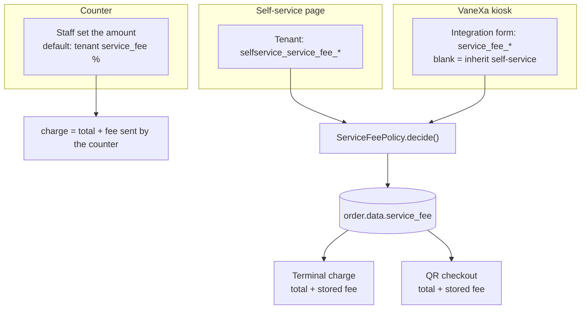
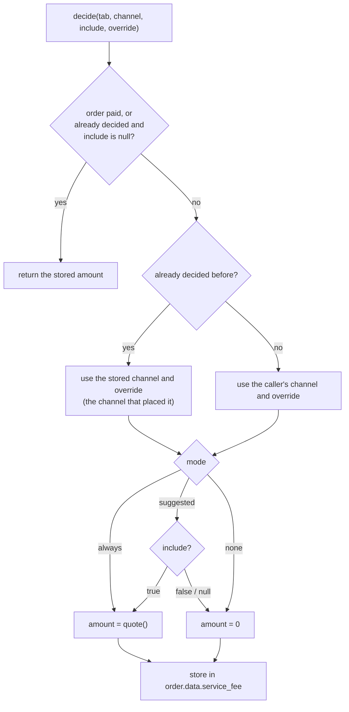
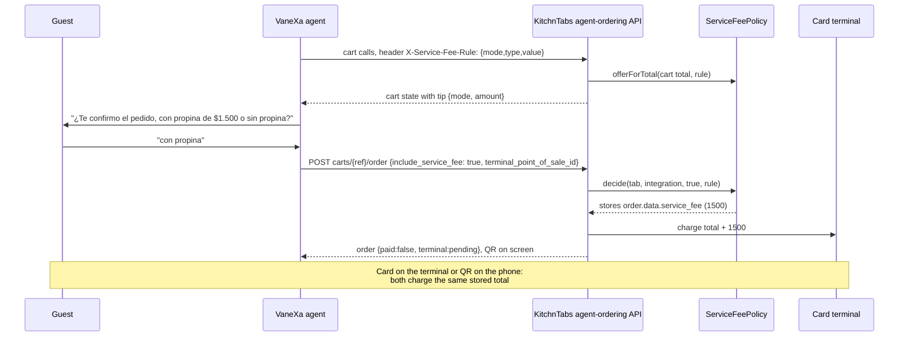
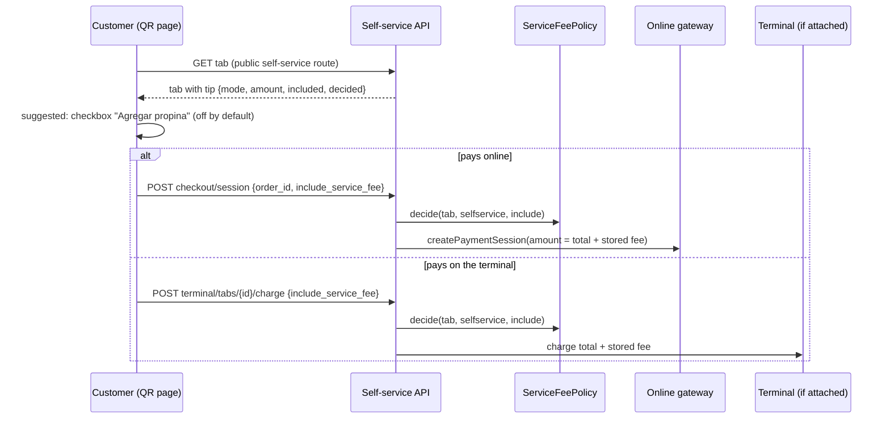

# Service fees (tips)

> **Status:** built and tested; unmerged on the `feat/pos-terminals` line of work.
> **Audience:** engineers working on tabs, self-service, VaneXa ordering or payments.
> **Related:** [PHYSICAL-POS-INTEGRATIONS.md](./PHYSICAL-POS-INTEGRATIONS.md) (card terminals, §16 is the KitchnTabs wiring) · [System Point of Sale](../F10-Point-of-Sale/F10-Point-of-Sale_FEAT-SYSTEM-POINT-OF-SALES.md)

## Table of contents

1. [What this is](#1-what-this-is)
2. [Channels and who decides](#2-channels-and-who-decides)
3. [Settings](#3-settings)
4. [The policy: `ServiceFeePolicy`](#4-the-policy-servicefeepolicy)
5. [Where the decision is stored](#5-where-the-decision-is-stored)
6. [Flows](#6-flows)
7. [What the customer and the agent see](#7-what-the-customer-and-the-agent-see)
8. [Settlement, refunds and reports](#8-settlement-refunds-and-reports)
9. [API reference](#9-api-reference)
10. [Code map](#10-code-map)
11. [Tests](#11-tests)
12. [Known limits](#12-known-limits)
13. [Setting up a venue](#13-setting-up-a-venue)

---

## 1. What this is

KitchnTabs calls a tip a **service fee** (`service_fee`, "servicio" or "propina" on screen). It is
charged **on top of the order total**, as part of one amount: a card terminal, an online gateway and
a manual payment all receive a single figure, never a separate tip line.

An order can be paid in four places, and each decides the tip differently:

| Channel | Who is there to choose | How the tip is decided |
|---|---|---|
| **Counter** | Staff | Staff edit the amount on the spot. Default from the tenant's `service_fee` percentage. |
| **Self-service (QR page)** | The customer | The tenant's `selfservice_service_fee_*` settings. |
| **VaneXa kiosk** | The customer, by voice | The kiosk's own rule in its VaneXa integration form, over the tenant's self-service rule. |
| **Terminal on a kiosk or tablet** | The customer | Whatever the order was already decided with. |

The principle that ties them together:

> **The tip is decided once, stored on the order, and every way of paying reads that stored amount.**
> So whether a customer pays on the card terminal or with the QR, the total is the same.

## 2. Channels and who decides



Two rules keep the channels from fighting each other:

- **The channel that placed the order keeps its rule.** A VaneXa order has a QR page, and that page is
  a self-service session. When the QR page pays it, the stored kiosk decision stands: the
  self-service rule does **not** add a second tip.
- **A paid order's tip is history.** Changing a setting later never changes an order already paid.

## 3. Settings

### 3.1 Tenant settings (KitchnTabs)

Defined in `config/tenant_settings.php` and merged into the tenant setting formats.

| Setting | Type | Default | Used by |
|---|---|---|---|
| `service_fee` | integer, 0 to 100 (percent) | `10` | The counter. Unchanged by this feature. |
| `selfservice_service_fee_mode` | `none` \| `suggested` \| `always` | `none` | Self-service QR page. |
| `selfservice_service_fee_type` | `percentage` \| `fixed` | `percentage` | Same. |
| `selfservice_service_fee` | integer ≥ 0 | `10` | Same: the percentage, or the fixed amount, by type. |

The three `selfservice_service_fee_*` settings are built by one helper in the config file, so a
future channel gets the same trio.

**Modes**

| Mode | Meaning |
|---|---|
| `none` | No tip. This is the default, so nothing changes until a venue turns it on. |
| `suggested` | The customer chooses. Without an answer, **no tip is added**. |
| `always` | Added to every order. |

**Types.** `percentage` is a share of the order total, `fixed` is an amount in the tenant's
currency. Amounts are rounded to the currency's decimals, so a CLP total stays a whole number (the
Mercado Pago connector refuses decimals in CLP).

### 3.2 The VaneXa kiosk (integration form)

A VaneXa kiosk is not part of the KitchnTabs core, so its tip rule lives in the **KitchnTabs
integration** in VaneXa, next to `terminal_point_of_sale_id`. Each kiosk can differ.

| Field | Values | Default |
|---|---|---|
| `service_fee_mode` | `inherit` \| `none` \| `suggested` \| `always` | `inherit` |
| `service_fee_type` | `inherit` \| `percentage` \| `fixed` | `inherit` |
| `service_fee` | number ≥ 0, or empty | empty |

**Blank means inherit, field by field.** An `inherit` or empty field takes the tenant's
`selfservice_service_fee_*` value; any other value overrides it. So a kiosk can say only
`service_fee = 8` and still use the restaurant's mode and type.

KitchnTabs does not know the word "kiosk". To it, the order comes from an **integration** that sent a
rule with the request (channel `integration`).

## 4. The policy: `ServiceFeePolicy`

`kitchntabs-backend-domain/app/Services/Tabs/ServiceFeePolicy.php` is the only place that decides.

| Method | What it does |
|---|---|
| `sanitizeOverride(array)` | Keeps only valid, non-blank fields of an integration's rule. A bad mode or type, a negative or non-numeric value is dropped, so it inherits instead of changing the tip. |
| `rule(tab, channel, override)` / `ruleFor(tenant, …)` | The effective rule: the tenant's self-service rule, with the integration's fields over it (only for channel `integration`). A percentage is capped at 100. |
| `quote(tab, channel, override)` | What the fee would be for this order, whatever the mode. |
| `offer(tab, channel, override)` | The mode and amount to show, or `null` when nothing is offered (mode `none`, or an amount of 0). |
| `offerForTotal(tenant, channel, total, decimals, override)` | The same for a **cart that is not an order yet**. The agent needs this before placing the order. |
| `status(tab)` | What the self-service page shows: the offer plus `included` and `decided`. |
| `decide(tab, channel, include, override)` | Decides and stores the fee of an unpaid order; returns the amount. |
| `stored(tab)` | The fee already decided for an order, 0 if none. |

### 4.1 How `decide()` behaves



The `include` argument is the customer's answer and only matters in `suggested`. `null` means "no
new answer": an earlier decision stands. `false` after a `true` is a change of mind and is honoured
until the order is paid.

## 5. Where the decision is stored

On `orders.data` (a JSON column), key `service_fee`:

```json
{
  "channel": "integration",
  "mode": "suggested",
  "type": "percentage",
  "value": 10,
  "amount": 1500,
  "override": { "mode": "suggested", "value": 10 }
}
```

- `channel` is `selfservice` or `integration`. The counter does not write here: it sends its amount
  with each charge.
- `override` is kept only for `integration`, so a later change of mind is quoted under the same
  rule the kiosk used.
- The stored amount, not the setting, is what is charged. Changing a setting never alters an
  undecided-then-paid order retroactively.

## 6. Flows

### 6.1 Counter (unchanged)

Staff pick the point of sale. The tab screen computes the fee from the tenant's `service_fee` and
lets staff edit it, then sends `service_fee` with the request:

- **Terminal:** `POST tab/tab/{id}/terminal-charge {payment_method_id, service_fee}` charges
  `order total + service_fee` as one amount (`TabPosPaymentService::chargeOnTerminal`).
- **Manual (cash):** `PUT tab/tab/{id}/payment` adds the fee to the order total when the order is
  marked paid.

When a terminal charge is approved, `order.total_amount` becomes the charged amount (fee included).
A declined or cancelled charge leaves the total untouched and the tab open.

### 6.2 VaneXa kiosk

The agent has to ask about a suggested tip **before** the order is placed, because the card terminal
is charged the moment it is placed.



- The rule is sent on **every** VaneXa call in the `X-Service-Fee-Rule` header (JSON), so the cart
  state, the order and the charge all quote the same rule. The body keeps carrying only the
  customer's answer, `include_service_fee`.
- A decline is sent as an explicit `false`, never dropped, so KitchnTabs records it.
- If the tip cannot be decided, the order still goes through, charged without a tip. The tip step
  never fails the order.
- In `always` mode nothing is asked; the agent says the order carries the service charge and
  includes it when it reads the total.

### 6.3 Self-service (QR page and venue tablet)



- **The checkout amount is computed on the server**: order total plus the stored fee. The `amount`
  the browser sends is not used.
- The page shows the total to pay (total, plus the tip when it is included or accepted).
- The checkbox starts **off**: a tip is never added unless the customer accepts it.

## 7. What the customer and the agent see

**Self-service page** (`SelfServiceOrderActions`):

| Mode | Shows |
|---|---|
| `suggested` | A checkbox "Agregar propina de $X", and "Total a pagar". |
| `always` | "Incluye servicio de $X", and "Total a pagar". |
| `none` / no tip | Nothing. |

**VaneXa agent.** The cart state carries a `tip` (`mode`, `type`, `value`, `amount`) whenever the
kiosk adds or offers one. The agent's instructions (`KitchntabsIntegrationService::tipGuide()`) say:

- `always`: mention the service charge and include it in the total it reads.
- `suggested`: ask in the same question as the confirmation, then call `kitchntabs_place_order`
  with `include_service_fee` true or false.
- Never add a tip the customer did not accept.

`kitchntabs_place_order` accepts an optional boolean `include_service_fee`, only for `suggested`.

## 8. Settlement, refunds and reports

| What | How the tip is handled |
|---|---|
| **Terminal approval** | `TabPosPaymentService::settled()` sets `order.total_amount` to the charged amount and marks the order paid. The payment keeps `data.service_fee`. |
| **QR / online approval** | `CompleteSelfServiceCheckoutSale` sets `order.total_amount` to the amount charged (total plus the stored fee) once, marks the order paid, and records the fee on the payment (`payments.service_fee`). |
| **Cash counts and reports** | They read tips from the payment through `SaleDefinition::serviceFeeExpression()` (`payments.service_fee`, or `data.service_fee`). Both the terminal and the QR payment now carry it. |
| **Refunds** | A refund returns the **charged amount**, tip included. Splitting a tip in a partial refund has no rule yet (§12). |
| **First payment wins** | Paying on the QR cancels a pending terminal charge. If the terminal approves anyway, the order is marked as a duplicate payment for staff to refund. Both charge the same amount, so the duplicate is exact. |

## 9. API reference

### 9.1 Agent ordering (VaneXa → KitchnTabs, service-account key)

| | |
|---|---|
| Header `X-Service-Fee-Rule` | Optional JSON `{"mode","type","value"}`. Sanitized by `ServiceFeePolicy::sanitizeOverride`. Read on every `agent-ordering/v1` call. |
| `POST carts/{ref}/order` | New optional body field `include_service_fee` (boolean): the customer's answer to a suggested tip. Decides the fee, then charges the terminal if `terminal_point_of_sale_id` is set. |
| Cart responses | New `tip` key: `null`, or `{mode, type, value, amount}`. Present on cart reads and on every cart mutation, while the cart is not yet an order. |

### 9.2 Self-service (public, session-scoped)

| | |
|---|---|
| `GET tab/{id}` | The tab now carries `tip` (`{mode, type, value, amount, included, decided}` or `null`), only on the public self-service routes and only while the order is unpaid. |
| `POST checkout/session` | New optional `include_service_fee`. The amount is computed on the server. |
| `POST terminal/tabs/{id}/charge` | New optional `include_service_fee`. |

### 9.3 Counter (staff)

No change. `POST tab/tab/{id}/terminal-charge` and `PUT tab/tab/{id}/payment` keep taking
`service_fee`.

## 10. Code map

`kitchntabs-backend-domain/`:

| File | Role |
|---|---|
| `app/Services/Tabs/ServiceFeePolicy.php` | §4. The only place that decides. |
| `config/tenant_settings.php` | The `selfservice_service_fee_*` settings (and the helper that builds a channel's trio). |
| `app/Services/Tabs/TabPosPaymentService.php` | `chargeOnTerminal()` uses the stored fee when the caller sends none (the counter sends its own). |
| `app/Http/Controllers/API/AI/AgentOrdering/AgentOrderingController.php` | The header, `include_service_fee`, the `tip` offer in cart responses, `decideServiceFee()`. |
| `app/Http/Controllers/API/SelfService/SelfServiceCheckoutController.php` | Server-computed amount, `include_service_fee`. |
| `app/Http/Controllers/API/SelfService/SelfServiceTerminalController.php` | `include_service_fee` on the terminal charge. |
| `app/Listeners/Checkout/CompleteSelfServiceCheckoutSale.php` | Adds the fee to the total and records it on the payment. |
| `app/Http/Resources/Tab/TabResource.php` | The `tip` field for the self-service page. |

`vanexa-backend-domain/app/Services/Lab/Integrations/KitchntabsIntegrationService.php`: the three
form fields, the `X-Service-Fee-Rule` header, `include_service_fee` on `place_order`, `tipGuide()`.

`kitchntabs-frontend/`:

| File | Role |
|---|---|
| `apps/kitchntabs-app/src/kt-kiosk/components/SelfServiceOrderActions.tsx` | The tip checkbox / line and the total to pay. |
| `apps/kitchntabs-app/src/kt-kiosk/hooks/useSelfServiceCheckout.tsx` | Passes the customer's answer to the checkout. |
| `packages/vx-integrations/src/i18n/{en,es}.ts` | Labels of the VaneXa form fields. |

## 11. Tests

| Suite | What it covers |
|---|---|
| `tests/API/Tabs/ServiceFeePolicyTest.php` (14) | Each mode and type; `always`; `suggested` and a change of mind; the integration override field by field; invalid rules and the 100% cap; the channel that placed an order keeping its rule; a paid order keeping its tip; `status()`; the terminal charging total plus the stored tip; the counter still sending its own. |
| `tests/API/Tabs/ServiceFeeCheckoutTest.php` (4) | Against the demo bank: the amount is computed on the server and a tampered browser amount is ignored; a declined or unanswered tip adds nothing; an accepted tip charges total plus tip and leaves the order total, the payment and `payments.service_fee` at that amount; a change of mind before paying. |
| `tests/API/AI/AgentOrderingApiTest.php` (+2) | The cart offers the tip the rule asks for; an empty cart or a garbled header offers nothing. |
| VaneXa `KitchntabsIntegrationTest` (+3) | The rule header goes out with only the chosen fields; no header when nothing is chosen; a "no" reaches the order as `false`. |

## 12. Known limits

- **A tip changed after a terminal charge started.** If the kiosk already started a terminal charge
  and the customer then changes the tip on the QR page, that terminal charge keeps its old amount
  (a pending charge is returned as is, never recharged). Paying online is unaffected: it cancels the
  terminal charge first.
- **Partial refunds.** A tip is not split in a partial refund; there is no rule for it yet.
- **Fixed amount and currency.** A fixed tip is an amount in the tenant's currency. There is no
  conversion.
- **Counter has no mode.** The counter stays "suggested by default, editable by staff". It has no
  `none` / `always` setting of its own.
- **`suggested` needs a conversation or a screen.** On a channel with neither, `suggested` behaves as
  no tip, because nobody can answer.
- **Terminal screen.** The terminal shows one amount. The tip cannot be shown or changed there.
- **Payment test mode.** An integration in [test mode](./PAYMENT-TEST-MODE.md) charges one small fixed amount, so
  it carries **no tip**: the tip is forced to 0 on the terminal and recorded as 0 on a QR payment.

## 13. Setting up a venue

1. **Self-service QR tip.** In the tenant settings, set `selfservice_service_fee_mode`, `_type` and
   the value. Leave the mode at `none` to offer nothing.
2. **VaneXa kiosk tip.** In the VaneXa integration form of that kiosk, set *Propina en este kiosco*
   (mode), *Tipo de propina* and *Valor de la propina*. Leave them on "Heredar" to follow the
   self-service setting above, or choose a rule for this kiosk only.
3. **Counter.** Nothing new: `service_fee` is still the default percentage staff see.
4. After a change to the integration, restart the VaneXa queue workers (`horizon:terminate`), or the
   Lab keeps using the previous tool schema.
