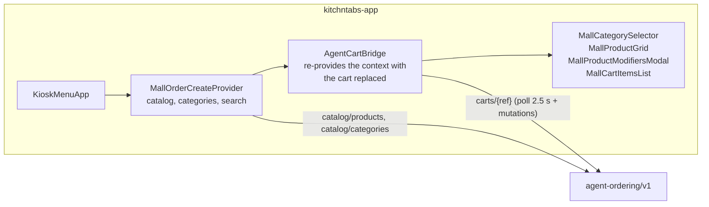

# VaneXa kiosk interactive menu (`/kiosk-menu`)

> **Status:** built 2026-10-31, **not tested on a device or in a browser**. Backend tests pass (catalog, QR);
> the page type-checks and the Android module compiles. Nothing is committed or pushed.
> **Repos:** `kitchntabs-backend-domain`, `kitchntabs-frontend` (kitchntabs-app), `vanexa-backend-domain`,
> `vanexa-android-kiosk`.

A transparent web page that the VaneXa kiosk loads beside the conversation (and when idle): categories and
products to browse by touch, and, once the agent has a cart, that same cart with a Confirm button. It lives in
kitchntabs-app and knows nothing about VaneXa; everything arrives in the URL.

## URL

`<kitchntabs-app>/kiosk-menu?token=…&ref=…&alignment=left|right&terminal=…&label=…`

| Param | Who sets it | Meaning |
|---|---|---|
| `token` | operator, inside `kiosk_idle_url` / `kiosk_conversation_url` | A KitchnTabs **service-account API key**. It fixes the restaurant and can be disabled or expire like any key. Issue a dedicated one for the page. Without a good one the page shows "Menú no disponible". |
| `alignment` | kiosk, from `kiosk_conversation_webpage_alignment` | Which screen edge the category column is on (default `left`). |
| `ref` | kiosk, from `GET lab/chat/{p}/sessions/{s}/kitchntabs-cart` | The agent's cart (`<integration id>:<session id>`). Absent on the idle page: browse only. |
| `terminal` | same endpoint | The point of sale of the card terminal charged on Confirm. |
| `label` | optional | Name the order is placed under. |

## How it reuses the self-service kiosk

The components are the self-service kiosk's own. `MallOrderCreateProvider` supplies the catalog from two new
routes that subclass the self-service product and category controllers and take the restaurant from the key.
`AgentCartBridge` replaces only the cart members, so voice and touch edit one order.

## Backend

- `agent-ordering/v1/catalog/products|categories`: `KioskCatalogProductController` / `KioskCatalogCategoryController`
  (tenant from the key, never from the request).
- `agent-ordering/v1/kiosk-qr` (create) and `kiosk-qr/{code}` (claimed?): the idle "scan to browse on your phone" QR.
  A scan burns its session, so the page replaces a claimed or 10-minute-old one.
- Permissions `api.agent-ordering.catalog.*` and `kiosk-qr.*` for `TenantServiceAccount`
  (migration `2026_10_31_000100` and `tenantServiceAccountPermissions.json`).
- VaneXa: `GET lab/chat/{p}/sessions/{s}/kitchntabs-cart` returns `{ref, terminal_point_of_sale_id}` or `null`.

## Flow

Idle: browse, QR at the bottom. Conversation: the agent adds an item and it appears on the page; touch +/− and
remove call the same cart API. **Confirm** places the order (`carts/{ref}/order`, with the terminal if set); the
page then shows the payment QR and the terminal state, and goes back to the menu after "paid" (8 s) or a cancel
(`carts/{ref}/new-order`).

## Known limits

- The kiosk's tip rule (`X-Service-Fee-Rule`, held by VaneXa) is not known to the page: an order confirmed by
  touch uses the restaurant's default policy and no answer to a "suggested" tip.
- VaneXa's agent only learns of a touch-confirmed order on its next cart read; its screen QR is not shown
  (the page shows the payment QR itself).
- Options travel to the agent by name, so two options with the same name in different groups are ambiguous.
- Closed restaurants (`is_open` off) return an empty menu, as in the self-service kiosk.
- Editing an order while a card terminal waits cancels that charge and charges the new total
  ([PHYSICAL-POS-INTEGRATIONS.md §16.3.1](./PHYSICAL-POS-INTEGRATIONS.md)).
