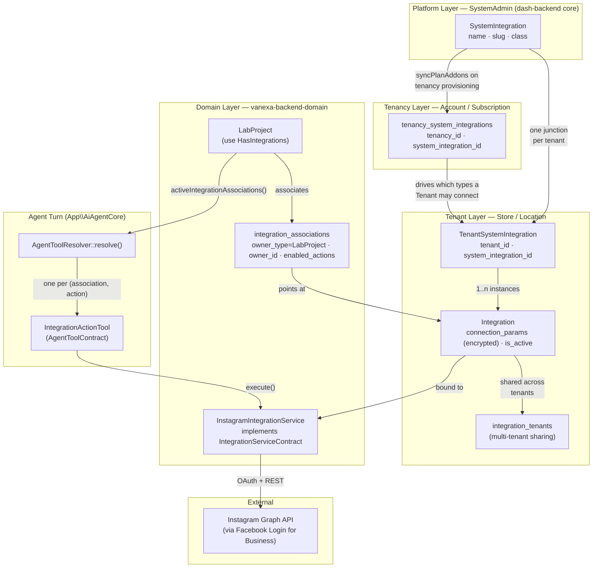
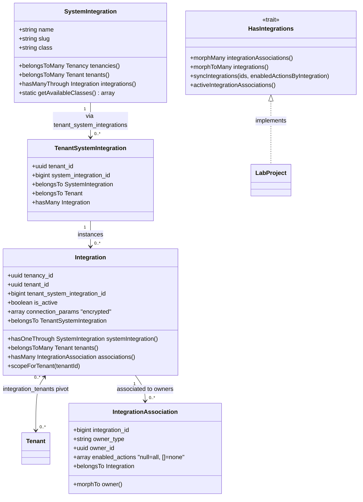
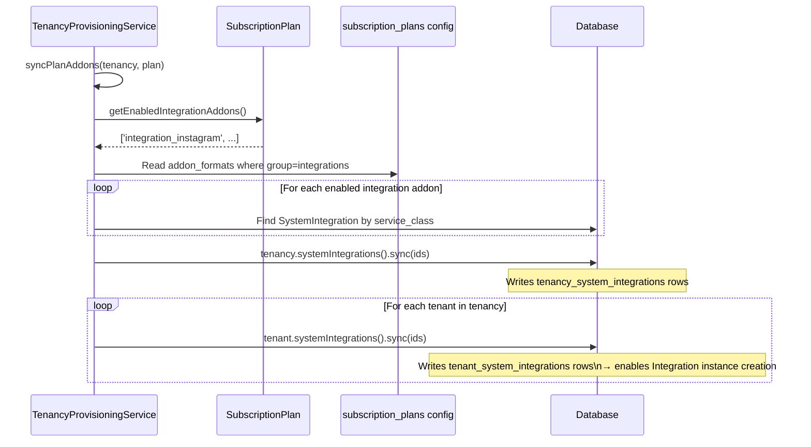
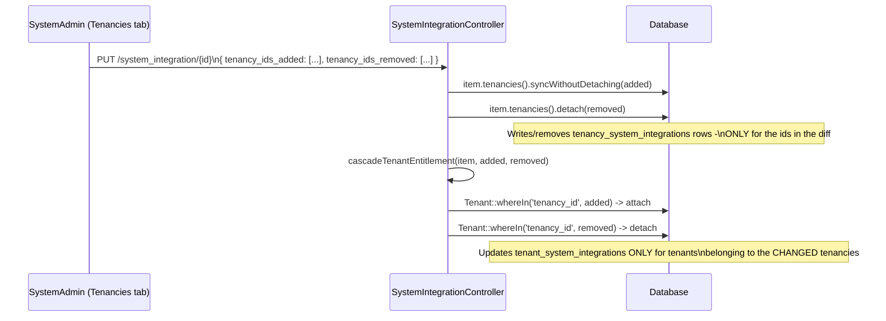
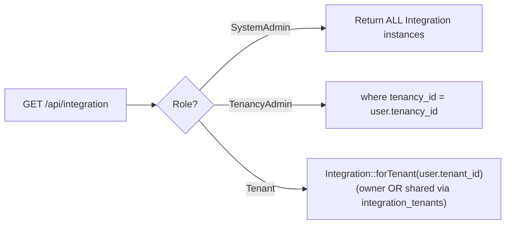
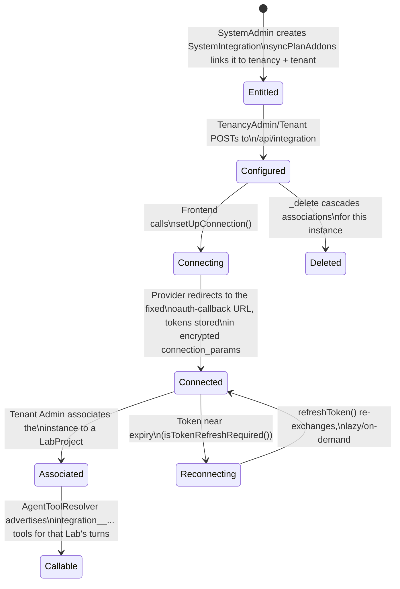
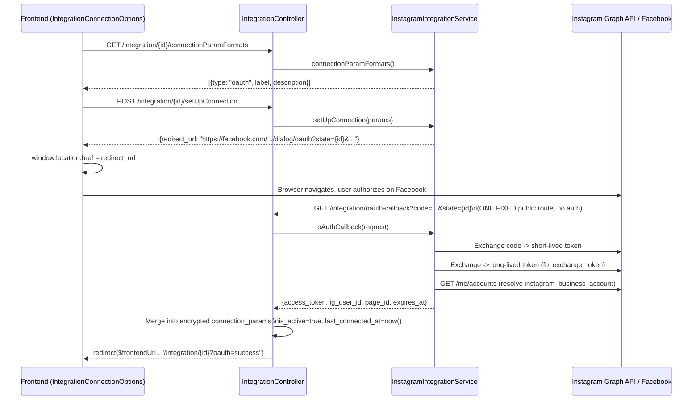
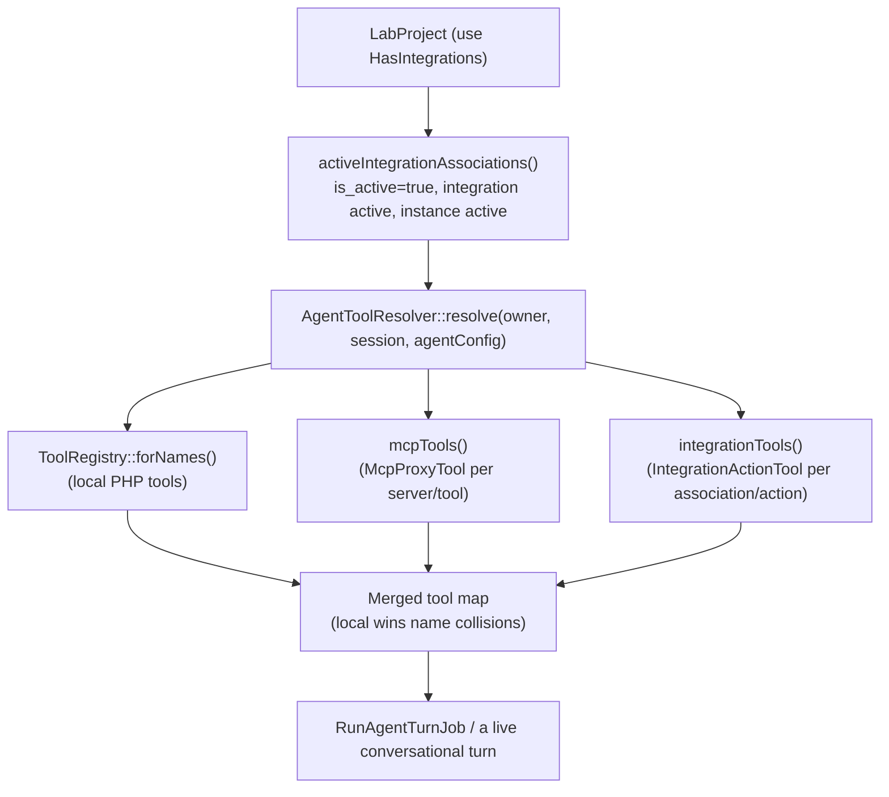

# System Integrations — Technical Documentation

> **Version:** 1.0
> **Last Updated:** September 2026
> **Status:** Shipped (Instagram POC)
> **Audience:** Engineers, Backend/Frontend Developers
> **Related Docs:** [F9-Marketplaces_FEAT-SYSTEM-MARKETPLACES.md](../F9-Marketplaces/F9-Marketplaces_FEAT-SYSTEM-MARKETPLACES.md) · [F10-Point-of-Sale_FEAT-SYSTEM-POINT-OF-SALES.md](../F10-Point-of-Sale/F10-Point-of-Sale_FEAT-SYSTEM-POINT-OF-SALES.md) · [MCP-TOOL-MANAGEMENT.md](MCP-TOOL-MANAGEMENT.md)

---

## Table of Contents

1. [Overview](#overview)
2. [Why Not MCP](#why-not-mcp)
3. [Architecture Layers](#architecture-layers)
4. [Database Schema](#database-schema)
5. [Entity Relationships](#entity-relationships)
6. [Provisioning Flow](#provisioning-flow)
7. [Visibility & Access Control](#visibility--access-control)
8. [Integration Instance Lifecycle](#integration-instance-lifecycle)
9. [OAuth & Connection Flow](#oauth--connection-flow)
10. [Agent Tool Bridge](#agent-tool-bridge)
11. [The Instagram Service](#the-instagram-service)
12. [API Reference](#api-reference)
13. [Service Contract](#service-contract)
14. [Permissions](#permissions)
15. [Frontend](#frontend)
16. [Extending: Adding a New Integration Type](#extending-adding-a-new-integration-type)
17. [Known Limitations](#known-limitations)

---

## Overview

System Integrations is a generic gateway that lets a Lab (or any future
polymorphic owner) query a structured, tenant-configured external service —
"show me the latest 4 Instagram pictures" being the first real case — through
the same multi-step conversational flow every other agent tool already uses.
It is **not** an MCP server: the service classes are native PHP, registered
in-process, with no remote protocol in between.

The entity-relationship shape is deliberately copied from
`kitchntabs-backend-domain`'s **Marketplace** and **Point-of-Sale**
integrations (System catalog → tenancy entitlement → tenant junction →
connected instance, shared across sibling tenants), because that shape
already solves exactly this problem for e-commerce. Two things were
upgraded rather than copied verbatim — see [Database Schema](#database-schema)
for why.

### Key Concepts

| Concept | Description |
|---------|-------------|
| **SystemIntegration** | Platform-defined integration type (name, slug, service class). Managed by SystemAdmin only. |
| **tenancy_system_integrations** | Entitlement pivot: which integration types this account's subscription allows. Written only by `TenancyProvisioningService::syncPlanAddons()`. |
| **TenantSystemIntegration** | Junction: one record per (tenant × system_integration) pair, enabling that tenant to create connected instances. |
| **Integration** | Tenant-specific connected instance — encrypted OAuth tokens, active status, shareable with sibling tenants. |
| **IntegrationAssociation** | The polymorphic leaf link: which owner (a `LabProject` today) may call which of an instance's actions. |
| **IntegrationServiceContract** | The PHP interface every integration type implements — connection setup, OAuth callback, and its `actions()`/`execute()` pair. |
| **IntegrationActionTool** | The `AgentToolContract` bridge — one instance per (association × action), built per turn, with zero dependency on any concrete service class. |

---

## Why Not MCP

`App\AiAgentCore`'s MCP client (see [MCP-TOOL-MANAGEMENT.md](MCP-TOOL-MANAGEMENT.md))
already solves "System enables a type → Tenant connects an account → a Lab
selects which tools to grant" — for a *remote* MCP server reached over
Streamable HTTP. System Integrations reuses that exact shape for a *native*
PHP service class instead:

| | MCP (`App\AiAgentCore`) | System Integrations (`App\IntegrationCore`) |
|---|---|---|
| What's registered | A remote server's URL + bearer token | A PHP class implementing `IntegrationServiceContract` |
| Discovery | Live `tools/list` JSON-RPC call, cached | A static `actions()` array on the class itself |
| Invocation | `McpProxyTool` → HTTP round trip to the server | `IntegrationActionTool` → a direct method call, in-process |
| Tool name prefix | `mcp__` | `integration__` |
| Entitlement | Manual per-tenancy registration | Subscription-plan-driven (`syncPlanAddons`, like Marketplace/POS) |
| Extending it | Register a new remote server (no code) | Ship a new class implementing the contract (no core change) |

Both are merged into the same tool set for a turn by
`AgentToolResolver::resolve()` — see [Agent Tool Bridge](#agent-tool-bridge).

---

## Architecture Layers



`App\IntegrationCore` (the catalog/entitlement/connection framework) lives in
**dash-backend core** — it is domain-agnostic, the same placement rationale
as `App\ReportCore` and `App\AiAgentCore`. `InstagramIntegrationService` and
the Lab-side wiring live in **vanexa-backend-domain**, the only two files a
future vanexa integration type needs to add.

---

## Database Schema

### Core Tables

```mermaid
erDiagram
    system_integrations {
        bigint id PK
        string name
        string slug UK
        string class
        text description
        string icon_path
        boolean is_active
        json settings
        json metadata
        timestamp deleted_at
        timestamps
    }

    tenancy_system_integrations {
        bigint id PK
        uuid tenancy_id FK
        bigint system_integration_id FK
        timestamps
    }

    tenant_system_integrations {
        bigint id PK
        uuid tenant_id FK
        bigint system_integration_id FK
        boolean is_active
        json settings
        timestamps
    }

    integrations {
        uuid id PK
        uuid tenancy_id FK
        uuid tenant_id FK
        bigint tenant_system_integration_id FK
        string name
        boolean is_active
        text connection_params "encrypted:array cast"
        timestamp last_connected_at
        boolean notified
        timestamp deleted_at
        timestamps
    }

    integration_tenants {
        bigint id PK
        uuid integration_id FK
        uuid tenant_id FK
        timestamps
    }

    integration_associations {
        bigint id PK
        uuid integration_id FK
        string owner_type
        uuid owner_id
        json enabled_actions "null = all, [] = none"
        boolean is_active
        timestamps
    }

    system_integrations ||--o{ tenancy_system_integrations : "entitlement"
    system_integrations ||--o{ tenant_system_integrations : "junction"
    tenant_system_integrations ||--o{ integrations : "instance"
    integrations ||--o{ integration_tenants : "shared with"
    integrations ||--o{ integration_associations : "associated to owners"
```

### Two Deliberate Departures From the Marketplace/POS Precedent

1. **`connection_params` is encrypted, not plain JSON.** Marketplace's own
   column is plain `json`; this one is `text` with an Eloquent
   `encrypted:array` cast on the `Integration` model, matching
   `SystemAiProviderKey.credentials` and `McpServerRegistration.auth_token` —
   both already live in this codebase. A 60-day Instagram token is not
   something to leave readable in a database dump.
2. **`integration_associations` is polymorphic from day one.** POS's
   equivalent association has a fixed `StockType` FK; here, "the owner" is a
   `LabProject` in vanexa today and something else in a future domain
   tomorrow — the exact same reasoning `ai_agent_mcp_selections`
   (`owner_type`/`owner_id`) already applies for "the agent". A plain FK
   would only ever serve one domain.

`integration_associations` uses a plain auto-increment `id()`, **not** a
uuid primary key — `sync()`/`attach()` never set a pivot's own id, so a uuid
column with no database-side default fails its `NOT NULL` constraint on
every insert. The same trap `ai_agent_mcp_selections` already documents.

### Table Roles at a Glance

| Table | Purpose | Who writes it |
|-------|---------|--------------|
| `system_integrations` | Platform-defined integration types | SystemAdmin via CRUD |
| `tenancy_system_integrations` | Subscription entitlement — what the _account_ can access | `syncPlanAddons` on provisioning / plan change, or a SystemAdmin's manual `tenancy_ids` grant |
| `tenant_system_integrations` | Store-level junction — what a _tenant_ can configure | Always DERIVED, never set directly: `syncPlanAddons` (plan path) or `SystemIntegrationController::cascadeTenantEntitlement()` (manual path) recompute it from the current tenancy grant |
| `integrations` | Actual connected instance with encrypted credentials | TenancyAdmin / Tenant via CRUD |
| `integration_tenants` | Shares one connected instance across sibling tenants | `IntegrationController` on create/update |
| `integration_associations` | Grants an owner (a Lab) some or all of an instance's actions | `LabProjectController` via `HasIntegrations::syncIntegrations()` |

---

## Entity Relationships



`Integration::systemIntegration()` is a real `hasOneThrough` relation (via
`TenantSystemIntegration`), not a `?->` chain through two `belongsTo`
lookups — the latter cannot be eager-loaded with `with()` and silently
triggers an N+1 wherever it's used.

---

## Provisioning Flow

Identical shape to Marketplace/POS: `TenancyProvisioningService::syncPlanAddons()`
gained a third block that links every plan-enabled integration type at both
the **tenancy** and **tenant** level.



`config/subscription_plans.php` (dash-backend core) carries the addon
definition as a **lazy string** class reference
(`\Domain\App\Services\Lab\Integrations\InstagramIntegrationService::class`),
the same trick the existing Marketplace addons already use to let core
config name a class that only exists once a domain is mounted.

### The Second Entitlement Path: a SystemAdmin's Manual Tenancy Grant

Plan addons are the default, no-UI path most tenancies go through — but a
SystemAdmin can also grant a tenancy access directly from the Integration
Types catalog form's **Tenancies** tab
(`SystemIntegrationTenancyAssociator`), for a one-off grant outside the
standard plan tiers. Both paths land on the exact same tables:



There is **no per-tenant grant** anywhere in this framework, by design —
feature availability is tenancy-wide only. `tenant_system_integrations` is
never written to directly by a human in either path; it is always a derived
mirror of the current tenancy-level grant. Revoking a tenancy cascades the
same way in reverse — a tenant loses the junction the moment its tenancy is
removed from the grant.

**Why a diff, not a snapshot.** An earlier version of this accepted a plain
`tenancy_ids` array and did `sync()` + a full recompute over every granted
tenancy on every save — correct, but O(total grant size) regardless of how
small the actual change was, which round-trips the WHOLE grant on every
save at catalog scale (thousands of tenancies). `tenancy_ids_added`/
`tenancy_ids_removed` are computed client-side by
`SystemIntegrationTenancyAssociator` against whatever `tenancy_ids` it
loaded, so the payload and the backend work are both proportional to what
actually changed. The incremental cascade is exact, not an approximation:
a tenant belongs to exactly one tenancy (a plain `belongsTo` FK, never
many-to-many), so a newly granted tenancy's tenants can never already be
covered by another still-granted tenancy, and a newly revoked tenancy's
tenants can never still be covered by one either.

---

## Visibility & Access Control

### `_preList`/`_preGetOne` Scoping (`IntegrationController`)



### Who Sees What

| Role | `system_integration` list | `integration` list |
|------|---------------------------|---------------------|
| SystemAdmin | All integration types | All connected instances |
| TenancyAdmin | — (no route; System bypasses the access middleware, nobody else is granted `system_integration.*`) | All instances in their tenancy |
| Tenant user | — | Only instances they own or that are shared via `integration_tenants` |

### Authorization Policy (`IntegrationPolicy`)

Update and delete on an `Integration` require:

```
user.tenant_id === integration.tenant_id  OR  integration shared via tenants()
```

Checked via `$this->_authorize('manage', $item)` in `IntegrationController::_update`/`_delete`.

### The `tenant_ids`/`integration_ids` Re-Derivation Rule

Both `IntegrationController::tenantIdsForTenancy()` (dash-backend) and
`LabProjectController::integrationIdsForTenant()` (vanexa) re-derive the
submitted id array from the database, scoped to the acting tenancy/tenant,
before calling `sync()` — never trusting the request array as-is. `sync()`
only validates that a foreign key exists, not that the caller is entitled to
it; an unscoped id list could silently share a connected account's
credentials with a tenant belonging to someone else's tenancy, or associate
a Lab with an integration instance it has no business calling.

---

## Integration Instance Lifecycle



---

## OAuth & Connection Flow

Unlike Marketplace's own per-instance callback URL, an OAuth app (Facebook's
included) whitelists **exact** redirect URIs in its own dashboard — a URL
parameterised per `Integration` instance does not scale. The callback is
therefore **one fixed public route**; `state` (set to the `Integration`'s own
id in `setUpConnection()`'s redirect URL) ties the single callback back to a
specific row.

The callback is also a **full browser redirect**, not a popup+authenticated-XHR
round trip like `MarketplaceCallback.tsx`'s own flow: the provider redirects
the raw browser here with no session or Authorization header attached, so
the response itself must be what the browser renders next — a `redirect()`
back into the SPA, the same shape `GoogleAuthController`'s own
provider-redirects-here login callback already uses.



`IntegrationConnectionOptions.tsx` reads the `?oauth=success` /
`?oauth=error&message=...` query flags on mount and surfaces one toast, then
the query string is left for the next navigation to replace naturally.

---

## Agent Tool Bridge

This is the piece that makes a Lab's tool set include Instagram (or any
other connected type) with **zero new mechanism** beyond what
`App\AiAgentCore` already has for MCP.



- **Naming**: `integration__{system_integration_slug}__{association_id}__{action_name}`
  — the association id is **always** part of the name, not only on
  collision, so a Lab with two connected accounts of the same integration
  type gets two distinct, stable tool names from the start. Truncated and
  hash-suffixed past Bedrock's 64-character `toolSpec` name cap, the same
  safeguard `McpProxyTool::qualify()` already applies.
- **`IntegrationActionTool`** has zero dependency on any concrete
  `IntegrationServiceContract` implementation — it resolves the bound
  service class from `$association->integration->systemIntegration->class`
  at call time. This is the actual mechanism behind "one new local-tool
  class, no core changes": a future data-viz integration only ever adds a
  new service class and one `IntegrationRegistry::register()` line.
- **Failure handling**: an integration action failing (an expired token, a
  rate limit) returns `AgentToolResult::error(...)`, never a throw — the
  model sees an ordinary tool result it can recover from and tell the
  customer about, the same treatment a failing local PHP tool already gets.
- **Display, reused as-is**: the existing rule in `config/lab_agent_tools.php`'s
  prompt guide — "a `web_fetch`/`web_search` result is an input to a display
  tool, not a display itself" — was extended by one sentence to cover
  `integration__...` tools too. `ShowImageTool` already renders an
  `images: [{image_url, title, description}]` array with a grid layout, so
  Instagram's `list_recent_media` result needed **no new display tool**.
- **Known gap**: `AgentToolResolver`'s session-level narrowing
  (`selected_mcp_ids`/`disabled_mcp_tools` metadata keys) only ever filters
  `mcp_`-prefixed tools today. A conversation cannot yet narrow which
  `integration__...` tools are offered per-session — only the Lab-level
  `enabled_actions` grant applies. See [Known Limitations](#known-limitations).

---

## The Instagram Service

`vanexa-backend-domain/app/Services/Lab/Integrations/InstagramIntegrationService.php`
is the POC implementation, and the reference every future integration type
should read before writing its own.

- **Facebook Login for Business, not the Basic Display API** — Meta is
  deprecating the latter, so this uses the Graph API path tied to a
  connected Facebook Page instead, the durable choice.
- **Three real HTTP calls in `oAuthCallback()`**, none optional: the
  authorization code exchange returns a *short-lived* user token; that must
  be upgraded to a *long-lived* one (~60 days) before it's worth storing;
  and neither token names an Instagram account directly — only
  `/me/accounts` (the Facebook Pages this user manages) links to one via its
  own `instagram_business_account` field.
- **One action for the POC**: `list_recent_media` (`limit`, default 4,
  max 25) — `GET /{ig-user-id}/media`, filtered to `IMAGE`/`CAROUSEL_ALBUM`
  (a `VIDEO`'s `media_url` is a playable file, not something `ShowImageTool`
  can render), mapped to `['id', 'caption' (truncated to 140 chars),
  'media_url', 'permalink', 'timestamp']` — **minimal fields only**, never
  Instagram's raw payload, matching the "server performs the query, the
  screen step gets only what it needs to render" contract this whole
  framework is built around.
- **Token refresh is lazy/on-demand**, matching every other credential in
  this codebase (Marketplace's own OAuth clients refresh the same way) —
  there is no scheduled-job precedent to follow instead.
  `isTokenRefreshRequired()` checks `expires_at` against `now()->addDays(7)`;
  `refreshToken()` re-exchanges via Facebook's own `fb_exchange_token` grant.

---

## API Reference

### SystemIntegration Endpoints (dash-backend core, `App\IntegrationCore`)

| Method | Path | Description | Access |
|--------|------|-------------|--------|
| GET | `/api/system_integration` | List integration types | SystemAdmin |
| GET | `/api/system_integration/{id}` | Get single integration type | SystemAdmin |
| POST | `/api/system_integration` | Create integration type | SystemAdmin |
| PUT | `/api/system_integration/{id}` | Update integration type | SystemAdmin |
| DELETE | `/api/system_integration/{id}` | Delete + cascade to all instances | SystemAdmin |
| GET | `/api/system_integration/availableClasses` | List registered `IntegrationServiceContract` classes | SystemAdmin |

### Integration Instance Endpoints

| Method | Path | Description | Access |
|--------|------|-------------|--------|
| GET | `/api/integration` | List connected instances (scoped, see [Visibility](#visibility--access-control)) | TenancyAdmin, Tenant |
| GET | `/api/integration/{id}` | Get single instance | TenancyAdmin, Tenant |
| POST | `/api/integration` | Create instance | TenancyAdmin, Tenant |
| PUT | `/api/integration/{id}` | Update instance | Owner (via `IntegrationPolicy`) |
| DELETE | `/api/integration/{id}` | Delete instance | Owner |
| GET | `/api/integration/{id}/connectionParamFormats` | Get connection field schema | Owner |
| POST | `/api/integration/{id}/setUpConnection` | Begin the connection (OAuth redirect URL, or validate a manual token) | Owner |
| GET | `/api/integration/oauth-callback` | **One fixed** provider callback, `state`=instance id | Public |

### Lab-Side Association (vanexa-backend-domain)

| Method | Path | Description | Access |
|--------|------|-------------|--------|
| POST/PUT | `/api/lab/project` (`integration_ids` + `integration_enabled_actions` fields) | Associate connected instances to this Lab and curate their actions | TenancyAdmin, Tenant |

No new route was needed here — `integration_ids`/`integration_enabled_actions`
ride on `LabProject`'s own existing create/update payload, exactly like
`mcp_server_ids`/`mcp_enabled_tools` already do.

---

## Service Contract

Each integration type implements `App\IntegrationCore\Contracts\IntegrationServiceContract`:

| Method | Description |
|--------|-------------|
| `__construct(Integration $integration)` | Every method operates on one bound connected instance |
| `static connectionParamFormats(): array` | The fields (or OAuth descriptor) a Tenant fills in before connecting |
| `setUpConnection(array $params): array` | Begins the connection — returns e.g. `['redirect_url' => ...]` |
| `oAuthCallback(array $params): array` | Completes the round trip — returns fields merged into encrypted `connection_params` |
| `isTokenRefreshRequired(): bool` | Whether the stored credential needs refreshing before use |
| `refreshToken(): void` | Refreshes in place, lazy/on-demand |
| `actions(): array` | `[['name', 'description', 'parameters' => JSON Schema], ...]` — the agent tool manifest |
| `execute(string $action, array $params): array` | Runs one action, returns **minimal** structured data only |

### Available Implementations

| Class | Integration | Auth Method |
|-------|-------------|-------------|
| `Domain\App\Services\Lab\Integrations\InstagramIntegrationService` | Instagram (via Facebook Login for Business) | OAuth 2.0 |

Registered into `App\IntegrationCore\Services\IntegrationRegistry` from
`vanexa-backend-domain`'s `AppDomainServiceProvider::registerIntegrations()` —
see [Extending](#extending-adding-a-new-integration-type).

---

## Permissions

`api.integration.*` (getList, getMany, getManyReference, getForSelect,
getOne, create, update, delete, deleteMany, updateMany,
getConnectionParamFormats, setUpConnection) is granted to `TenancyAdmin` and
`Tenant` via a `PermissionMigration` **and** the matching entries added to
`database/data/rolePermissions/tenancyAdminPermissions.json` /
`tenantAdminPermissions.json` — both are required, or the next
`db:sync_roles` silently strips the migration's grant (see the
`dashadmin-permissions` skill).

`api.system_integration.*` has **no** permission rows at all, deliberately —
`SystemAdmin` bypasses `AccessMiddleware` entirely, so the absence of a grant
already means 403 for everyone else.

> **Known pre-existing gap, not introduced by this feature**: dash-backend
> core's `tenancyAdminPermissions.json` and `tenantAdminPermissions.json`
> both declare `"role": "Tenant"` — no core file actually seeds the
> `TenancyAdmin` role (`ReportCore`'s own `api.report.*` TenancyAdmin grant
> has the identical latent issue). The `api.integration.*` migration still
> grants both roles directly and this is verified working today, but the
> TenancyAdmin half is not durable across a future `db:sync_roles` until
> that core gap is fixed separately.

---

## Frontend

`packages/vx-integrations` (kitchntabs-frontend), registered in all three
VaneXa apps per role:

| Resource | Package export | Roles | Registered in |
|---|---|---|---|
| Integration type catalog | `systemIntegrationResource` | System | `vanexa-system` |
| Connected instances (tenant-owned) | `integrationResource` | Tenant | `vanexa-app`, `vanexa-web` (tenant-switched manifest) |
| Connected instances (cross-tenant sharing view) | `integrationTenancyResource` | TenancyAdmin | `vanexa-web` (tenancy manifest) |

`integrationResource` and `integrationTenancyResource` share the same
`model` (`integration`) — safe only because exactly one manifest loads at a
time, the identical note `mcpServerResource`/`mcpServerTenancyResource`
already carries.

### Components

- **`SystemIntegrationTenancyAssociator`** — the SystemAdmin's manual
  entitlement override, a **Tenancies** tab on the Integration Types catalog
  form. Deliberately tenancy-wide only — there is no per-tenant equivalent.
  Submits a diff (`tenancy_ids_added`/`tenancy_ids_removed` against whatever
  `tenancy_ids` it loaded), not the full current selection — see
  [The Second Entitlement Path](#the-second-entitlement-path-a-systemadmins-manual-tenancy-grant)
  for why. `SystemIntegrationController::cascadeTenantEntitlement()`
  attaches/detaches `tenant_system_integrations` for exactly the tenants
  belonging to the changed tenancies, so a Tenant Admin sees the type in
  their own create-form picker immediately, with no separate per-tenant
  step to remember.
- **`IntegrationTypeSelector`** — picks `tenant_system_integration_id` at
  create time from `tenant.systemIntegrations` (added to `TenantResource.php`
  alongside `systemMarketplaces`/`systemPointOfSales` for exactly this),
  mirroring `TenantMarketplaceSelector`'s pivot-id contract. Immutable after
  create — carried forward as a hidden field on edit, since
  `IntegrationRequest` requires it on every write.
- **`IntegrationConnectionOptions`** — the Connect/Reconnect button and live
  status (`is_active`, `expires_at`), driving the full-redirect OAuth flow
  described above. `connection_params` is never returned by the API (see
  `IntegrationResource.php`'s own docblock); this component only ever reads
  `connectionParamFormats()`'s descriptor and the derived status fields.
- **`IntegrationEnabledActionsSelector`** — the Lab's own two-level picker
  ("which connected instances, and which of each one's actions"), added as
  an **Integrations** tab on `labProjectResource.tsx` next to
  **Documents**/**MCP Tools**. Ported from `McpServerIdsSelector`'s identical
  shape, including the same JSON-encoding workaround for
  `integration_enabled_actions` (a dot path only nests one object level;
  this field is genuinely two levels deep).

---

## Extending: Adding a New Integration Type

This is the concrete "one new local-tool class, no core changes" path the
framework was designed around:

1. Write a class implementing `App\IntegrationCore\Contracts\IntegrationServiceContract`
   in the relevant domain (e.g. `vanexa-backend-domain/app/Services/Lab/Integrations/`).
2. Register it: one line in that domain's `AppDomainServiceProvider`:
   ```php
   $this->app->make(IntegrationRegistry::class)->register(MyNewIntegrationService::class);
   ```
3. A SystemAdmin creates a `SystemIntegration` catalog row pointing `class`
   at it (via `system_integration/availableClasses`, which reads the
   registry — no hardcoded array to keep in sync).
4. Add the addon to `config/subscription_plans.php`'s `integrations` group
   so a plan can entitle tenancies to it.
5. Nothing else changes: `IntegrationController`, `IntegrationActionTool`,
   `AgentToolResolver`, and every frontend component in `vx-integrations`
   are already generic over the service class.

---

## Known Limitations

- **No scheduled token-refresh job.** Instagram's 60-day token is refreshed
  lazily, on next use — matching every other credential in this codebase,
  but a Lab that goes quiet for 60+ days could hit an expired token with
  nothing to trigger the lazy check first. A `integrations:refresh-tokens`
  scheduled command is recommended hardening, explicitly separable from this
  POC.
- **No session-level narrowing for integration tools.** `AgentToolResolver`'s
  `selected_mcp_ids`/`disabled_mcp_tools` narrowing only ever filters
  `mcp_`-prefixed tools; a conversation cannot yet turn off one
  `integration__...` tool for itself the way it can for an MCP tool. Only
  the Lab-level `enabled_actions` grant applies today.
- **TenancyAdmin's `api.integration.*` grant is not durable across
  `db:sync_roles`**, a pre-existing gap in dash-backend core's own
  `tenancyAdminPermissions.json`/`tenantAdminPermissions.json` seeding — see
  [Permissions](#permissions).
